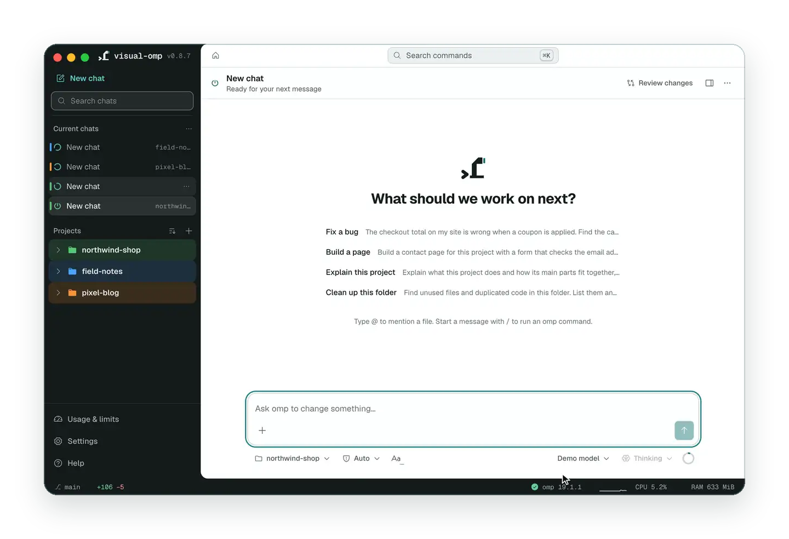
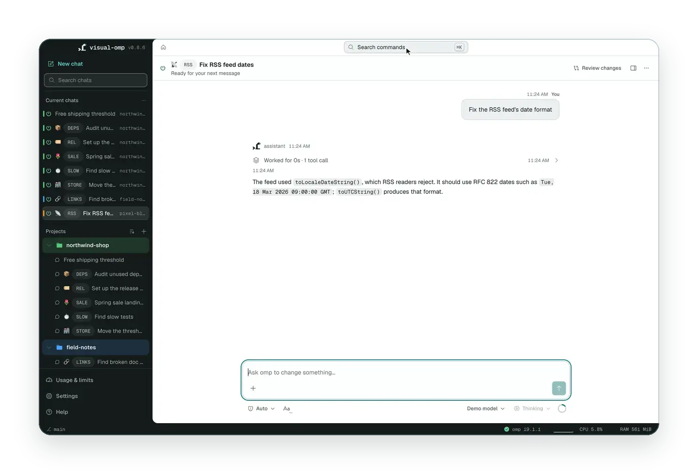
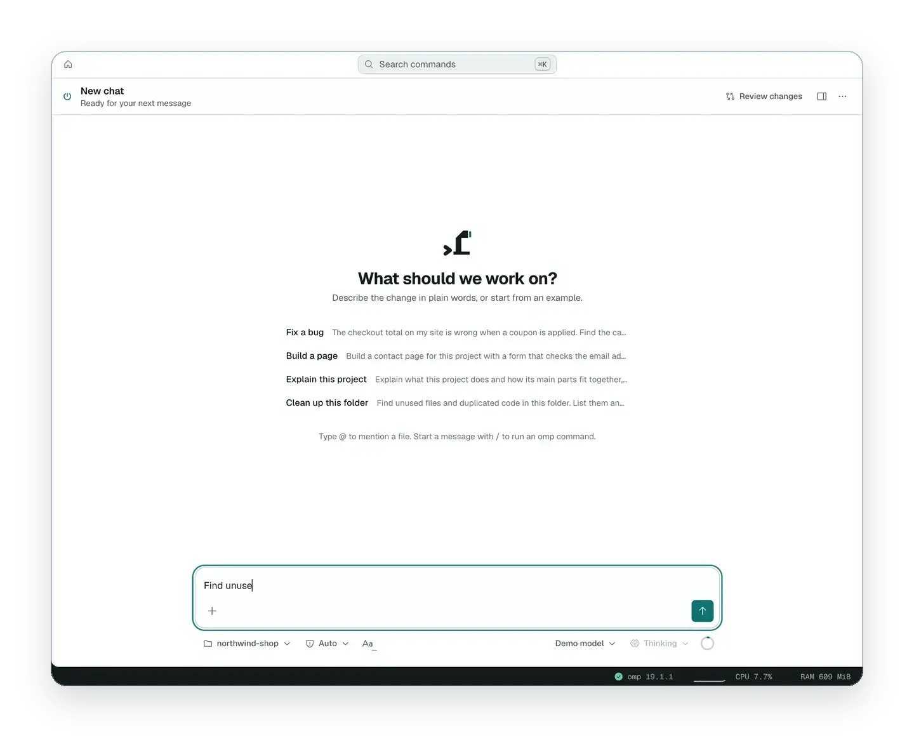
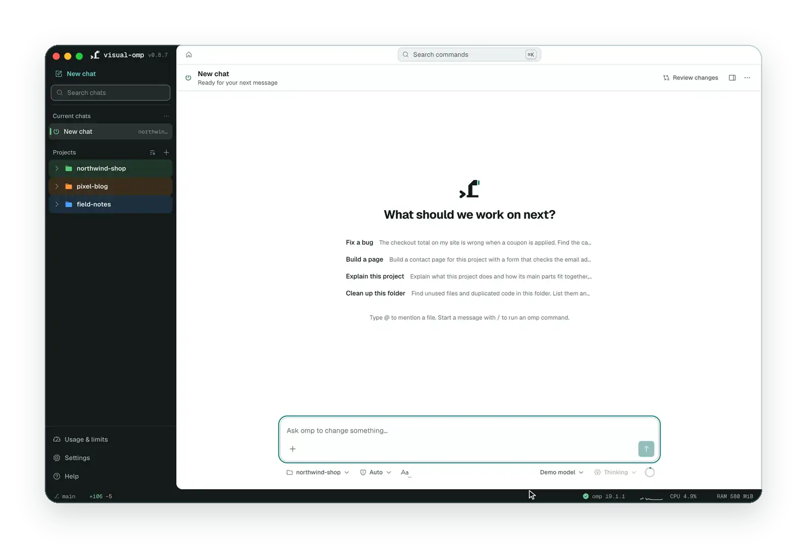
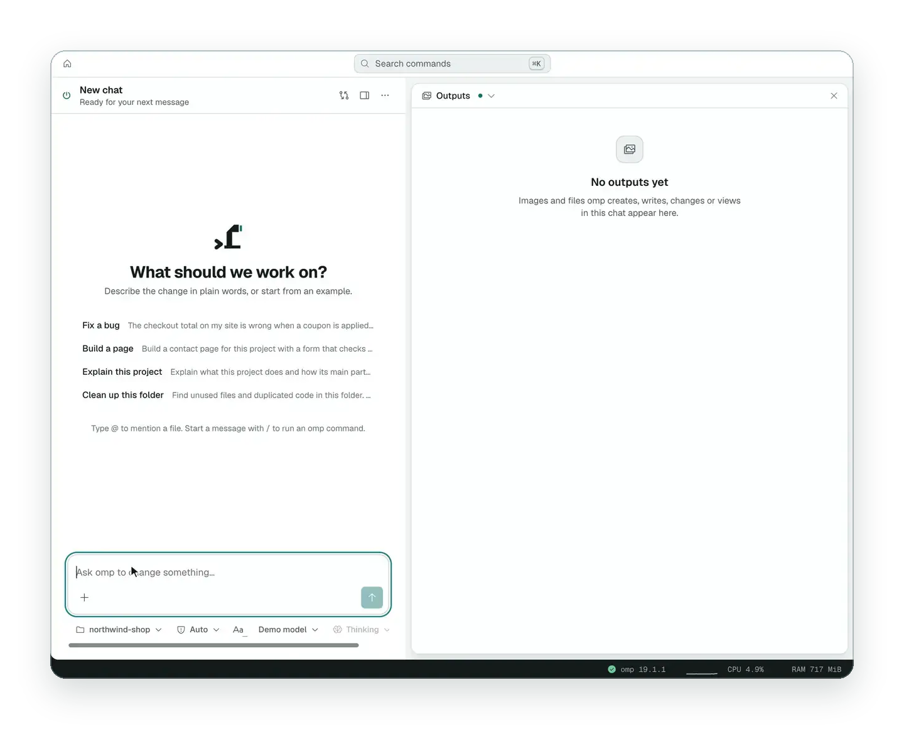
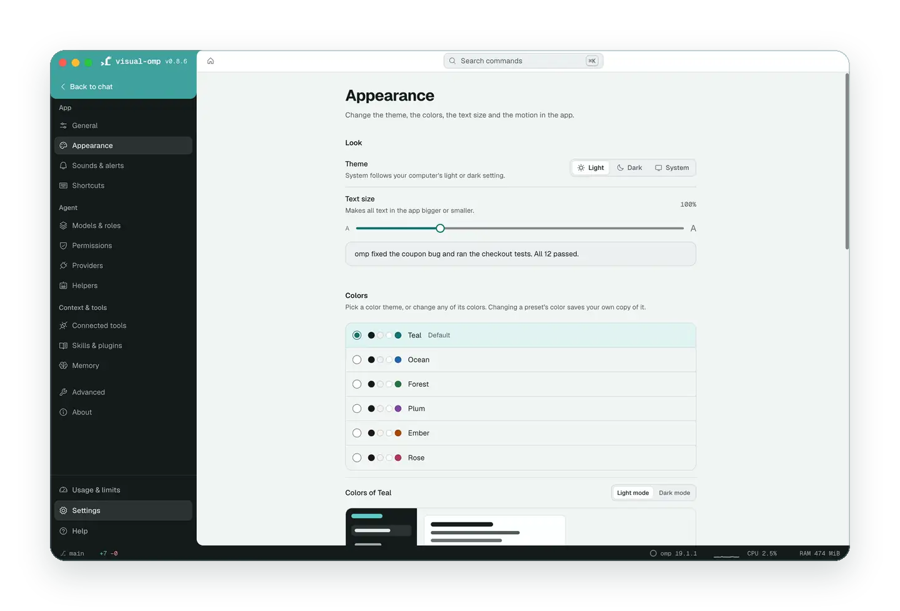
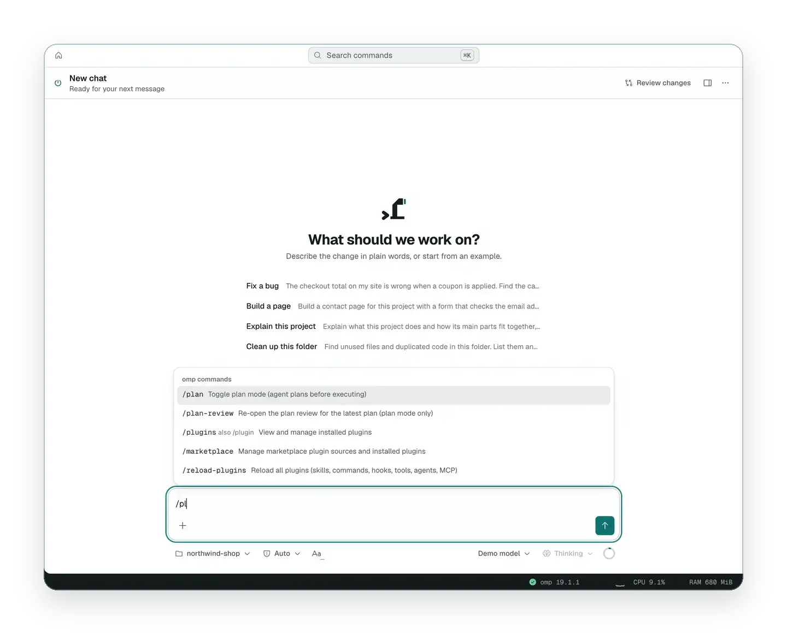
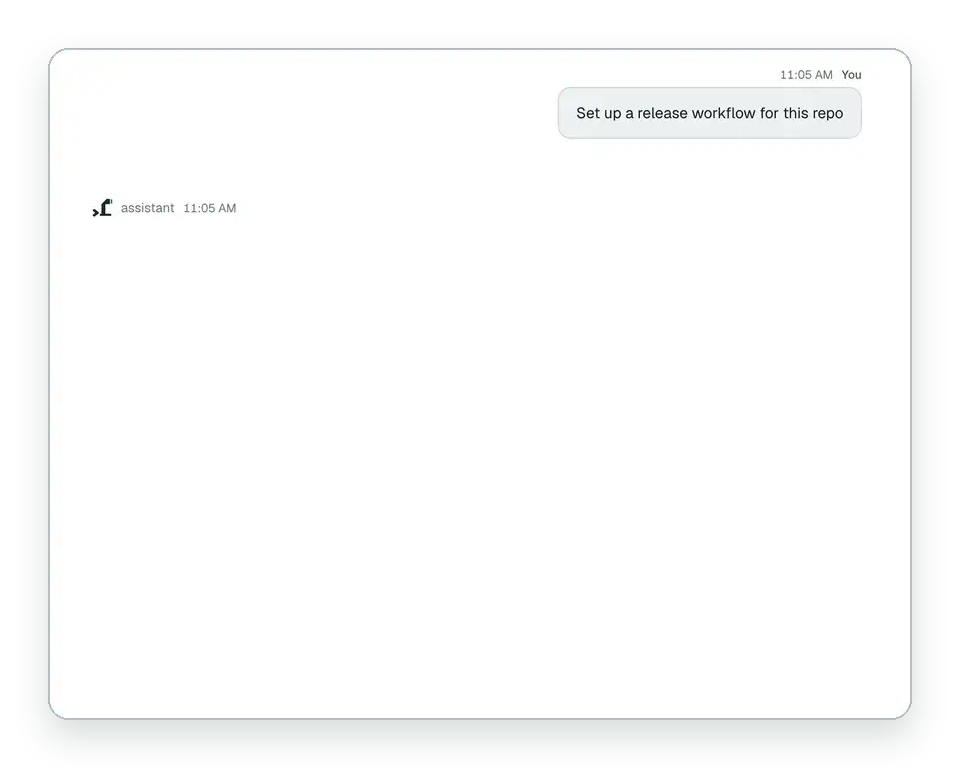
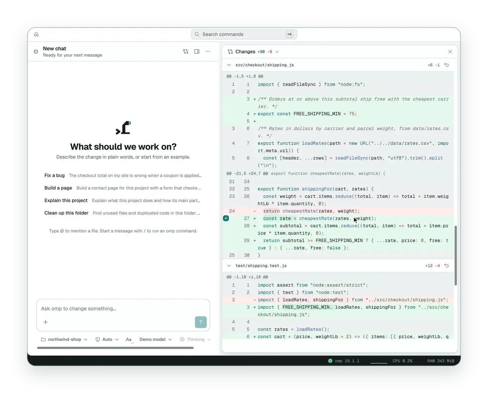
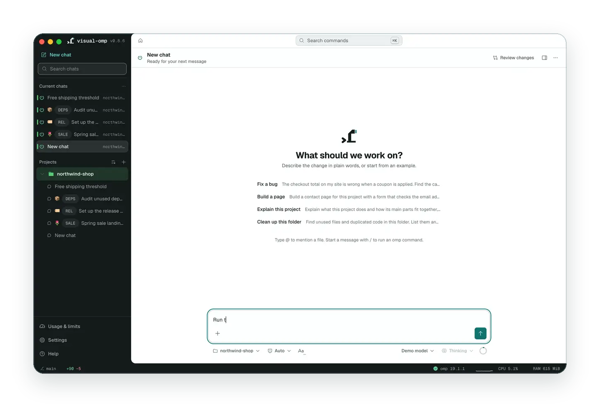

<p align="center">
  <picture>
    <source media="(prefers-color-scheme: dark)" srcset="assets/readme/lockup-dark.svg">
    
  </picture>
</p>

<p align="center">
  visual-omp runs the <a href="https://github.com/can1357/oh-my-pi">omp</a> you already use and puts every chat in one window, with each chat's status in the sidebar and its files, pages and helpers beside it.
</p>

<p align="center">
  <a href="https://github.com/decoy-dev/visual-omp/releases/latest"><picture><source media="(prefers-color-scheme: dark)" srcset="assets/readme/download-apple-silicon-dark.svg"></picture></a>
  <a href="https://github.com/decoy-dev/visual-omp/releases/latest"><picture><source media="(prefers-color-scheme: dark)" srcset="assets/readme/download-intel-dark.svg"></picture></a>
  <a href="https://github.com/decoy-dev/visual-omp/releases/latest"><picture><source media="(prefers-color-scheme: dark)" srcset="assets/readme/download-windows-dark.svg"></picture></a>
</p>

<p align="center">
  Or install it with <a href="#installation">Homebrew or Scoop</a>.
</p>

<p align="center">
  <a href="LICENSE"></a>
  <a href="https://github.com/decoy-dev/visual-omp/releases"></a>
  <a href="#installation"></a>
</p>

<p align="center">
  <picture>
    <source media="(prefers-reduced-motion: reduce)" srcset="docs/images/glance-still.webp">
    
  </picture>
</p>

<p align="center"><sub>Four chats in three projects work at once. One stops to ask a question, and the others finish with a result mark that moves them to the top of Current chats.</sub></p>

> [!NOTE]
> The recordings on this page come from a development build made after visual-omp 0.8.6, using demo projects. A scripted demo model writes omp's replies, and omp runs every tool call in those projects. Some recordings speed up typing, waits and reply text, so they do not show a model's speed.

## Your own omp

visual-omp starts the omp you installed in a hidden terminal on your computer and shows omp's own screen, so each chat uses your sign-ins, settings, extensions and saved sessions.

- Slash commands go to omp as you type them. Commands with an app screen open that screen, and omp menus without one, such as `/extensions`, open in the omp screen.
- Sessions you start in a terminal appear in the sidebar. On macOS you can follow one while the terminal works and continue it in the app once the terminal releases it.
- Provider sign-in runs `omp login`, and accounts are managed through omp, so visual-omp stores no credentials of its own.
- The app reads omp's collaboration stream over a relay bound to 127.0.0.1, so the connection between the app and omp stays on your computer.
- visual-omp is updated throughout the week to support each new omp release, and a scheduled daily check runs the app's tests against new omp versions.

## Why visual-omp

Many omp desktop and web apps start omp in RPC mode or load its SDK, then draw their own chat from the events omp sends. visual-omp shows what omp itself draws, so a new omp menu or screen built from controls the omp screen already supports opens in the app before visual-omp adds a screen of its own for it.

visual-omp uses these omp mechanisms:

| Area | What visual-omp uses |
| --- | --- |
| **Chat transcript** | omp's collaboration stream, the one omp's browser client reads |
| **Menus and screens** | omp's Tern Surface Protocol (TSP), drawn as native controls |
| **Sign-in and accounts** | `omp login` and omp's own account list |
| **Saved chats** | omp's session files, shared with the terminal |
| **Updates to omp** | `omp update`, run from Settings → About |

## Features

### Every chat in one window

Each chat runs its own omp, and Current chats lists them all with their status. A spinner means omp is working, a pulsing robot means only its helpers are still working, a question mark means omp is waiting for your answer, and double check marks with a bold title mark a result you haven't opened yet. Chats with unopened results move to the top of the list. Give each project one of seven colors, and its folder and chat rows show that color.

The Dock icon on macOS and the taskbar button on Windows show how many chats have unopened results. With **Alert me in the background** on in Settings → Sounds & alerts, a chat that finishes or asks a question while the window is in the background also bounces the Dock icon once on macOS. On Windows it flashes the taskbar button and sends a notification, which plays a sound if your Windows notification settings allow it. <kbd>⌘K</kbd> (<kbd>Ctrl</kbd> + <kbd>K</kbd> on Windows) searches commands by what they do, and Open side by side shows two chats together.

<p align="center">
  <picture>
    <source media="(prefers-reduced-motion: reduce)" srcset="docs/images/chats-still.webp">
    
  </picture>
</p>

<p align="center"><sub>Two chats in different projects work on follow-ups, and Outputs previews the page one of them adds.</sub></p>

### Helpers

When omp hands work to helpers (subagents), each one gets a card in the chat that shows what it is doing and updates as it works. Open a helper to read its conversation while it runs, and use the Tasks pane for every helper's token count next to omp's todo list and background jobs. While only helpers are still working, the chat's row in the sidebar shows a pulsing robot.

<p align="center">
  <picture>
    <source media="(prefers-reduced-motion: reduce)" srcset="docs/images/helpers-still.webp">
    
  </picture>
</p>

<p align="center"><sub>Three helpers check one package each, and omp collects their findings into one table.</sub></p>

### Files, PDFs and web pages

Images, PDFs, video and audio open in the side panel, from the Files pane or from the Outputs pane, which lists the files omp saves as it works. Saved HTML files open as pages. A link to a local server opens in the chat's Preview pane, a built-in browser for dev servers, from the link's right-click menu.

<p align="center">
  <picture>
    <source media="(prefers-reduced-motion: reduce)" srcset="docs/images/files-still.webp">
    
  </picture>
</p>

<p align="center"><sub>omp exports the spring sale page to a PDF and a PNG with headless Chrome, and the page it serves opens in the Preview pane.</sub></p>

### Live outputs

The Outputs pane previews HTML, Markdown, CSV, SVG and Mermaid as omp writes them, and lists the images, PDFs and other files it saves.

<p align="center">
  <picture>
    <source media="(prefers-reduced-motion: reduce)" srcset="docs/images/outputs-still.webp">
    
  </picture>
</p>

<p align="center"><sub>omp writes the stylesheet first, and the preview updates as omp writes the page.</sub></p>

### Themes and settings

Appearance offers six color themes, each in light and dark, and each one recolors the whole window. Settings also covers omp's providers, model roles, permissions, helpers, MCP servers, skills and memory, and it saves changes to omp's own settings. **Models & roles** assigns models to jobs such as chat, planning and commits, and provider sign-in opens omp's own sign-in inside the app, including when a token expires.

<p align="center">
  <picture>
    <source media="(prefers-reduced-motion: reduce)" srcset="docs/images/settings-still.webp">
    
  </picture>
</p>

<p align="center"><sub>Each color theme recolors the whole window, in light and dark.</sub></p>

### Usage and app resources

The status bar shows plan usage for the providers your chats use, such as Claude's 5-hour window, next to the CPU and RAM that visual-omp itself is using. **Usage & limits** adds each provider's plan limits and the usage recorded in omp's session files, by day and by chat.

### Plan review

In plan mode, omp writes a plan and waits for you. Read it in the side panel, then approve it, compact the chat first or send a comment back from the card in the chat.

<p align="center">
  <picture>
    <source media="(prefers-reduced-motion: reduce)" srcset="docs/images/plan-still.webp">
    
  </picture>
</p>

<p align="center"><sub>omp drafts the free-shipping plan, and Approve and run starts the work in the same chat.</sub></p>

### Question cards

When omp asks several questions, the card shows one at a time. Previous question and Next question keep your answers, and Send answers delivers them all together.

<p align="center">
  <picture>
    <source media="(prefers-reduced-motion: reduce)" srcset="docs/images/questions-still.webp">
    
  </picture>
</p>

<p align="center"><sub>Three questions about a release workflow: which tags start a release, where it publishes and where its notes come from.</sub></p>

### Changes and line comments

The Changes pane shows uncommitted diffs and commit history. Comment on a line to send it to omp, then commit with a generated message, open a pull request and check CI.

<p align="center">
  <picture>
    <source media="(prefers-reduced-motion: reduce)" srcset="docs/images/changes-still.webp">
    
  </picture>
</p>

<p align="center"><sub>A line comment goes to omp, which moves the threshold into <code>data/store.json</code> and reruns the tests.</sub></p>

### Tool steps and bash details

Tool calls fold into a short list of steps. Open a bash step to see each command's state, the values it set and how long it took, then replay the run one event at a time. Browser steps show the page omp opened and the screenshots it took, including tabs in your own Chrome when omp uses its browser relay.

<p align="center">
  <picture>
    <source media="(prefers-reduced-motion: reduce)" srcset="docs/images/tools-still.webp">
    
  </picture>
</p>

<p align="center"><sub>omp times the test files, and the Pseudo view shows the loop, the values it recorded and each step's duration.</sub></p>

### Phone sharing

Start sharing from Share → Invite and scan its QR code to open the chat in omp's browser client on your phone, with control of messages and approvals. A view-only link is also available, and chat content is encrypted end to end through omp's public relay, which can see connection metadata.

<details>
<summary>While a chat is shared</summary>

The computer stays awake while sharing, though closing its lid can still put it to sleep. If omp changes the room, the dialog provides a new code and links for reconnecting. Stop sharing disconnects guests, and sharing the same room again makes its previous code and links work again.

</details>

### Other features

| Area | What's included |
| --- | --- |
| **Projects** | Start a chat in any folder, create a folder or clone a repository, and sort or group the sidebar |
| **Transcript** | SVG and Mermaid diagrams, charts drawn from tables in omp's replies, and Normal, Thinking and Verbose views of omp's work |
| **Modes** | Plan, Goal, Vibe and Loop modes and the Advisor, from the chat's ⋯ menu or the command palette |
| **omp features** | MCP servers, skills and plugins, memory, usage and cost, live collaboration, Claude Code and Codex imports, the session tree, the security scan and `omp cleanse` |
| **Accessibility** | Text size, reduced motion, light and dark themes, keyboard commands, screen-reader labels, the first-launch tour and Help's glossary |

## Installation

visual-omp runs the omp you already have installed, so install omp first. If it is missing, visual-omp detects that on first launch and offers to run the installer for you. visual-omp supports macOS on Apple Silicon and Intel, Windows 10 and later, and omp 18.15.0 or later. An older omp opens the setup screen, where **Update omp** runs omp's updater without a separate terminal.

**omp on macOS or Linux**

```sh
curl -fsSL https://omp.sh/install | sh
```

**omp on Windows (PowerShell)**

```powershell
irm https://omp.sh/install.ps1 | iex
```

**visual-omp on macOS with Homebrew (recommended)**

The Homebrew cask requires Homebrew 6.0.16 or later. Run `brew update` before installing or updating visual-omp.

```sh
brew tap decoy-dev/tap https://github.com/decoy-dev/visual-omp
brew install --cask decoy-dev/tap/visual-omp
```

**visual-omp on Windows with Scoop (recommended)**

Install Scoop by following the instructions on [scoop.sh](https://scoop.sh) if you don't have it, then run these commands in PowerShell. The first installs Git, which Scoop needs to add the visual-omp bucket.

```powershell
scoop install git
scoop bucket add decoy-dev https://github.com/decoy-dev/visual-omp
scoop install decoy-dev/visual-omp
```

<details>
<summary>Switch a disk-image copy to Homebrew</summary>

Open **Settings → About** and choose **Switch to Homebrew**. The app adds the tap and checks its published cask. Homebrew adopts an app at its destination when that app matches the cask version, including a separate copy, or installs into an empty destination. If the destination has a different version, update that copy through its existing update flow first, then try the switch again. The switch never replaces a bundle. A copy in another folder can be kept or moved to the Trash after the Homebrew copy is verified. An existing cask copy is reused without installing another. Saved chats and omp settings remain available; omp's installation does not change.

If Homebrew is missing, About shows a guide to [brew.sh](https://brew.sh) and the commands above. After installing Homebrew, choose **Check package manager again** to use the automated switch.

</details>

<details>
<summary>More about Scoop installs</summary>

Scoop installs visual-omp without the setup wizard, and later updates run from **Settings → About** without it too. visual-omp then appears under **Scoop Apps** in the Start menu. The commands above install it for your user, which is what the in-app update expects. A copy installed for all users with `--global` can only be updated by an administrator, so its update window shows the command to run instead.

</details>

<details>
<summary>macOS disk image or Windows installer</summary>

**macOS:** download the disk image for your processor from the [latest release](https://github.com/decoy-dev/visual-omp/releases/latest), open it, and move visual-omp to Applications.

**Windows:** download `visual-omp-<version>-win-x64.exe` from the [latest release](https://github.com/decoy-dev/visual-omp/releases/latest) and run it. To move this copy to Scoop, install Scoop and Git first, then open **Settings > About**, choose **Switch to Scoop** and confirm **Continue in PowerShell**. The app closes, and a visible PowerShell window reuses an existing Scoop copy or installs `decoy-dev/visual-omp`. It verifies the executable, install record and matching manifest version before running a temporary copy of the old uninstaller with app-data retention enabled, then starts the Scoop copy.

An installation or verification failure keeps and reopens the installer copy. If removal fails after verification, the script starts the Scoop copy and reports that the old copy may still need removal through **Windows Settings > Apps**. The PowerShell window stays open on errors. Its JSON result and plain log are saved as `scoop-switch-result.json` and `scoop-switch-result.json.log` in visual-omp's profile folder. Missing Scoop shows the manual installation guide and **Check package manager again** in About. Both copies use the same chats and settings; omp's installation stays unchanged.

</details>

<details>
<summary>First launch: macOS and Windows approval</summary>

visual-omp is not notarized by Apple or signed for Windows SmartScreen yet. The Homebrew cask removes quarantine from the installed app bundle to avoid the approval check that this attribute triggers, and Homebrew still checks each download against the checksum in the cask. Scoop unpacks visual-omp without running the installer and checks each download against the checksum in its manifest, and the copy it installs carries no download mark for SmartScreen to check. Other installs ask you to approve visual-omp before it opens. Expect the prompt on first launch, and possibly again after an update:

- **macOS (disk image):** open visual-omp, then go to **System Settings → Privacy & Security** and click **Open Anyway** next to the message about visual-omp. Versions from 0.6.7 on are signed with the project's own certificate, and this step hasn't been confirmed with it yet. If macOS offers no way to approve visual-omp, install it with Homebrew as described above.
- **Windows (installer):** on the "Windows protected your PC" screen, click **More info**, then **Run anyway**.

If macOS reports a Homebrew-installed copy as damaged, open Terminal and run `brew update`. After that succeeds, run `brew upgrade --cask visual-omp`. If Homebrew reports that the latest version is already installed, run `brew reinstall --cask visual-omp` to apply the updated cask to that version.

</details>

## Updating and rollback

visual-omp checks GitHub for a new release about ten seconds after it opens and every 30 minutes while it stays open, and it checks omp the same way through `omp update --check`. **Settings → About** shows both versions and installs either update. A Homebrew install upgrades through `brew upgrade --cask visual-omp`, and any other macOS install downloads the new disk image. On Windows, a Scoop install closes, updates through `scoop update visual-omp` in a PowerShell window and opens again, and an installer copy downloads and runs the new installer. Open chats keep the omp version they started with until they restart, so after an omp update the app offers to restart them.

<details>
<summary>What the update check sends</summary>

Each fresh visual-omp update check in a packaged build sends the app version, platform and architecture to the
project's Cloudflare Worker at `visual-omp-update-count.chris-216.workers.dev`. The collector stores
daily counts in Cloudflare D1, with no IP address or identifier. Worker request logs and traces are
disabled. Development builds and tests do not send these requests, and a failed request does not
delay or interrupt an update check.
These totals measure update checks and cannot identify unique installations.

</details>

<details>
<summary>Reinstall visual-omp</summary>

Open **Settings → About** and choose the reinstall action beside the running version. Direct
installer copies offer **Reinstall v{version}** and confirm the exact version to replace.
Homebrew and Scoop copies offer **Reinstall through Homebrew** or **Reinstall through Scoop** with
package-manager instructions. Saved chats and omp settings remain available. Cancel leaves the
installation unchanged.

For macOS disk-image and Windows installer copies, confirming downloads the exact current
version from its official GitHub release through the existing installer window. Downloads use
the same trusted asset and redirect checks as updates, verify the byte count, and validate a
SHA256 digest when the release supplies one. Older releases without a digest remain supported.
Open the disk image or run the installer, then complete the replacement and reopen visual-omp.
Reinstalling that exact version leaves any update skip saved after a rollback unchanged.

Homebrew and Scoop copies show commands to run after quitting visual-omp:

- **Homebrew:** `brew reinstall --cask visual-omp` uses the currently published cask, which may
  install a newer version than the one running.
- **Scoop:** run `scoop update visual-omp --force` in PowerShell. This reinstalls from the bucket's
  current manifest and may install a newer version than the one running. For a global
  installation, run `scoop update visual-omp --force --global` in an administrator PowerShell.

Package-manager reinstalls retain their package-manager records for future updates. If either
command installs a version newer than the saved rollback skip, the usual startup check clears
that skip.

Reinstall is unavailable in development builds, for unsupported installations, when the exact
release or a trusted installer for this computer is missing, or when GitHub cannot be reached.

</details>

<details>
<summary>Return to an earlier version</summary>

Open **Settings → About → Read release notes**, find the earlier release and choose **Install
v{version}**. The confirmation names the version you are leaving and the version you selected.
After you confirm, visual-omp downloads the matching installer from the official GitHub release,
using the same download progress and installer controls as a regular update. Your saved chats and
omp settings remain available.

- **macOS disk-image installs:** open the downloaded disk image, quit visual-omp, drag the app into
  Applications and choose **Replace**. Reopen visual-omp to use the earlier version.
- **Windows installer installs:** run the downloaded installer. visual-omp closes so setup can
  replace it; complete setup and reopen the app.
- **Homebrew installs:** choose **Show downgrade steps**. Obtain the older `visual-omp.rb` cask
  from the [tap's history](https://github.com/decoy-dev/visual-omp/commits/main/Casks/visual-omp.rb),
  quit visual-omp, run `brew uninstall --cask visual-omp`, then run
  `brew install --cask /path/to/older/visual-omp.rb`. Review the historical cask and confirm its
  download is still available before removing the current copy.
- **Scoop installs:** choose **Show downgrade steps**. If Scoop still retains the selected version
  from a previous installation, quit visual-omp and run `scoop reset visual-omp@VERSION`, replacing
  `VERSION` with that retained version. Otherwise, consult the
  [bucket's history](https://github.com/decoy-dev/visual-omp/commits/main/bucket/visual-omp.json)
  for an older manifest and its download. Reset cannot restore files Scoop has already removed.

A confirmed installer rollback records the version you are leaving in the app's preferences.
visual-omp 0.7.1 and later suppress background update offers through that version and offer a
release newer than it. **Check for updates** includes skipped versions without clearing this
choice; choosing a regular update clears it. The skip also clears when you run a version strictly
newer than the skipped version. Versions before 0.7.1 do not honor this preference, so they may
still offer the version you left. You can leave that update uninstalled; those releases require
you to choose an update before they install it.

</details>

## Freeze and crash reports

After a freeze or crash, open **Settings → About → Open logs folder** to review local event logs and crash reports before sharing them with your issue report. Crash reports may contain sensitive information.

<details>
<summary>What the logs contain and what is sent</summary>

The profile's `logs` folder contains native crash reports under `crashes`. The two
event-log files are capped at 1 MiB each and exclude chat text, prompts, file contents and tokens.
A renderer crash reloads the window once; another crash within a minute leaves it stopped so it
cannot enter a reload loop.

Automatic reporting is controlled in **Settings → Advanced → Send crash reports**. The switch is
on by default and automatically sends crash reports and selected app failure events to Sentry.
Event logs exclude chat contents. Native crash reports may contain sensitive information from
process memory. Turn the switch off to keep diagnostics local.

App events include app and runtime versions, operating system, transport, failure categories and a
bounded event-log excerpt, with a random installation id and home-directory paths replaced by `~`.
The Sentry organization has server-side data scrubbing, default scrubbers and IP-address storage
prevention enabled. These settings do not guarantee that native crash reports exclude sensitive
information. Development builds send only when `VOMP_SENTRY_DSN` explicitly selects an endpoint.

</details>

## Development

```sh
git clone https://github.com/decoy-dev/visual-omp
cd visual-omp
npm install
npm run dev
```

[docs/ARCHITECTURE.md](docs/ARCHITECTURE.md) explains how the app drives omp, [docs/SPEC.md](docs/SPEC.md) covers the product scope, and [docs/RELEASING.md](docs/RELEASING.md) describes how a version is published. visual-omp has been in beta since 0.7, and [CHANGELOG.md](CHANGELOG.md) lists what each version contains.

## License

visual-omp is licensed under the [MIT License](LICENSE). It includes code adapted from [oh-my-pi](https://github.com/can1357/oh-my-pi) (MIT), credited in [NOTICE](NOTICE).

<p align="center"><sub>Published by <a href="https://decoy.ltd">decoy</a>.</sub></p>
