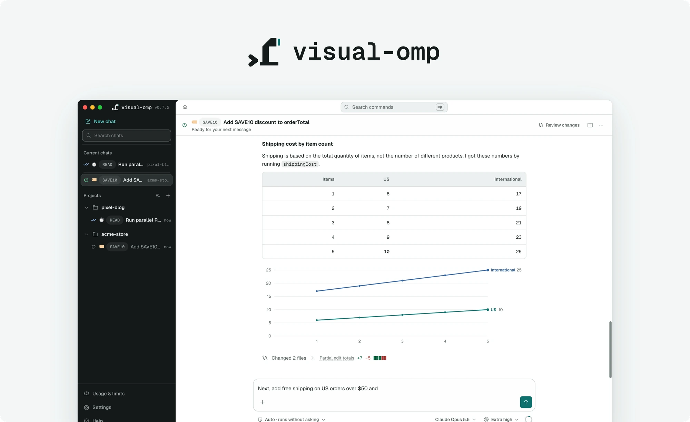
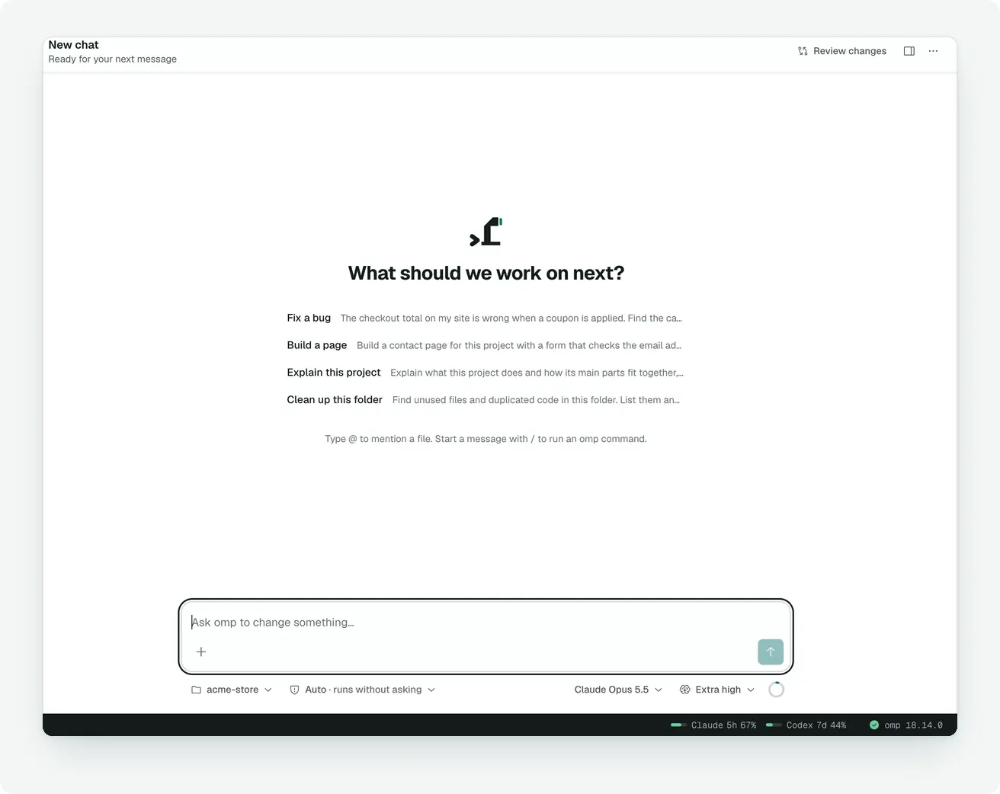
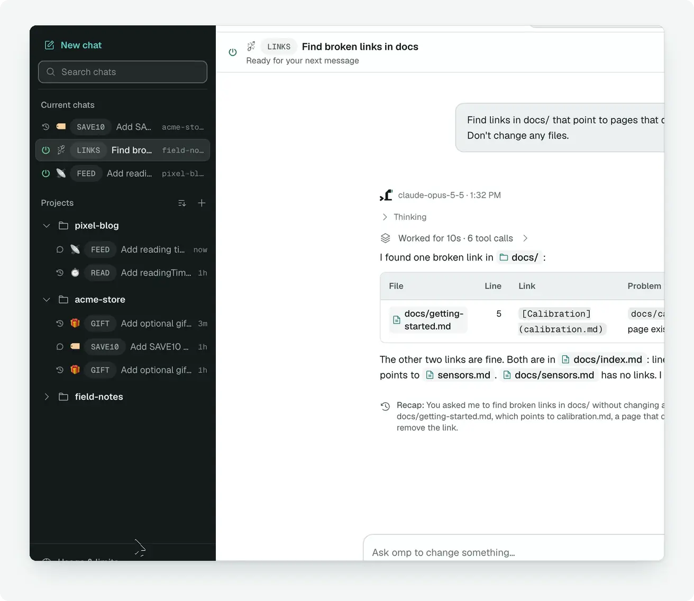
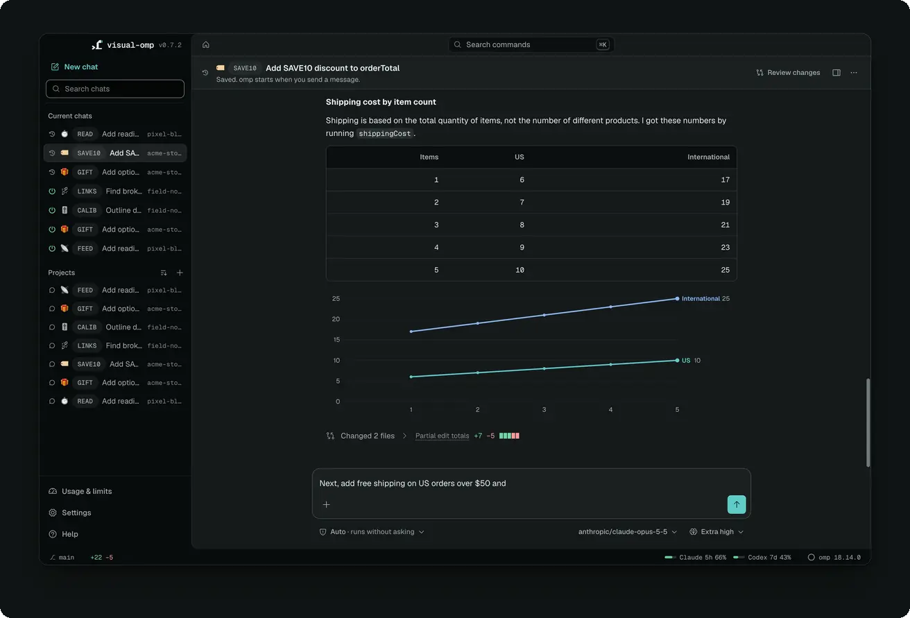
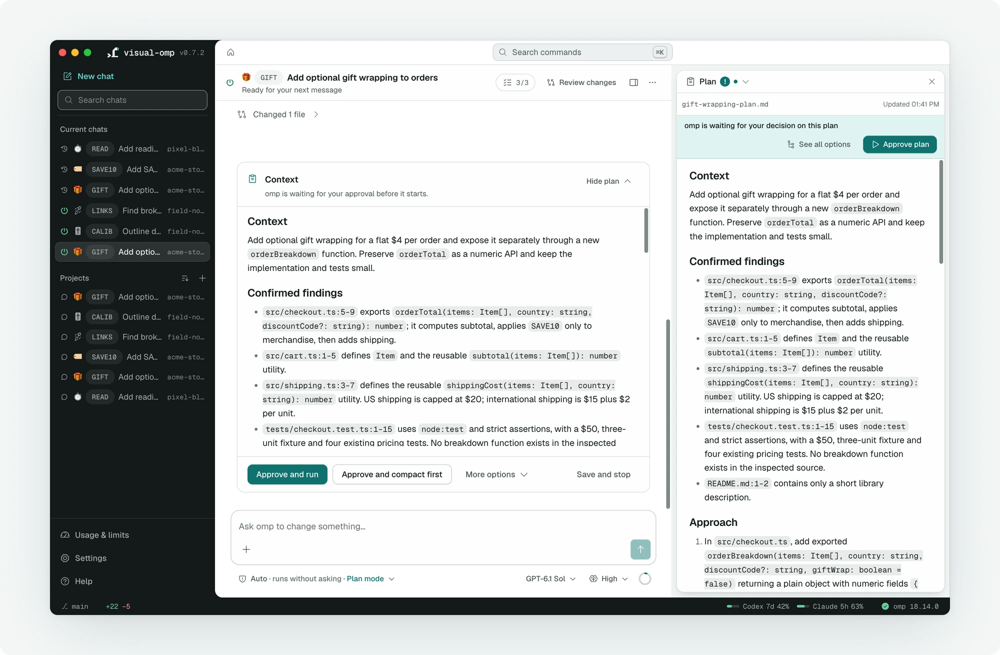
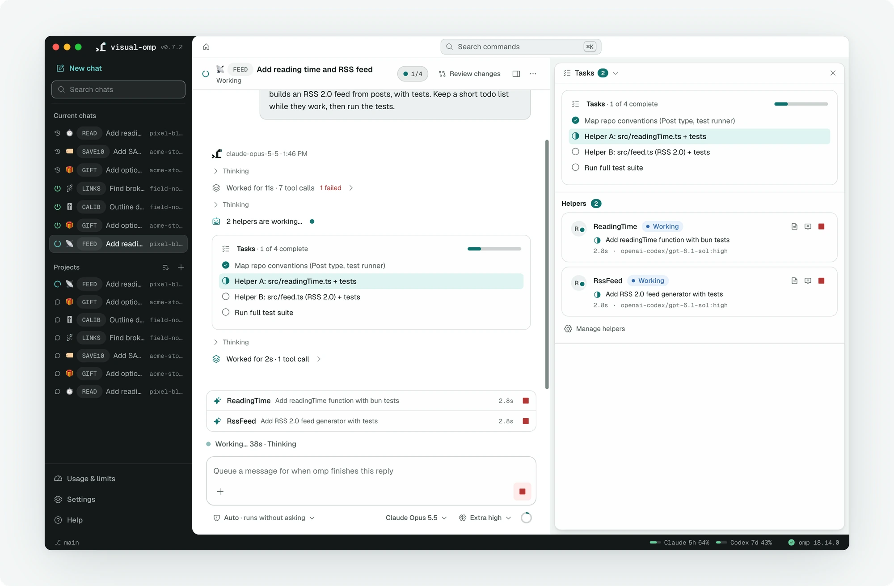
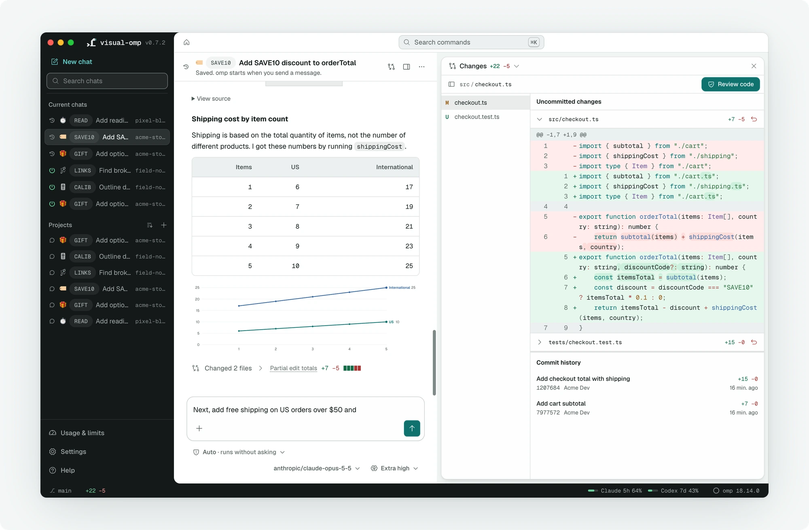
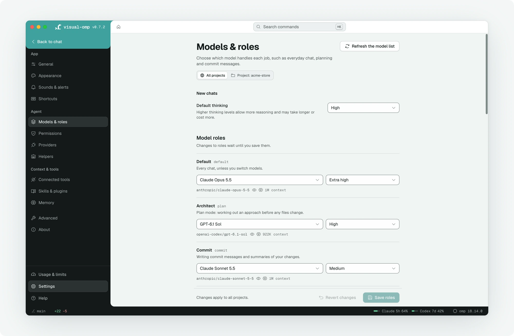

<p align="center">
  <picture>
    <source media="(prefers-color-scheme: dark)" srcset="assets/hero-dark.webp">
    <source media="(prefers-color-scheme: light)" srcset="assets/hero-light.webp">
    
  </picture>
</p>

<p align="center">
  A desktop app for <a href="https://github.com/can1357/oh-my-pi">omp</a>, the coding agent. Chats, plans, subagents and changes appear in a native window.
</p>

<p align="center">
  <a href="LICENSE"></a>
  <a href="https://github.com/decoy-dev/visual-omp/releases"></a>
  <a href="#install"></a>
</p>

<p align="center">
  <a href="https://github.com/decoy-dev/visual-omp/releases/latest">Download for macOS (Apple Silicon)</a> · <a href="https://github.com/decoy-dev/visual-omp/releases/latest">macOS (Intel)</a> · <a href="https://github.com/decoy-dev/visual-omp/releases/latest">Windows</a>, or <a href="#install">install with Homebrew or Scoop</a>.
</p>

omp (oh-my-pi) has subagents, plan mode, model roles, an advisor, MCP servers and skills. visual-omp runs that same omp in a hidden terminal and renders its chats, plans, tools and settings in a desktop app for macOS and Windows. You can use it without working in a terminal, or review sessions you already run there. visual-omp is published by [decoy](https://decoy.ltd).

> [!NOTE]
> visual-omp 0.7 is the first beta release. Earlier versions were alpha releases. The installers are on the [releases page](https://github.com/decoy-dev/visual-omp/releases/latest), and [CHANGELOG.md](CHANGELOG.md) lists what each version contains.

## Screenshots

These screenshots show demo projects in a development build, so some details can differ from the current release.

<p align="center">
  <picture>
    <source media="(prefers-reduced-motion: reduce)" srcset="docs/images/anim-stream-still.webp">
    
  </picture>
</p>

<p align="center"><em>Replies stream as formatted text, with a chart drawn beneath numeric tables. The tool-call wait is shortened in this recording; the reply streams at its original speed.</em></p>

## Install

visual-omp runs the omp you already have installed, so install omp first. If it is missing, visual-omp detects that on first launch and offers to run the installer for you.

**omp on macOS or Linux**

```sh
curl -fsSL https://omp.sh/install | sh
```

**omp on Windows (PowerShell)**

```powershell
irm https://omp.sh/install.ps1 | iex
```

**visual-omp on macOS (Homebrew, recommended)**

The Homebrew cask requires Homebrew 6.0.16 or later. Run `brew update` before installing or updating visual-omp.

```sh
brew tap decoy-dev/tap https://github.com/decoy-dev/visual-omp
brew install --cask decoy-dev/tap/visual-omp
```

**visual-omp on Windows (Scoop, recommended)**

Scoop installs visual-omp without the setup wizard, and later updates run from **Settings → About** without it too. Install Scoop by following the instructions on [scoop.sh](https://scoop.sh) if you don't have it, then run these commands in PowerShell. The first installs Git, which Scoop needs to add the visual-omp bucket.

```powershell
scoop install git
scoop bucket add decoy-dev https://github.com/decoy-dev/visual-omp
scoop install decoy-dev/visual-omp
```

visual-omp then appears under **Scoop Apps** in the Start menu. These commands install it for your user, which is what the in-app update expects. A copy installed for all users with `--global` can only be updated by an administrator, so its update window shows the command to run instead.

**visual-omp on macOS (disk image, alternative)**

Download the macOS disk image for your processor from the [latest release](https://github.com/decoy-dev/visual-omp/releases/latest), open it, and move visual-omp to Applications.

**visual-omp on Windows (installer, alternative)**

Download `visual-omp-<version>-win-x64.exe` from the [latest release](https://github.com/decoy-dev/visual-omp/releases/latest) and run it. To move a copy installed this way to Scoop, run the Scoop commands above, quit visual-omp, and uninstall the installer's copy in Windows Settings under **Apps**. Both copies use the same profile folder, so your chats and settings stay.

visual-omp supports macOS on Apple Silicon and Intel, Windows 10 and later, and omp 18.14.0 or later. An older omp opens the setup screen, where **Update omp** runs omp's updater without a separate terminal.

<details>
<summary>First launch: macOS and Windows approval</summary>

visual-omp is not notarized by Apple or signed for Windows SmartScreen yet. The Homebrew cask removes quarantine from the installed app bundle to avoid the approval check that this attribute triggers, and Homebrew still checks each download against the checksum in the cask. Scoop unpacks visual-omp without running the installer and checks each download against the checksum in its manifest, and the copy it installs carries no download mark for SmartScreen to check. Other installs ask you to approve visual-omp before it opens. Expect the prompt on first launch, and possibly again after an update:

- **macOS (disk image):** open visual-omp, then go to **System Settings → Privacy & Security** and click **Open Anyway** next to the message about visual-omp. Versions from 0.6.7 on are signed with the project's own certificate, and this step hasn't been confirmed with it yet. If macOS offers no way to approve visual-omp, install it with Homebrew as described above.
- **Windows (installer):** on the "Windows protected your PC" screen, click **More info**, then **Run anyway**.

If macOS reports a Homebrew-installed copy as damaged, open Terminal and run `brew update`. After that succeeds, run `brew upgrade --cask visual-omp`. If Homebrew reports that the latest version is already installed, run `brew reinstall --cask visual-omp` to apply the updated cask to that version.

</details>

## How it works

Each chat runs a full omp session in a hidden terminal on your computer. visual-omp types your messages into that session and reads omp's own collaboration stream back over a relay bound to 127.0.0.1, which means the connection between the app and omp never leaves your machine.

The practical consequence is that visual-omp does not reimplement omp: a slash command works when you type it into the message box whether or not the app has a button for it yet, and the handful of full-screen omp menus without a native screen open in a terminal sheet drawn by omp itself.

## What you can do

### Start a chat in any folder

**Choose the folder omp works in before you send a message.** Home's folder picker lets you select a project or browse to another folder, and the project wizard can create a folder or clone a repository. Projects and saved terminal sessions appear in the sidebar, so you can return to earlier work. In the development build shown here, the Projects list can be sorted by recent activity, name or creation date, and **Group by project** switches between project groups and one list of non-archived chats.

<p align="center">
  <picture>
    <source media="(prefers-reduced-motion: reduce)" srcset="docs/images/anim-sort-still.webp">
    
  </picture>
</p>

<p align="center"><em>Sort the sidebar by name, or group chats by project.</em></p>

### Follow a chat that is open in a terminal

**On macOS, you can watch a terminal session from the app while it works.** Replies go through the terminal while it owns the session. Once the app sees that no other omp process has the session open, **Continue here** checks again and lets you resume it in the app.

### Read what omp did

**Replies stream as formatted text, with SVG and Mermaid diagrams and charts beneath numeric tables.** Tool calls collapse into short steps that open to their output, diffs or reasoning. Normal, Thinking and Verbose views let you choose how much of that work to read.

### Run commands without memorizing them

**⌘K (Ctrl+K on Windows) searches app commands by what they do.** The chat header and its ⋯ menu offer commands such as Restart, Compact and Plan mode. Slash commands in the message box go to omp as they would in the terminal.

<p align="center">
  <picture>
    <source media="(prefers-reduced-motion: reduce)" srcset="docs/images/anim-palette-still.webp">
    
  </picture>
</p>

<p align="center"><em>The command palette searches app commands by what they do.</em></p>

### Plan before building

**Plan mode asks omp to draft a plan for your approval before implementation.** Review the draft in the Plan pane, then approve it or use the review options to summarize the chat, keep its full context or send a comment back. Goal, Vibe and Loop modes and the Advisor are available from the chat header's ⋯ menu and the command palette.

<a href="docs/images/shot-02-plan-light.webp"><picture>
  <source media="(prefers-color-scheme: dark)" srcset="docs/images/shot-02-plan-dark.webp">
  <source media="(prefers-color-scheme: light)" srcset="docs/images/shot-02-plan-light.webp">
  
</picture></a>

*Review the draft beside the chat, then approve it or choose another review option.*

### Review changes and ship them

**The Tasks and Changes panes let you follow delegated work and review its result.** Tasks shows helpers (subagents), their token counts and available transcripts alongside the todo list and background jobs. Changes shows uncommitted diffs and commit history; you can send line comments on uncommitted edits to omp, commit with a generated message, open a pull request and check CI.

<a href="docs/images/shot-03-tasks-light.webp"><picture>
  <source media="(prefers-color-scheme: dark)" srcset="docs/images/shot-03-tasks-dark.webp">
  <source media="(prefers-color-scheme: light)" srcset="docs/images/shot-03-tasks-light.webp">
  
</picture></a>

*The Tasks pane shows helpers while they work.*

<a href="docs/images/shot-04-changes-light.webp"><picture>
  <source media="(prefers-color-scheme: dark)" srcset="docs/images/shot-04-changes-dark.webp">
  <source media="(prefers-color-scheme: light)" srcset="docs/images/shot-04-changes-light.webp">
  
</picture></a>

*The Changes pane shows uncommitted edits and earlier commits for review.*

### Manage providers, models and agents

**Settings lets you connect providers and choose which models and helpers omp uses.** Provider sign-in opens omp's own sign-in inside the app, including when a token expires. **Models & roles** assigns models to jobs such as chat, planning and commits, and **Helpers** lists bundled and custom subagents with their models.

<a href="docs/images/shot-06-models-light.webp"><picture>
  <source media="(prefers-color-scheme: dark)" srcset="docs/images/shot-06-models-dark.webp">
  <source media="(prefers-color-scheme: light)" srcset="docs/images/shot-06-models-light.webp">
  
</picture></a>

*Models & roles shows the model assigned to each omp role.*

### Everything else omp can do

**MCP servers, skills and plugins, memory, usage limits and cost, session sharing and live collaboration, imports from Claude Code and Codex, and the session tree have their own screens.** omp's security scan and `omp cleanse` run from the command palette. Settings offers text size, reduced motion and light or dark themes; keyboard commands, screen-reader labels, a first-launch tour and Help's glossary provide other ways to find and use the controls.

## Updating

visual-omp checks GitHub for a new release about ten seconds after it opens and every 30 minutes while it stays open, and it checks omp the same way through `omp update --check`. **Settings → About** shows both versions and installs either update. A Homebrew install upgrades through `brew upgrade --cask visual-omp`, and any other macOS install downloads the new disk image. On Windows, a Scoop install closes, updates through `scoop update visual-omp` in a PowerShell window and opens again, and an installer copy downloads and runs the new installer. Open chats keep the omp version they started with until they restart, so after an omp update the app offers to restart them.

<details>
<summary>What the update check sends</summary>

Each fresh visual-omp update check in a packaged build sends the app version, platform and architecture to the
project's Cloudflare Worker at `visual-omp-update-count.chris-216.workers.dev`. The collector stores
daily counts in Cloudflare D1, with no IP address or identifier. Worker request logs and traces are
disabled. Development builds and tests do not send these requests, and a failed request does not
delay or interrupt an update check.
These totals measure update checks and cannot identify unique installations.

</details>

## Reinstall and rollback

<details>
<summary>Reinstall visual-omp</summary>

Open **Settings → About** and choose the reinstall action beside the running version. Direct
installer copies offer **Reinstall v{version}** and confirm the exact version to replace.
Homebrew and Scoop copies offer **Reinstall through Homebrew** or **Reinstall through Scoop** with
package-manager instructions. Saved chats and omp settings remain available. Cancel leaves the
installation unchanged.

For macOS disk-image and Windows installer copies, confirming downloads the exact current
version from its official GitHub release through the existing installer window. Downloads use
the same trusted asset and redirect checks as updates, verify the byte count, and validate a
SHA256 digest when the release supplies one. Older releases without a digest remain supported.
Open the disk image or run the installer, then complete the replacement and reopen visual-omp.
Reinstalling that exact version leaves any update skip saved after a rollback unchanged.

Homebrew and Scoop copies show commands to run after quitting visual-omp:

- **Homebrew:** `brew reinstall --cask visual-omp` uses the currently published cask, which may
  install a newer version than the one running.
- **Scoop:** run `scoop update visual-omp --force` in PowerShell. This reinstalls from the bucket's
  current manifest and may install a newer version than the one running. For a global
  installation, run `scoop update visual-omp --force --global` in an administrator PowerShell.

Package-manager reinstalls retain their package-manager records for future updates. If either
command installs a version newer than the saved rollback skip, the usual startup check clears
that skip.

Reinstall is unavailable in development builds, for unsupported installations, when the exact
release or a trusted installer for this computer is missing, or when GitHub cannot be reached.

</details>

<details>
<summary>Return to an earlier version</summary>

Open **Settings → About → Read release notes**, find the earlier release and choose **Install
v{version}**. The confirmation names the version you are leaving and the version you selected.
After you confirm, visual-omp downloads the matching installer from the official GitHub release,
using the same download progress and installer controls as a regular update. Your saved chats and
omp settings remain available.

- **macOS disk-image installs:** open the downloaded disk image, quit visual-omp, drag the app into
  Applications and choose **Replace**. Reopen visual-omp to use the earlier version.
- **Windows installer installs:** run the downloaded installer. visual-omp closes so setup can
  replace it; complete setup and reopen the app.
- **Homebrew installs:** choose **Show downgrade steps**. Obtain the older `visual-omp.rb` cask
  from the [tap's history](https://github.com/decoy-dev/visual-omp/commits/main/Casks/visual-omp.rb),
  quit visual-omp, run `brew uninstall --cask visual-omp`, then run
  `brew install --cask /path/to/older/visual-omp.rb`. Review the historical cask and confirm its
  download is still available before removing the current copy.
- **Scoop installs:** choose **Show downgrade steps**. If Scoop still retains the selected version
  from a previous installation, quit visual-omp and run `scoop reset visual-omp@VERSION`, replacing
  `VERSION` with that retained version. Otherwise, consult the
  [bucket's history](https://github.com/decoy-dev/visual-omp/commits/main/bucket/visual-omp.json)
  for an older manifest and its download. Reset cannot restore files Scoop has already removed.

A confirmed installer rollback records the version you are leaving in the app's preferences.
visual-omp 0.7.1 and later suppress background update offers through that version and offer a
release newer than it. **Check for updates** includes skipped versions without clearing this
choice; choosing a regular update clears it. The skip also clears when you run a version strictly
newer than the skipped version. Versions before 0.7.1 do not honor this preference, so they may
still offer the version you left. You can leave that update uninstalled; those releases require
you to choose an update before they install it.

</details>

## Development

```sh
git clone https://github.com/decoy-dev/visual-omp
cd visual-omp
npm install
npm run dev
```

[docs/ARCHITECTURE.md](docs/ARCHITECTURE.md) explains how the app drives omp, [docs/SPEC.md](docs/SPEC.md) covers the product scope, and [docs/RELEASING.md](docs/RELEASING.md) describes how a version is published.

## License

visual-omp is licensed under the [MIT License](LICENSE). It includes code adapted from [oh-my-pi](https://github.com/can1357/oh-my-pi) (MIT), credited in [NOTICE](NOTICE).
