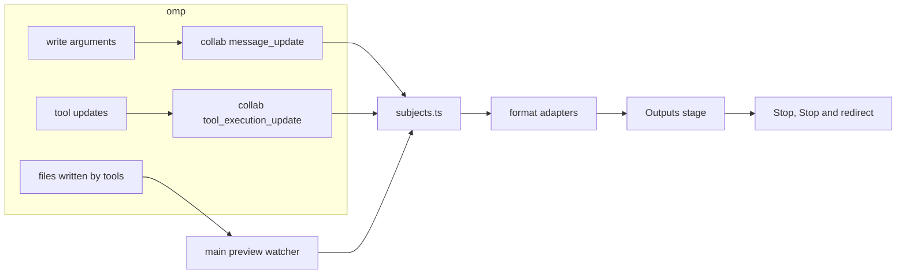

# visual-omp: live previews of visual outputs

Status: proposal for 0.7.6, written 2026-11-04 against `main` at `2f6256f` (0.7.5) and omp 18.16.0, then revised after astra's review. The owner has not decided the open questions at the end. Nothing in this plan is implemented yet.

## Sources and citations

- **visual-omp** paths in backticks are relative to the repository root; renderer paths omit `src/renderer/src/`.
- **omp** citations come from two places on this machine. The installed omp is the 18.16.0 bundle (`~/node_modules/@oh-my-pi/pi-coding-agent/dist/cli.js`), which can only be searched for strings. The readable source next to it (`~/node_modules/@oh-my-pi/*/src`) reports version 17.3.4. Citations marked **[17.3.4]** come from that source and may differ in 18.16; citations marked **[18.16 bundle]** were checked by searching the bundle.
- **Claude Code** behavior comes from its published documentation: [Desktop application](https://code.claude.com/docs/en/desktop) and [Share session output as artifacts](https://code.claude.com/docs/en/artifacts).
- **Image token costs** come from Anthropic's [vision documentation](https://platform.claude.com/docs/en/build-with-claude/vision).
- `[INFERENCE]` marks an engineering conclusion that no source or probe has confirmed.

## Objective

When omp makes something visual (an SVG, a web page, a chart, a PDF, a slide deck, an image, a video), the person can watch it take shape and step in before omp finishes. A drift between the request and the output can then be corrected early, before a finished result has to be redone.

The preview adds no model requests: it renders data the app already receives and files omp already writes. Token savings are possible in two ways. The person can stop or redirect omp sooner, and for outputs that take long to render, omp can show a proof before the full render (see [Proofs](#proofs)). Neither is guaranteed to save tokens, because a stop that comes too late or a proof that is not needed still costs what it costs.

## What Claude Code does

- The Desktop app's Browser pane runs the project's dev server, and Claude checks its own changes there after each edit ("auto-verify"). Clicking an HTML, PDF or video path in the chat opens it in the same pane.
- Artifacts are pages Claude publishes from a session and publishes again as work continues; open viewers update in place, so a page can "fill in while a long task runs".

Both refresh at checkpoints: a saved file, a reload, a republish. The documentation does not describe rendering a file while the model is still writing it. visual-omp can do both, because omp's collab stream already gives the app each tool call's arguments while the model writes them.

## Background: where a visual exists while omp works

1. **Text the model writes is visible before the file exists.** Collab's `message_update` event carries the whole partial assistant message (`collab/wire/index.ts:234-235`), and the client replaces its stream with each one (`collab/lib/client.ts:514-517`). omp parses partial tool-call JSON as it arrives, so a `write` call's `path` and `content` grow in the renderer while the model writes them (`chat/friendly.ts:4`). omp parses the buffer again only after it grows by the larger of 256 bytes or 1/32 of its current length (`pi-utils/src/json-parse.ts:613-623` **[17.3.4]**), so the arguments the app sees lag the model's output by up to that amount.
2. **Files reach disk only when a tool runs.** `write` saves after its arguments are complete and the tool executes (`pi-coding-agent/src/tools/write.ts:393` **[17.3.4]**).
3. **Large frames are cut.** Collab caps each frame at 1 MiB. A frame over the cap has every string cut to its first 64 KiB, then to smaller sizes down to 64 bytes until it fits, and each cut ends with `…[N chars elided for collab session]` (`pi-coding-agent/src/collab/replication-shrink.ts:31,52-60` **[17.3.4]**; the marker is in the **[18.16 bundle]**). Every frame repeats the whole partial message, so a single `write` stops streaming its full content somewhere below 1 MiB. `[INFERENCE]` The message is serialized twice per frame (`message` and the event's `partial`), which puts the limit near 500 KiB.
4. **Running tools report progress.** bash and eval send output tails, eval also sends images per cell, edit sends per-file diffs and task sends helper progress (`pi-agent-core/src/agent-loop.ts:2533-2542`, `pi-coding-agent/src/tools/bash.ts:1460`, `pi-coding-agent/src/tools/eval.ts:499-505` **[17.3.4]**). The app already renders these from `partialResult` (`chat/transcript/ToolCard.tsx:115-124`).
5. **`generate_image` produces nothing until it finishes.** It never requests partial images (no `partial_images` in the **[18.16 bundle]**), and it saves to `os.tmpdir()/omp-image-<id>.<ext>` (`pi-coding-agent/src/tools/image-gen.ts:710-716` **[17.3.4]**).
6. **The person can already stop or redirect.** Stop sends an abort request for the turn (`state/session.ts:973-975`), and queued messages can resume once work ends (`state/session.ts:1431-1447`). Send now steers the running turn (`chat/composer/send.ts:55-66`). omp checks for a queued steer when a tool batch starts and skips tools that have not started, then gives the model the steer (`pi-agent-core/src/agent-loop.ts:2364-2375,2420-2440,2638-2700` **[17.3.4]**). `[INFERENCE]` A steer sent while the model is still writing a `write` call therefore discards that write once the model finishes it, and the model still spends the output tokens for the rest of the content. Phase 1 confirms this, and the abort behavior, against the installed omp before any UI text describes them (see [Acting on drift](#acting-on-drift)).
7. **What the app shows today:**
   - The `write` card draws `.svg` and `.mmd` content with `DiagramPreview`, only while the card is expanded (`tool-render/tools/write.tsx:68-72`). A partial SVG fails to parse until the call is complete, because the card does not use the existing `closePartialSvg` repair (`ui/charts/vendor/omp/svg-source.ts:94`) that streamed replies use (`ui/rich-content.ts:10`).
   - Outputs lists images, PDFs and files from finished tool results (`chatOutputs` in `features/panes/derive.ts:883`), so nothing appears while a call runs. For commands, main scans the paths a finished call named, two levels deep, and skips folders that are too broad, such as the file system root, its direct children, home and temporary folders (`scanMadeFiles` and `isBroadFolder` in `src/main/services/panes.ts:318-341`).
   - `panes:thumbnail` returns one operating-system thumbnail of an image or of a PDF's first page (`src/shared/contracts/panes.ts:53`).
   - Files reads a file again when git reports a change (`features/panes/FilesPane.tsx:330-360`). The only general watcher is the git watcher, which sends no paths and only runs in git repositories (`src/main/git/watch.ts`).
   - Preview opens local and `https:` pages in a sandboxed iframe and relies on the dev server to reload (`features/panes/PreviewPane.tsx:124`). Main blocks top-level navigation and new windows (`src/main/index.ts:87-91`) but has no rule for navigation inside frames.
   - There is no custom protocol for local files. Images and PDFs reach the renderer over IPC as data or Blob URLs, with 2 MiB text and 8 MiB image caps (`src/main/services/panes.ts:7-8`). The renderer's CSP allows inline styles and `https:` images and blocks inline scripts (`src/renderer/index.html:7`).

## Four sources of progress

Each format gets its preview from one or more of these sources, preferring the earliest one available.

1. **The source as omp writes it.** When the file's text is the visual (SVG, HTML, Mermaid, Markdown, CSV), the app renders the streamed `write` content and repairs the incomplete end. This adds no model requests, updates whenever omp sends newly parsed arguments, and shows drift earliest: a wrong layout or palette is visible after the first few elements. Rendering still uses the person's CPU, which the throttle in [Renderer modules](#renderer-modules) bounds.
2. **What a running program produces.** When a script makes the output (plots, PDFs from LaTeX or reportlab, slides, video), the app shows the tool's own updates (eval images, output tails with parsed progress) and the files that change on disk during the call.
3. **The request.** For generators whose work is invisible until they return (`generate_image`, image or video APIs called from scripts), the earliest artifact is the prompt and its parameters. The app shows them while omp writes them, so a wrong subject or aspect ratio can be stopped before omp sends the request.
4. **Proofs omp makes on purpose.** For outputs that only exist at the end or take long to render (a video, a 40-page report, a deck, a generated image), omp can make a cheaper proof first: the first page, a few key frames, a low-resolution draft. This needs omp's cooperation, which the app requests through an omp skill in Phase 2.

## Format matrix

Phase 1 is the 0.7.6 proposal; later phases are described in [Phasing](#phasing).

| Output | How omp usually makes it | Sources | What the person sees before it finishes | Renderer | Phase |
|---|---|---|---|---|---|
| SVG (icons, logos, illustrations, charts) | `write` | 1 | Shapes appear as each element closes | `closePartialSvg`, then `sanitizeSvg` into an `` (both exist) | 1 |
| Mermaid diagrams | `write` of `.mmd` | 1 | The latest version that parses, redrawn as statements complete | `mermaid-render.ts` (exists) | 1 |
| HTML and CSS (pages, emails, HTML slides, single-file prototypes) | `write`, then a browser for checks | 1, then 2 | The page builds from the top with its styles and project images; no scripts run | A `vomp-preview:` document with scripts off | 1 (static), 2 (scripts after saving) |
| Markdown documents | `write` | 1 | The formatted document as written | Transcript Markdown renderer (exists) | 1 |
| CSV and TSV tables | `write` or a script | 1, 2 | Rows as written, with the existing numeric chart under the table | Table and chart from reply rendering (exists) | 1 |
| Python plots (matplotlib, seaborn, plotly static export) | eval or bash | 2 | Each figure as its cell displays it, and saved image files as they change | eval partial images (exists in cards), image refresh | 1 |
| Raster images from scripts (Pillow, sharp, ImageMagick, canvas posters, GIF and APNG) | bash or eval | 2 | The image after each save that stays unchanged long enough to read | Zoom view with refresh on change | 1 |
| Generated images | `generate_image` | 3, later 2 | Prompt, model, size and count while omp writes them; partial frames once omp reports them | Request card; progressive image after an omp change | 1 (request), 3 (partials) |
| PDF (LaTeX, Typst, reportlab, WeasyPrint, Chromium print) | bash compile | 2, later 4 | The new PDF after each valid save or compile | Chromium's PDF viewer through a Blob URL (exists) | 1 (refresh), 2 (first-page proofs) |
| Word documents (DOCX) | python-docx, pandoc | 2, 4 | The document after each save | `docx-preview` (new, lazy) or a PDF from LibreOffice when installed | 2 |
| Spreadsheets (XLSX) | openpyxl, SheetJS | 2 | Sheets after each save, read-only | SheetJS grid (new, lazy) | 2 |
| Slide decks (PPTX) | python-pptx, pptxgenjs | 2, 4 | Slide thumbnails after each save; a proof of the first slides before the rest | A PDF from LibreOffice when installed; otherwise the slide images omp renders for its own checks | 2 |
| Video (Remotion, ffmpeg, manim, Motion Canvas) | bash render | 2, 4 | Frames rendered out of the total, parsed from the output; key frames or a contact sheet before the full render; the finished video | `<video>` from `vomp-preview:` with range requests; progress parsers per tool | 2 |
| Graphviz DOT | `write` of the source, then a CLI | 1 with a bundled renderer, otherwise 2 | The graph as written | `@hpcc-js/wasm` (new, lazy) | 3 |
| D2 and PlantUML | `write` of the source, then a CLI | 2 | The SVG or PNG the CLI saves | Image refresh; an in-app renderer is unresolved | 3 |
| 3D models (glTF, GLB, STL, OBJ) | scripts, CAD tools | 2 | The model after each save, with orbit controls | three.js viewer (new, lazy) | 3 |
| Web apps on a dev server | `write`/`edit` plus a dev server | 2 | The Preview pane with the dev server's hot reload | Preview pane (exists) | Unchanged |

Audio playback and waveform or spectrogram previews are outside this proposal.

## Design

### Where the preview appears

- **Outputs gains an "In progress" stage** above its existing sections. It appears while omp is making a visual and shows one output at a time, large. Other outputs from the same turn appear as chips above the stage.
- **The stage shows** the render, a status line ("Writing poster.svg · 42 KB", "Rendering · frame 120 of 300", "Compiling report.tex") and these actions: **Stop**, **Stop and redirect**, Open in Files, and **Expand preview** (`ArrowsOut`) for images and PDFs, reusing the Files pane's full-window layer (DESIGN §3.7).
- **Tool cards** for visual outputs get a Watch action (`Eye`) that opens that chat's Outputs at the stage. Collapsed cards keep their current height, so the transcript does not move while a preview updates.
- **Settings › General** gains "Show visual outputs while omp makes them" (default on) and "Open Outputs when omp starts a visual output" (default an owner decision, see [Open questions](#open-questions-for-the-owner)).
- The side panel keeps its per-chat state and the Outputs badge keeps its rules (DESIGN §3.7): in-progress outputs count the same way new outputs count today.

### Stage behavior

- **Selection.** The stage follows the newest output until the person picks one, then stays on that output while others update. Picking the newest chip returns to following.
- **End states.** When a subject ends, the stage keeps its last frame and labels it "Saved", "Stopped", "Failed" (the tool reported an error) or "Skipped" (omp skipped the call for a steer). Only saved subjects join Created, Written or Changed. A saved subject offers "Show in Outputs", which scrolls to its entry. The stage stays until the person closes it or a new subject starts while nothing is selected, so the preview being reviewed never disappears by itself.
- **Ordering.** Each render carries the subject's revision. A result for an older revision is dropped, and when a render finishes the stage starts the newest pending revision, so the last revision always renders.
- **Narrow panel.** At the side panel's 320px minimum and at large text sizes, chip labels truncate in the middle with a maximum width, Stop stays visible, and Stop and redirect, Open in Files and Expand preview move into a `DotsThree` menu.
- **Reduced motion.** Frames replace each other without transitions.

### Acting on drift

- **Stop** sends the existing abort request for the turn (`state/session.ts:973-975`). It stops the whole turn, including other tool calls in it. It cannot undo writes that already finished, and it cannot recall a provider request omp already sent, so a `generate_image` call that started still finishes or fails at the provider. `[INFERENCE]` omp records the aborted assistant message with `stopReason: "aborted"` and does not run its tool calls (`pi-agent-core/src/agent-loop.ts:1239-1272` **[17.3.4]**), so a `write` stopped while streaming saves nothing.
- **Stop and redirect** works in four steps:
  1. It holds the queue with the session's existing hold, so no queued message is sent while the person writes the correction.
  2. It sends the abort and shows "Stopping…" until omp reports that the turn ended.
  3. It inserts `About <file name>: ` at the start of the composer's draft and focuses it. Text and attachments already in the draft stay.
  4. It releases the hold when the person sends a message or presses Escape. If omp does not confirm the stop within 10 seconds, the stage shows "omp did not stop", releases the hold and offers Stop again.
- **Send now** keeps working as it does today. Its effect on a streaming `write` (Background item 6) is described in the UI only after a scripted probe confirms it against the installed omp.
- **Attach this frame** (Phase 2) adds what the stage shows to the draft as a PNG, so omp can see what the person saw. Main captures the stage's visible rectangle with `webContents.capturePage`, which works the same for SVG, HTML, PDF pages and video frames and produces a format the composer accepts (`chat/composer/send.ts:18` lists PNG, JPEG, GIF and WebP). A raster image whose file is one of those formats attaches the file itself. An attached image costs input tokens: on Claude models, after any resizing the model requires, `⌈width / 28⌉ × ⌈height / 28⌉` visual tokens, 1,521 for a 1,092 × 1,092 image. Stop and redirect therefore sends text unless the person attaches a frame.

### Renderer modules

A new `features/live-preview/` feature, loaded lazily with `lazyView` so the entry chunk stays within `scripts/guard-renderer-bundle.mjs`:

- `subjects.ts` is a pure function from the chat snapshot (`stream`, `activeTools`, `backgroundTools`, recent entries) and watcher events to `LiveSubject[]`:
  `{ id, kind: "source" | "file" | "request" | "progress", format, path?, text?, revision, state: "writing" | "running" | "saved" | "stopped" | "failed" | "skipped", elided, progress?: { done, total, unit } }`.
  It matches formats by path extension and tool name, detects the collab elision marker and switches an elided subject to its file once the tool runs.
- `formats/*.ts` holds one adapter per format with `match(subject)` and `render(subject, previous)`. Heavy adapters (Mermaid, and later DOCX, XLSX, DOT and 3D) load with `import()`, as Mermaid does today. An adapter that fails on a partial input keeps the last frame that rendered.
- `progress.ts` parses progress from output tails: ffmpeg `frame=` and `time=` against the input duration, Remotion's rendered-frame counts, manim's animation counts and LaTeX's page counts.
- `Stage.tsx` limits renders to 8 per second for SVG and Mermaid and 4 per second for HTML and coalesces updates that arrive while a render runs, as described in [Stage behavior](#stage-behavior).
- Independently of the stage, `tool-render/tools/write.tsx` repairs partial SVG with `closePartialSvg` while the call runs, so an expanded card shows the drawing as it grows.

### HTML previews

All HTML previews, streaming and saved, load from `vomp-preview:` documents whose policy main sets. A `srcdoc` or `blob:` document would inherit the renderer's own CSP, and the renderer would have to widen that policy for project stylesheets and fonts, so the plan keeps the renderer's policy as it is apart from the additions listed below.

- **Address.** Each subject's document has one address, `vomp-preview://<token>/<path from the asset root>?rev=<revision>`. While omp writes the file, the renderer sends the latest partial text to main (at most 4 times a second) and main answers that address from memory; after the write runs, main answers it from the saved file. Because the address keeps the file's own folder, relative references such as `./style.css` resolve exactly as they would on disk, and those requests go through the same grant checks as any other.
- **Updates.** Two iframes alternate: the next revision replaces the visible one only after it has loaded, so the page does not flash blank on every update.
- **Policy.** Every HTML response carries this CSP as a response header, so it applies before any content is parsed:
  `default-src 'none'; script-src 'none'; style-src 'unsafe-inline' vomp-preview:; img-src vomp-preview: data: blob:; font-src vomp-preview: data:; media-src vomp-preview:; connect-src 'none'; frame-src 'none'; child-src 'none'; worker-src 'none'; object-src 'none'; manifest-src 'none'; form-action 'none'; base-uri 'self'`.
  Pages therefore load stylesheets, images and fonts from granted files and inline sources only, and make no network requests.
- **Sandbox.** The iframe has `sandbox=""` in Phase 1, for streaming and saved pages alike, which blocks scripts, forms, popups and top-level navigation and gives the page an opaque origin.
- **Navigation inside the frame.** A sandboxed frame can still navigate itself through a link or a `<meta http-equiv="refresh">`. Main handles `will-frame-navigate` for the window: it permits a load that the app's own document starts (the navigation's initiator is the main frame) to the subject's own address, which covers each new revision and the switch to the saved file, and it cancels every navigation the preview page starts. A link the person clicks offers Open in browser through the app's existing external-link handler instead.
- **Phase 2 scripts.** After saving, a page may run its scripts with `sandbox="allow-scripts"` (still without `allow-same-origin`) and `script-src 'unsafe-inline' vomp-preview:`. Network access stays blocked unless the person allows it (an owner decision).
- **What a page can reach.** A preview page can read every file its token grants, and nothing else. Grants are narrow for that reason (see the protocol below).

### Main-process additions

- **`vomp-preview:` protocol**, registered as privileged (standard, secure, stream, fetch) and served with `protocol.handle`.
  - Each preview subject gets its own random token, and main decides its grants from what omp did, never from the page's content. When the subject's folder is not broad by the existing `isBroadFolder` rule (root, its direct children, home and temporary folders), that folder and its subfolders are the asset root. When it is broad, the token grants the subject's file plus files that omp's tool calls in the same turn wrote or named by path; references to anything else stay unavailable, and the stage says that some assets are not shown.
  - Main resolves each request's path against the subject's folder, rejects any path that leaves the asset root or the granted files (including `..` segments and encoded separators), resolves the result with `realpath` and checks it again against the grants, so a symlink cannot reach outside them.
  - Main serves regular files only and caps reads (2 MiB for HTML, CSS and SVG, 8 MiB for images, ranges only for video and audio).
  - Tokens are revoked when the stage closes the subject, the chat closes or the window reloads.
  - Responses send `Access-Control-Allow-Origin: *` for fonts, which the opaque-origin frame loads in CORS mode, and support `Range` for video in Phase 2.
- **Renderer CSP** adds `vomp-preview:` to `frame-src`, `img-src` and `media-src`. `style-src` and `font-src` stay as they are, because preview documents carry their own policy.
- **Preview watcher** (`src/main/features/preview.ts`, contract in `src/shared/contracts/preview.ts`): `preview:watch` and `preview:unwatch`, reference counted like `git:watch`.
  - **Scope.** It watches the chat's folder when that folder is not broad by the `isBroadFolder` rule. New chats default to a temporary folder, which is broad, so for those chats and for home or root folders it watches only the files and folders that running tool calls name. The same rule applies to a named folder: a broad folder a tool call names (`/tmp` or `/`, for example) is never watched recursively, and only the files the call names inside it are watched. It also watches omp's local artifact folder for the session.
  - **Subscriptions.** On macOS and Windows, a recursive `fs.watch` is one operating-system subscription per root, so the watcher filters events and skips `.git`, `node_modules` and git-ignored paths. `[INFERENCE]` On Linux, Node implements recursive watching with one inotify watch per directory, including ignored ones, so there the watcher walks the tree itself, subscribes only to directories it keeps and stops at 2,000 directories, falling back to named paths.
  - **Named outputs win.** A path a running call names in its arguments or output (the same extraction Outputs uses for finished calls, DESIGN §3.7) is watched and reported even inside a git-ignored folder such as `dist/` or `build/`.
  - **Events.** It keeps an allowlist of visual extensions, debounces for 250 ms, reports a file only after its size and modification time are unchanged across two checks 150 ms apart, and broadcasts `preview:changed { folder, path, size, mtimeMs }`.
  - **Lifecycle.** It starts when a turn starts and the setting is on, stays while background jobs that the turn started still run, and stops after one final debounced read once the turn and its jobs end.
  - **Attribution.** `subjects.ts` assigns an event to the running call that named the path, or else to the call whose time window covers it. Events nobody named are best-effort discovery: another program writing in the same folder can appear in the stage, labelled with its file name only.

### Large and fast output

- When the elision marker appears in a streamed string, the stage stops rendering that stream and says "This file is too large to preview while omp writes it. The preview continues when omp saves it." It switches to the saved file when the tool runs.
- Collab already sends the whole partial message in every frame; the preview adds no frames. The added cost is the format render, which the throttle bounds. `sanitizeSvg` already refuses sources over 1,000,000 characters (`ui/diagram-source.ts:56-57`).
- A file that fails to decode keeps the previous frame, and the status line says "Waiting for omp to finish saving".

### Proofs

Proofs are Phase 2.

- visual-omp ships a small omp skill, `visual-proofs`, and writes it to omp's user skill folder (`~/.omp/agent/skills/visual-proofs/SKILL.md`), where omp's own discovery finds it and Settings › Skills lists it (`src/main/features/skills/fixtures/list-all.json` shows that folder as a native source). A setting, "Ask omp for a proof before long renders", adds or removes the skill.
- **Ownership.** The file visual-omp writes carries a `managed-by: visual-omp` field in its frontmatter. visual-omp never overwrites or deletes a file at that path without the field; if a person's own skill uses the name, the setting says so and stays off.
- **Content.** The skill asks omp, before an output that takes long to render or costs credits (video, documents of many pages, decks, generated images, 3D), to make a proof first and save it in a `proofs/` folder beside the output, which the watcher previews:
  - the first page or first two slides;
  - three to five key frames as stills (Remotion `still`, ffmpeg `-frames:v 1` at chosen times);
  - a low-resolution or low-quality draft of a generated image.
- **Pause.** When the setting's "Wait for my answer" option is on, the skill also asks omp to call its `ask` tool after the proof ("The proof is ready. Continue with the full render?"), which the app already shows as a question card.
- **Limits.** A skill requests behavior; omp's model decides whether to follow it, so proofs are not an enforced approval gate. A draft from an image provider may itself be charged and may differ from the final image generated from the same prompt.

### omp upstream requests

The app does not need these for Phase 1. Following the wrapper-first rule, they are requests for omp:

1. `generate_image` could request `partial_images` from OpenAI's image tool and report each partial through the `onUpdate` parameter its `execute` already receives (`pi-coding-agent/src/tools/image-gen.ts:1101` **[17.3.4]**). The app would then show progressive frames through `tool_execution_update`, as it does for eval images. Providers without partial images would keep today's behavior.
2. Collab could throttle `message_update` frames, or send argument deltas, while a large tool argument streams. That would lower the per-frame cost described in Background item 3 for every client, including the transcript.

## Phasing

**Phase 1, proposed for 0.7.6**
- A scripted probe against the installed omp that confirms Stop and Send now behavior during a streaming `write` (Background item 6).
- The Outputs stage with the behavior above, the settings and the Watch action on tool cards.
- Streaming sources for SVG, Mermaid, static HTML, Markdown and CSV, with elision handling.
- eval images, plus image and PDF files from bash and eval through the preview watcher. PDFs refresh after each valid save or compile.
- The `generate_image` request card.
- Stop and Stop and redirect.
- The `vomp-preview:` protocol and navigation guard for HTML previews, with scripts off.
- `closePartialSvg` in the `write` card.
- `[INFERENCE]` About 7 to 10 engineer-days, with the protocol, its security tests and the watcher as the largest parts.

**Phase 2**: video (range requests, progress parsers, contact sheets), DOCX, XLSX, PPTX, scripts in saved HTML, Attach this frame, and the `visual-proofs` skill with first-page and key-frame proofs.

**Phase 3**: Graphviz DOT, D2 and PlantUML, 3D models, and progressive `generate_image` frames once omp reports them.

### Phase 1 acceptance

1. During the scripted SVG fixture, the stage begins rendering the newest available revision within 250 ms whenever no render is running. Intermediate revisions may be coalesced, and the final revision renders and matches the saved file.
2. Mermaid shows the latest version that parses; Markdown and CSV render as written.
3. Streaming and saved HTML draw their styles, fonts and project images, run no scripts and make no network requests, checked in the DevTools network log with a page that references a remote image, font, stylesheet and `fetch` target.
4. In an HTML preview, clicking a link, a `<meta http-equiv="refresh">` and a form submission all leave the frame on its preview address.
5. The protocol refuses `..`, encoded separators, symlinks that leave the grant, folders, files over the caps and revoked tokens. For a subject in a broad folder, a page reference to a file omp did not write or name in that turn stays unavailable, including through `../` and through a symlink.
6. A bash call whose Python script saves a PNG three times, each save at least one second after the previous one and complete before the next starts, shows three successive images.
7. A LaTeX compile that rewrites a PDF updates the stage after each compile.
8. `generate_image` shows its prompt while omp writes it, and Stop before the call executes means no provider request is sent.
9. Stop and redirect keeps an existing draft and its attachments, sends no queued message before the person sends or presses Escape, and recovers when omp does not confirm the stop.
10. A streamed file over the collab frame limit shows the size note, then the saved file.
11. In a new chat in a temporary folder, the watcher subscribes only to named paths, and a tool call that names `/tmp` or `/` itself starts no recursive watch.
12. Turning the setting off stops the watcher, closes the stage and leaves Outputs as it is today.
13. TSP and classic chats behave the same, because both take the transcript from collab.
14. At the 320px panel width with the largest text size, Stop and the preview remain visible.
15. The renderer entry chunk stays within the bundle guard; every format adapter loads lazily.

### Verification

- Unit tests for `subjects.ts` (partial arguments to subjects, format matching, elision, end states, attribution), the progress parsers, the watcher's scope and filter, and the protocol's grant checks.
- A scripted provider fixture kept in the repository that streams a long SVG and an HTML page slowly, driven in a development build, with screenshots of the stage mid-stream and after the save.

## Risks

- **Recursive watching of large folders.** Mitigated by the broad-folder rule, named paths for temporary chats, per-directory subscriptions with a cap on Linux, and watching only during turns.
- **Path traversal through the protocol.** Mitigated by per-subject tokens, narrow grants, `realpath` checks, regular-file checks and read caps, with the tests in acceptance item 5.
- **Render cost during long streams.** Mitigated by the throttle, coalescing and keeping the last good frame.
- **Partially written binary files.** Mitigated by the stability check and the decode fallback.

## Open questions for the owner

astra's recommendation follows each question.

1. Should Outputs open by itself when omp starts a visual output? Recommendation: off by default, with Watch opening it explicitly, because opening it automatically replaces the pane the person is using and can take over the main area at narrow widths.
2. Should proofs be on by default, and should a proof wait for an answer? Recommendation: opt-in, waiting for an answer before an expensive render, accepting the added latency and the cost of the proof itself.
3. May a saved HTML page reach the network after the person allows it? Recommendation: blocked by default, with a per-page permission in Phase 2.
4. Is Phase 1 the right scope for 0.7.6? Recommendation: yes, accepting that video and Office formats get no new progress view until Phase 2 and that PDFs update only after a valid save or compile.
5. Are lazy-loaded dependencies acceptable for Phase 2 and 3 formats (`docx-preview`, SheetJS, `@hpcc-js/wasm`, three.js)?
6. Should PPTX previews use LibreOffice when it is installed? visual-omp would never install it.
