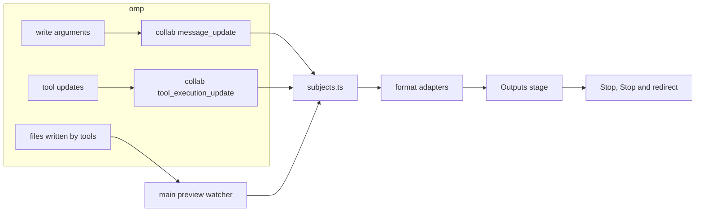

# visual-omp: live previews of visual outputs

Status: plan for 0.7.6, written 2026-11-04 against `main` at `2f6256f` (0.7.5) and omp 18.16.0, then revised after astra's review. On 2026-11-04 the owner accepted astra's recommendations on every open question (see [Owner decisions](#owner-decisions)) and asked for Phase 1 to be built. Phase 1 was implemented the same day; where it differs from this plan, the difference is noted in place. Phase 2 slices A1, B, C and E have implementation notes below; the remaining Phase 2 work and Phase 3 are not implemented.

## Sources and citations

- **visual-omp** paths in backticks are relative to the repository root; renderer paths omit `src/renderer/src/`.
- **omp** citations come from two places on this machine. The installed omp is the 18.16.0 bundle (`~/node_modules/@oh-my-pi/pi-coding-agent/dist/cli.js`), which can only be searched for strings. The readable source next to it (`~/node_modules/@oh-my-pi/*/src`) reports version 17.3.4. Citations marked **[17.3.4]** come from that source and may differ in 18.16; citations marked **[18.16 bundle]** were checked by searching the bundle.
- **Claude Code** behavior comes from its published documentation: [Desktop application](https://code.claude.com/docs/en/desktop) and [Share session output as artifacts](https://code.claude.com/docs/en/artifacts).
- **Image token costs** come from Anthropic's [vision documentation](https://platform.claude.com/docs/en/build-with-claude/vision).
- `[INFERENCE]` marks an engineering conclusion that no source or probe has confirmed.

## Objective

When omp makes something visual (an SVG, a web page, a chart, a PDF, a slide deck, an image, a video), the person can watch it take shape and step in before omp finishes. A drift between the request and the output can then be corrected early, before a finished result has to be redone.

The preview adds no model requests: it renders data the app already receives and files omp already writes. Token savings are possible in two ways. The person can stop or redirect omp sooner, and for outputs that take long to render, omp can show a proof before the full render (see [Proofs](#proofs)). Neither is guaranteed to save tokens, because a stop that comes too late or a proof that is not needed still costs what it costs.

Saved HTML file viewing is also available in the Files pane independently of live tracking. Opening an HTML or HTM file uses the same lazy adapter, narrowly granted local assets and opaque-origin sandbox. Preview is the default, Source retains the existing code viewer, and Open in browser retains a trust confirmation. The viewer states that scripts and network access are off. Phase 2's script and network permissions remain gated by its isolation and exfiltration acceptance criteria.

The external action selects the default HTTPS browser explicitly on macOS, Windows and Linux. If it cannot resolve a supported browser command, the trust confirmation explains that the fallback uses the HTML file association, which may select an editor.

## What Claude Code does

- The Desktop app's Browser pane runs the project's dev server, and Claude checks its own changes there after each edit ("auto-verify"). Clicking an HTML, PDF or video path in the chat opens it in the same pane.
- Artifacts are pages Claude publishes from a session and publishes again as work continues; open viewers update in place, so a page can "fill in while a long task runs".

Both refresh at checkpoints: a saved file, a reload, a republish. The documentation does not describe rendering a file while the model is still writing it. visual-omp can do both, because omp's collab stream already gives the app each tool call's arguments while the model writes them.

## Background: where a visual exists while omp works

1. **Text the model writes is visible before the file exists.** Collab's `message_update` event carries the whole partial assistant message (`collab/wire/index.ts:234-235`), and the client replaces its stream with each one (`collab/lib/client.ts:514-517`). omp parses partial tool-call JSON as it arrives, so a `write` call's `path` and `content` grow in the renderer while the model writes them (`chat/friendly.ts:4`). omp parses the buffer again only after it grows by the larger of 256 bytes or 1/32 of its current length (`pi-utils/src/json-parse.ts:613-623` **[17.3.4]**), so the arguments the app sees lag the model's output by up to that amount.
2. **Files reach disk only when a tool runs.** `write` saves after its arguments are complete and the tool executes (`pi-coding-agent/src/tools/write.ts:393` **[17.3.4]**).
3. **Large frames are cut.** Collab caps each frame at 1 MiB. A frame over the cap has every string cut to its first 64 KiB, then to smaller sizes down to 64 bytes until it fits, and each cut ends with `…[N chars elided for collab session]` (`pi-coding-agent/src/collab/replication-shrink.ts:31,52-60` **[17.3.4]**; the marker is in the **[18.16 bundle]**). Every frame repeats the whole partial message, so a single `write` stops streaming its full content somewhere below 1 MiB. `[INFERENCE]` The message is serialized twice per frame (`message` and the event's `partial`), which puts the limit near 500 KiB.
4. **Running tools report progress.** bash and eval send output tails, eval also sends images per cell, edit sends per-file diffs and task sends helper progress (`pi-agent-core/src/agent-loop.ts:2533-2542`, `pi-coding-agent/src/tools/bash.ts:1460`, `pi-coding-agent/src/tools/eval.ts:499-505` **[17.3.4]**). The app already renders these from `partialResult` (`chat/transcript/ToolCard.tsx:115-124`).
5. **`generate_image` produces nothing until it finishes.** It never requests partial images (no `partial_images` in the **[18.16 bundle]**), and it saves to `os.tmpdir()/omp-image-<id>.<ext>` (`pi-coding-agent/src/tools/image-gen.ts:710-716` **[17.3.4]**).
6. **The person can already stop or redirect.** Stop sends an abort request for the turn (`state/session.ts:973-975`), and queued messages can resume once work ends (`state/session.ts:1431-1447`). Send now steers the running turn (`chat/composer/send.ts:55-66`). A probe of the installed omp 18.16.0 in RPC mode (`scripts/live-preview-fixture/README.md`, evidence beside it) established what each does while the model is still writing a `write` call. An abort ends the message with `stopReason: "aborted"` and "Interrupted by user", drops the incomplete call from the saved message and runs no tool, so no file is saved. A steer is acknowledged, but the model finishes the arguments, the write runs and saves the file, and omp handles the steer afterwards. The 17.3.4 source suggested that omp skips tools that have not started when a steer is queued (`pi-agent-core/src/agent-loop.ts:2364-2375,2420-2440` **[17.3.4]**); 18.16 does not skip this write. Stop is therefore the only control that saves the remaining output tokens of a streaming write. The probe used RPC; that the app's collab and TSP paths behave the same is `[INFERENCE]`.
7. **What the app shows today:**
   - The `write` card draws `.svg` and `.mmd` content with `DiagramPreview`, only while the card is expanded (`tool-render/tools/write.tsx:68-72`). A partial SVG fails to parse until the call is complete, because the card does not use the existing `closePartialSvg` repair (`ui/charts/vendor/omp/svg-source.ts:94`) that streamed replies use (`ui/rich-content.ts:10`).
   - Outputs lists images, PDFs and files from finished tool results (`chatOutputs` in `features/panes/derive.ts:883`), so nothing appears while a call runs. For commands, main scans the paths a finished call named, two levels deep, and skips folders that are too broad, such as the file system root, its direct children, home and temporary folders (`scanMadeFiles` and `isBroadFolder` in `src/main/services/panes.ts:318-341`).
   - `panes:thumbnail` returns one operating-system thumbnail of an image or of a PDF's first page (`src/shared/contracts/panes.ts:53`).
   - Files reads a file again when git reports a change (`features/panes/FilesPane.tsx:330-360`). The only general watcher is the git watcher, which sends no paths and only runs in git repositories (`src/main/git/watch.ts`).
   - Preview opens local and `https:` pages in a sandboxed iframe and relies on the dev server to reload (`features/panes/PreviewPane.tsx:124`). Main blocks top-level navigation and new windows (`src/main/index.ts:87-91`) but has no rule for navigation inside frames.
   - There is no custom protocol for local files. Images and PDFs reach the renderer over IPC as data or Blob URLs, with 2 MiB text and 8 MiB image caps (`src/main/services/panes.ts:7-8`). The renderer's CSP allows inline styles and `https:` images and blocks inline scripts (`src/renderer/index.html:7`).

## Four sources of progress

Each format gets its preview from one or more of these sources, preferring the earliest one available.

1. **The source as omp writes it.** When the file's text is the visual (SVG, HTML, Mermaid, Markdown, CSV), the app renders the streamed `write` content and repairs the incomplete end. This adds no model requests, updates whenever omp sends newly parsed arguments, and shows drift earliest: a wrong layout or palette is visible after the first few elements. Rendering still uses the person's CPU, which the throttle in [Renderer modules](#renderer-modules) bounds.
2. **What a running program produces.** When a script makes the output (plots, PDFs from LaTeX or reportlab, slides, video), the app shows the tool's own updates (eval images, output tails with parsed progress) and the files that change on disk during the call.
3. **The request.** For generators whose work is invisible until they return (`generate_image`, image or video APIs called from scripts), the earliest artifact is the prompt and its parameters. The app shows them while omp writes them, so a wrong subject or aspect ratio can be stopped before omp sends the request.
4. **Proofs omp makes on purpose.** For outputs that only exist at the end or take long to render (a video, a 40-page report, a deck, a generated image), omp can make a cheaper proof first: the first page, a few key frames, a low-resolution draft. This needs omp's cooperation, which the app requests through an omp skill in Phase 2.

## Format matrix

Phase 1 is the 0.7.6 proposal; later phases are described in [Phasing](#phasing).

| Output | How omp usually makes it | Sources | What the person sees before it finishes | Renderer | Phase |
|---|---|---|---|---|---|
| SVG (icons, logos, illustrations, charts) | `write` | 1 | Shapes appear as each element closes | `closePartialSvg`, then `sanitizeSvg` into an `` (both exist) | 1 |
| Mermaid diagrams | `write` of `.mmd` | 1 | The latest version that parses, redrawn as statements complete | `mermaid-render.ts` (exists) | 1 |
| HTML and CSS (pages, emails, HTML slides, single-file prototypes) | `write`, then a browser for checks | 1, then 2 | The page builds from the top with its styles and project images; no scripts run | A `vomp-preview:` document with scripts off | 1 (static), 2 (scripts after saving) |
| Markdown documents | `write` | 1 | The formatted document as written | Transcript Markdown renderer (exists) | 1 |
| CSV and TSV tables | `write` or a script | 1, 2 | Rows as written, with the existing numeric chart under the table | Table and chart from reply rendering (exists) | 1 |
| Python plots (matplotlib, seaborn, plotly static export) | eval or bash | 2 | Each figure as its cell displays it, and saved image files as they change | eval partial images (exists in cards), image refresh | 1 |
| Raster images from scripts (Pillow, sharp, ImageMagick, canvas posters, GIF and APNG) | bash or eval | 2 | The image after each save that stays unchanged long enough to read | Zoom view with refresh on change | 1 |
| Generated images | `generate_image` | 3, later 2 | The subject, model, aspect ratio and image size while omp writes them; partial frames once omp reports them | Request card; progressive image after an omp change | 1 (request), 3 (partials) |
| PDF (LaTeX, Typst, reportlab, WeasyPrint, Chromium print) | bash compile | 2, later 4 | The new PDF after each valid save or compile | Chromium's PDF viewer through a Blob URL (exists) | 1 (refresh), 2 (first-page proofs) |
| Word documents (DOCX) | python-docx, pandoc | 2, 4 | The document after each save | `docx-preview` (new, lazy) or a PDF from LibreOffice when installed | 2 |
| Spreadsheets (XLSX) | openpyxl, SheetJS | 2 | Sheets after each save, read-only | SheetJS grid (new, lazy) | 2 |
| Slide decks (PPTX) | python-pptx, pptxgenjs | 2, 4 | Slide thumbnails after each save; a proof of the first slides before the rest | A PDF from LibreOffice when installed; otherwise the slide images omp renders for its own checks | 2 |
| Video (Remotion, ffmpeg, manim, Motion Canvas) | bash render | 2, 4 | Frames rendered out of the total, parsed from the output; key frames or a contact sheet before the full render; the finished video | `<video>` from `vomp-preview:` with range requests; progress parsers per tool | 2 |
| Graphviz DOT | `write` of the source, then a CLI | 1 with a bundled renderer, otherwise 2 | The graph as written | `@hpcc-js/wasm` (new, lazy) | 3 |
| D2 and PlantUML | `write` of the source, then a CLI | 2 | The SVG or PNG the CLI saves | Image refresh; an in-app renderer is unresolved | 3 |
| 3D models (glTF, GLB, STL, OBJ) | scripts, CAD tools | 2 | The model after each save, with orbit controls | three.js viewer (new, lazy) | 3 |
| Web apps on a dev server | `write`/`edit` plus a dev server | 2 | The Preview pane with the dev server's hot reload | Preview pane (exists) | Unchanged |

Audio playback and waveform or spectrogram previews are outside this proposal.

## Design

### Where the preview appears

- **Outputs gains an "In progress" stage** above its existing sections. It appears while omp is making a visual and shows one output at a time, large. Other outputs from the same turn appear as chips above the stage.
- **The stage shows** the render, a status line ("Writing poster.svg · 42 KB", "Rendering · frame 120 of 300", "Compiling report.tex") and these actions: **Stop**, **Stop and redirect**, Open in Files, and **Expand preview** (`ArrowsOut`) for images and PDFs, reusing the Files pane's full-window layer (DESIGN §3.7).
- **Tool cards** for visual outputs get a Watch action (`Eye`) that opens that chat's Outputs at the stage. Collapsed cards keep their current height, so the transcript does not move while a preview updates.
- **Settings › General** gains "Show visual outputs while omp makes them" (default on) and "Open Outputs when omp starts a visual output" (default off, see [Owner decisions](#owner-decisions)).
- The side panel keeps its per-chat state and the Outputs badge keeps its rules (DESIGN §3.7): in-progress outputs count the same way new outputs count today.

### Stage behavior

- **Selection.** The stage follows the newest output until the person picks one, then stays on that output while others update. Picking the newest chip returns to following.
- **End states.** When a subject ends, the stage keeps its last frame and labels it "Saved", "Stopped", "Failed" (the tool reported an error) or "Skipped" (omp skipped the call for a steer). Only saved subjects join Created, Written or Changed. A saved subject offers "Show in Outputs", which scrolls to its entry. The stage stays until the person closes it or a new subject starts while nothing is selected, so the preview being reviewed never disappears by itself.
- **Ordering.** Each render carries the subject's revision. A result for an older revision is dropped, and when a render finishes the stage starts the newest pending revision, so the last revision always renders.
- **Narrow panel.** At the side panel's 320px minimum and at large text sizes, chip labels truncate in the middle with a maximum width, Stop stays visible, and Stop and redirect, Open in Files and Expand preview move into a `DotsThree` menu.
- **Reduced motion.** Frames replace each other without transitions.

### Acting on drift

- **Stop** sends the existing abort request for the turn (`state/session.ts:973-975`). It stops the whole turn, including other tool calls in it. It cannot undo writes that already finished, and it cannot recall a provider request omp already sent, so a `generate_image` call that started still finishes or fails at the provider. `[INFERENCE]` omp records the aborted assistant message with `stopReason: "aborted"` and does not run its tool calls (`pi-agent-core/src/agent-loop.ts:1239-1272` **[17.3.4]**), so a `write` stopped while streaming saves nothing.
- **Stop and redirect** works in four steps:
  1. It holds the queue with the session's existing hold, so no queued message is sent while the person writes the correction.
  2. It sends the abort and shows "Stopping…" until omp reports that the turn ended.
  3. It inserts `About <file name>: ` at the start of the composer's draft and focuses it. Text and attachments already in the draft stay.
  4. It releases the hold when the person sends a message or presses Escape. If omp does not confirm the stop within 10 seconds, the stage shows "omp did not stop", releases the hold and offers Stop again.
- **Send now** keeps working as it does today. The stage does not describe it, because during a streaming `write` it does not stop the write (Background item 6).
- **Attach this frame** (Phase 2) adds what the stage shows to the draft as a PNG, so omp can see what the person saw. Main captures the stage's visible rectangle with `webContents.capturePage`, which works the same for SVG, HTML, PDF pages and video frames and produces a format the composer accepts (`chat/composer/send.ts:18` lists PNG, JPEG, GIF and WebP). A raster image whose file is one of those formats attaches the file itself. An attached image costs input tokens: on Claude models, after any resizing the model requires, `⌈width / 28⌉ × ⌈height / 28⌉` visual tokens, 1,521 for a 1,092 × 1,092 image. Stop and redirect therefore sends text unless the person attaches a frame.

### Renderer modules

A new `features/live-preview/` feature, loaded lazily with `lazyView` so the entry chunk stays within `scripts/guard-renderer-bundle.mjs`:

- `subjects.ts` is a pure function from the chat snapshot (`stream`, `activeTools`, `backgroundTools`, recent entries) and watcher events to `LiveSubject[]`:
  `{ id, kind: "source" | "file" | "request" | "images", format, path, text, revision, state: "writing" | "running" | "saved" | "stopped" | "failed" | "skipped", elided, request, images, size }` (`features/live-preview/types.ts`).
  It matches formats by path extension and tool name, detects the collab elision marker and switches an elided subject to its file once the tool runs.
- `formats/*.tsx` holds one adapter per format, each a `LiveAdapter` with its `maxFps` and a `Frame` component, loaded with `import()` through `loadAdapter`. An adapter that fails on a partial input keeps the last frame that rendered.
- `progress.ts` (Phase 2) parses progress from output tails: ffmpeg `frame=` and `time=` against the input duration, Remotion's rendered-frame counts, manim's animation counts and LaTeX's page counts. Phase 1's status line shows omp's intent line instead.
- `Stage.tsx` limits renders to 8 per second for SVG and Mermaid and 4 per second for HTML and coalesces updates that arrive while a render runs, as described in [Stage behavior](#stage-behavior).
- Independently of the stage, `tool-render/tools/write.tsx` repairs partial SVG with `closePartialSvg` while the call runs, so an expanded card shows the drawing as it grows.

### HTML previews

All HTML previews, streaming and saved, load from `vomp-preview:` documents whose policy main sets. A `srcdoc` or `blob:` document would inherit the renderer's own CSP, and the renderer would have to widen that policy for project stylesheets and fonts, so the plan keeps the renderer's policy as it is apart from the additions listed below.

- **Address.** Each subject's document has one address, `vomp-preview://<token>/<path from the asset root>?rev=<revision>`. While omp writes the file, the renderer sends the latest partial text to main (at most 4 times a second) and main answers that address from memory; after the write runs, main answers it from the saved file. Because the address keeps the file's own folder, relative references such as `./style.css` resolve exactly as they would on disk, and those requests go through the same grant checks as any other.
- **Updates.** Two iframes alternate: the next revision replaces the visible one only after it has loaded, so the page does not flash blank on every update. Before loading a revision, the renderer asks main to prepare it (`preview:prepare`): main reads the document once, from live text or disk, under the same grant, containment and size checks as a request, and keeps that exact copy. The iframe's request for that revision receives the prepared copy, so a file that disappears or grows between the check and the load cannot replace the preview with an error page. Main keeps the two newest prepared revisions per token and drops them when the token is revoked. When preparation fails, the visible frame stays with "Waiting for omp to finish saving". Stylesheets, images and fonts the page references are still read from disk under the grant.
- **Policy.** Every HTML response carries this CSP as a response header, so it applies before any content is parsed:
  `default-src 'none'; script-src 'none'; style-src 'unsafe-inline' vomp-preview:; img-src vomp-preview: data: blob:; font-src vomp-preview: data:; media-src vomp-preview:; connect-src 'none'; frame-src 'none'; child-src 'none'; worker-src 'none'; object-src 'none'; manifest-src 'none'; form-action 'none'; base-uri 'self'`.
  Pages therefore load stylesheets, images and fonts from granted files and inline sources only, and make no network requests.
- **Sandbox.** The iframe has `sandbox=""` in Phase 1, for streaming and saved pages alike, which blocks scripts, forms, popups and top-level navigation and gives the page an opaque origin.
- **Navigation inside the frame.** A sandboxed frame can still navigate itself through a link or a `<meta http-equiv="refresh">`. Main handles `will-frame-navigate` for the window: it permits a load that the app's own document starts (the navigation's initiator is the main frame) to the subject's own address, which covers each new revision and the switch to the saved file, and it cancels every navigation the preview page starts. A link the person clicks offers Open in browser through the app's existing external-link handler instead.
- **Phase 2 scripts.** After saving, a page may run its scripts with `sandbox="allow-scripts"` (still without `allow-same-origin`) and `script-src 'unsafe-inline' vomp-preview:`. Network access stays blocked unless the person allows it for that page.
- **What a page can reach.** A preview page can read every file its token grants, and nothing else. Grants are narrow for that reason (see the protocol below).

### Main-process additions

- **`vomp-preview:` protocol**, registered as privileged (standard, secure, stream, fetch) and served with `protocol.handle`.
  - Each preview subject gets its own random token, and main decides its grants from what omp did, never from the page's content. The asset root is the chat's folder when the subject is inside it and that folder is not broad by the existing `isBroadFolder` rule (root, its direct children, home and temporary folders), so a page in `site/` can use `../assets/`; otherwise it is the subject's own folder when that is not broad. When both are broad, the token grants the subject's file plus files that omp's tool calls in the same turn wrote or named by path; references to anything else stay unavailable, and the stage shows "Some assets may be unavailable. This preview can load only files named in this turn."
  - Main resolves each request's path against the asset root (or the subject's folder when there is none), rejects any path that leaves it or the granted files (including `..` segments and encoded separators), resolves the result with `realpath` and checks it again against the grants, so a symlink cannot reach outside them.
  - Main serves regular files only and caps reads (2 MiB for HTML, CSS, SVG and text, 8 MiB for images, 32 MiB for PDFs, ranges only for video and audio).
  - Tokens are revoked when the stage closes the subject, the chat closes or the window reloads.
  - Only WOFF, WOFF2, TTF and OTF font responses send `Access-Control-Allow-Origin: *`, which the opaque-origin frame needs for font loads in CORS mode. HTML documents, stylesheets and images load without CORS permission; SVG images do too. Image subjects load through the app document's `` elements without `crossorigin`, and PDF subjects use `panes:readPdf` and the app's Blob viewer, so neither needs the header. Refused requests have no CORS permission. Phase 2 adds `Range` support for video and reviews CORS for any new resource types.
- **Renderer CSP** adds `vomp-preview:` to `frame-src`, `img-src` and `media-src`. `style-src` and `font-src` stay as they are, because preview documents carry their own policy.
- **Preview watcher** (`src/main/services/preview-watch.ts`, registered by `src/main/features/preview.ts`, contract in `src/shared/contracts/preview.ts`): `preview:watch`, `preview:watchNamed` and `preview:unwatch`, owned by the window that asked, which closes its watches when it reloads or exits.
  - **Scope.** It watches the chat's folder when that folder is not broad by the `isBroadFolder` rule. New chats default to a temporary folder, which is broad, so for those chats and for home or root folders it watches only the files and folders that running tool calls name. The same rule applies to a named folder: a broad folder a tool call names (`/tmp` or `/`, for example) is never watched recursively, and only the files the call names inside it are watched. A named path that does not exist yet is followed from its nearest existing folder, non-recursively, and its scope is promoted once it appears, so a command that names `/tmp/new-output/plot.png` before creating `new-output` is still seen. Watching omp's local artifact folder for the session is left for Phase 2.
  - **Subscriptions.** On macOS and Windows, a recursive `fs.watch` is one operating-system subscription per root, so the watcher filters events and skips `.git`, `node_modules` and git-ignored paths. `[INFERENCE]` On Linux, Node implements recursive watching with one inotify watch per directory, including ignored ones, so there the watcher walks the tree itself, subscribes only to directories it keeps and stops at 2,000 directories, falling back to named paths.
  - **Named outputs win.** A path a running call names in its arguments or output (the same extraction Outputs uses for finished calls, DESIGN §3.7) is watched and reported even inside a git-ignored folder such as `dist/` or `build/`.
  - **Events.** It keeps an allowlist of visual extensions, debounces for 250 ms, reports a file only after its size and modification time are unchanged across two checks 150 ms apart, and broadcasts `preview:changed { watchId, path, size, mtimeMs }`. Paths keep the spelling the renderer gave, so on macOS a save under `/tmp` is reported as `/tmp/...` rather than `/private/tmp/...` and matches the path omp's call named.
  - **Lifecycle.** It starts when a turn starts and the setting is on, stays while background jobs that the turn started still run, and stops after one final debounced read once the turn and its jobs end. Replacing the named paths during a turn subscribes to the new paths at once and keeps the retiring ones until their pending reads finish, so neither a call's last save nor a save in a newly named folder is lost when the next call starts at once.
  - **Attribution.** `subjects.ts` assigns an event to the running call that named the path, or else to the call whose time window covers it. The save of a file a `write` call streamed stays in that write's subject, so the stage does not list the same file twice. Events nobody named are best-effort discovery: another program writing in the same folder can appear in the stage, labelled with its file name only.

### Large and fast output

- When the elision marker appears in a streamed string, the stage stops rendering that stream and says "This file is too large to preview while omp writes it. The preview continues when omp saves it." It switches to the saved file when the tool runs.
- Collab already sends the whole partial message in every frame; the preview adds no frames. The added cost is the format render, which the throttle bounds. `sanitizeSvg` already refuses sources over 1,000,000 characters (`ui/diagram-source.ts:56-57`).
- A file that fails to decode keeps the previous frame, and the status line says "Waiting for omp to finish saving".

### Proofs

Implemented in Phase 2 slice E for 0.7.8.

- visual-omp ships the `visual-proofs` skill in `src/main/services/visual-proofs.ts`. Settings > General offers "Ask omp for a proof before long renders", off by default. Turning it on writes `<omp agent directory>/skills/visual-proofs/SKILL.md`; turning it off removes that managed file. The existing `ompAgentDir()` resolver honors `PI_CODING_AGENT_DIR`, profiles and omp's configured layout. omp's normal discovery loads the skill, and Settings > Skills & plugins lists and reads it through the existing skill service. Start a new chat or restart omp in an existing chat to load skill changes.
- **Ownership.** The file carries `managed-by: visual-omp` and `managed-version: 1` in its frontmatter. An unmarked file is left unchanged and reported as a conflict, with the preference off. Writes use a temporary file; a managed replacement is renamed atomically, and an absent target is published with an atomic no-clobber link so a new personal file cannot be overwritten. Only the marked file is deleted, leaving neighboring files alone. Linked skill files and linked skill directories are refused. When the preference is on, startup repairs a missing file or an older managed version and preserves newer versions.
- **Availability.** The existing skill service applies omp's native user-source and name filters. Disabled skills or source settings, excluded names and unreadable configuration or files are reported beside the switch. Enabling proofs does not change omp's own skill settings.
- **Content.** Before an output that takes long to render or costs credits, the skill requests the cheapest useful proof saved in `proofs/` beside the intended output: the first page, the first two slides, three to five representative key frames (Remotion `still` or ffmpeg `-ss <t> -frames:v 1`), or a low-resolution draft. omp prints each proof's absolute path for the watcher.
- **Pause.** The wait is mandatory in the skill. After saving the proof, omp calls `ask` with "The proof is ready. Continue with the full render?" and Yes and No options. It continues only after an explicit Yes. No, cancellation, interruption, a missing answer or a timeout means no full render. The skill forbids starting that work in parallel or in the background while the question waits.
- **Limits.** omp's model decides whether to follow a skill, so this requests behavior rather than enforcing an approval boundary. The setting explains that the proof costs tokens and possibly provider credits. A paid proof needs permission first, and a final generated image may differ from its draft.

The deterministic `fixture proof` saves `proofs/frame-1.png`, asks the question, and runs the six-second ffmpeg render only after Yes. `node scripts/live-preview-fixture/proof-probe.mjs` checked the shipped skill against omp 18.16.0 in an isolated agent directory: its native user listing had no warnings and honored `PI_CODING_AGENT_DIR`. In headless `rpc-ui --no-ui`, both answers encountered the question only after the PNG existed, and the full video remained absent during a one-second wait. No ended with `bash, ask`; Yes completed with `bash, ask, bash` and a video. This checks the tool protocol, without establishing the Electron question card or Windows behavior. The fixture README gives the Windows Electron procedure.

### omp upstream requests

The app does not need these for Phase 1. Following the wrapper-first rule, they are requests for omp:

1. `generate_image` could request `partial_images` from OpenAI's image tool and report each partial through the `onUpdate` parameter its `execute` already receives (`pi-coding-agent/src/tools/image-gen.ts:1101` **[17.3.4]**). The app would then show progressive frames through `tool_execution_update`, as it does for eval images. Providers without partial images would keep today's behavior.
2. Collab could throttle `message_update` frames, or send argument deltas, while a large tool argument streams. That would lower the per-frame cost described in Background item 3 for every client, including the transcript.

## Phasing

**Phase 1, proposed for 0.7.6**
- A scripted probe against the installed omp that establishes Stop and Send now behavior during a streaming `write` (done; Background item 6).
- The Outputs stage with the behavior above, the settings and the Watch action on tool cards.
- Streaming sources for SVG, Mermaid, static HTML, Markdown and CSV, with elision handling.
- eval images, plus image and PDF files from bash and eval through the preview watcher. PDFs refresh after each valid save or compile.
- The `generate_image` request card.
- Stop and Stop and redirect.
- The `vomp-preview:` protocol and navigation guard for HTML previews, with scripts off.
- `closePartialSvg` in the `write` card.
- `[INFERENCE]` About 7 to 10 engineer-days, with the protocol, its security tests and the watcher as the largest parts.

**Phase 2**: video (range requests, progress parsers, contact sheets), DOCX, XLSX, PPTX, scripts in saved HTML, Attach this frame, and the `visual-proofs` skill with first-page and key-frame proofs. Its implementation plan, revised after astra's review, is [`LIVE-PREVIEW-PHASE2.md`](LIVE-PREVIEW-PHASE2.md). Slice A1 is complete as a Phase 1 fix: only WOFF, WOFF2, TTF and OTF responses carry the cross-origin header. The next security prerequisite is a blocking investigation of process isolation for script-running frames. Watching omp's local artifact folder moves to Phase 3.

#### Phase 2 shared contract and video

Implemented on 2026-11-05 for 0.7.8:

- Each preview grant owns a `PreviewPolicy`; `preview:prepare` returns its scripts-off and network-off values. The response table owns MIME types, read limits and CORS rules.
- MP4 and M4V (`video/mp4`), WebM and MOV use a streamed file handle under the existing containment, inode and `O_NOFOLLOW` checks. Whole-file GETs return `200`; single explicit, suffix and open-ended byte ranges return `206`. Only open-ended ranges are limited to 8 MiB. Invalid, multiple and unsatisfiable ranges return `416`; HEAD returns the same headers without a body. Request abort, response cancellation and grant revocation close the stream and its handle.
- Recognized ffmpeg, Remotion, manim, LaTeX and Blender commands become render subjects before a stable file appears. Progress uses tool output only; missing totals remain unknown. The ffmpeg, Remotion and manim samples in `scripts/live-preview-fixture/samples/` are captured, versioned output. A stable save replaces the render subject without changing its identity.
- Only frame patterns declared by recognized commands form sequences. The watcher reports the newest stable matching image and the current frame count; unrelated numbered images remain separate. Manim's `partial_movie_files` directories are excluded.
- The lazy video adapter uses muted, inline native playback controls. Failed saves keep the last playable revision; an unsupported codec offers Open in Files. A separate video seeks six evenly spaced times and draws display-only canvases. Clicking a key frame seeks the player. Stale video and contact-sheet work is discarded.

The integration owner must still exercise playback, seeking, unsupported ProRes, native protocol responses, stream revocation and the 320 px layout in Electron on Windows 11 ARM64. The fixture README provides the exact steps. Unit tests and headless browser checks do not establish Electron's codec support or custom-scheme range behavior. The video fixture's ffmpeg command creates an incomplete output file when rendering starts, so the check is advancing progress before the completed video is available, rather than a claim that no filesystem entry exists.

#### Phase 2 Office previews

DOCX, XLSX and PPTX saves are discovered by the same turn-scoped watcher. Main returns only a validated, at-most-32-MiB ZIP snapshot under the owning subject's grant. The shared validator rejects unsafe paths, encrypted packages, ZIP64 and oversized declarations; workers also count actual inflated bytes, bound each entry and verify CRCs.

DOCX removes external relationships, field instructions and active embedded parts before the document renderer runs. External images become placeholder text, while safe hyperlinks are mapped through inert anchors. The detached rendered document is sanitized again before it is attached inside a shadow root. Links are intercepted through the app's external-link action. `renderAsync` itself cannot abort, so document renders are serialized and stale work never attaches.

XLSX is read-only. SheetJS 0.20.3 from its pinned CDN tarball parses in a worker with formula and HTML output disabled. The worker keeps the workbook and sends formatted cell text for a small visible window, limited to 100,000 rows, 200 columns and 1,000 characters per cell. The grid virtualizes both rows and columns without another UI library. A newer revision terminates the previous worker; incomplete saves keep the last frame.

PPTX conversion requires an already-installed LibreOffice. visual-omp never installs it. Main rewrites a validated snapshot in a bounded worker, rejects macros, removes external relationship targets and writes that snapshot into a private revision directory. One headless converter runs at a time with a private security profile, closed-loopback proxies, a 60-second timeout and 32-MiB input/output caps. Newer requests supersede queued conversions, and a newer revision cancels the same subject's active conversion. Revoking the grant cancels its work and deletes its output.

Without LibreOffice, the stage explains the requirement and lists image file subjects discovered in the same turn, without widening the subject's asset grant. The fixture README includes exact Windows Electron acceptance and scratch LibreOffice setup. LibreOffice conversion, its no-network behavior, packaged worker loading, native PDF display and Windows process-tree termination still require that manual acceptance; unit stubs do not establish those results.

**Phase 3**: Graphviz DOT, D2 and PlantUML, 3D models, and progressive `generate_image` frames once omp reports them.

### Phase 1 acceptance

1. During the scripted SVG fixture, the stage begins rendering the newest available revision within 250 ms whenever no render is running. Intermediate revisions may be coalesced, and the final revision renders and matches the saved file.
2. Mermaid shows the latest version that parses; Markdown and CSV render as written.
3. Streaming and saved HTML draw their styles, fonts and project images, run no scripts and make no network requests, checked in the DevTools network log with a page that references a remote image, font, stylesheet and `fetch` target.
4. In an HTML preview, clicking a link, a `<meta http-equiv="refresh">` and a form submission all leave the frame on its preview address.
5. The protocol refuses `..`, encoded separators, symlinks that leave the grant, folders, files over the caps and revoked tokens. For a subject in a broad folder, a page reference to a file omp did not write or name in that turn stays unavailable, including through `../` and through a symlink.
6. A bash call whose Python script saves a PNG three times, each save at least one second after the previous one and complete before the next starts, shows three successive images.
7. A LaTeX compile that rewrites a PDF updates the stage after each compile.
8. `generate_image` shows its subject while omp writes it, and Stop before the call executes means no provider request is sent.
9. Stop and redirect keeps an existing draft and its attachments, sends no queued message before the person sends or presses Escape, and recovers when omp does not confirm the stop.
10. A streamed file over the collab frame limit shows the size note, then the saved file.
11. In a new chat in a temporary folder, the watcher subscribes only to named paths, and a tool call that names `/tmp` or `/` itself starts no recursive watch.
12. Turning the setting off stops the watcher, closes the stage and leaves Outputs as it is today.
13. TSP and classic chats behave the same, because both take the transcript from collab.
14. At the 320px panel width with the largest text size, Stop and the preview remain visible.
15. The renderer entry chunk stays within the bundle guard; every format adapter loads lazily.

### Verification

- Unit tests for `subjects.ts` (partial arguments to subjects, format matching, elision, end states, attribution), the progress parsers, the watcher's scope and filter, and the protocol's grant checks.
- A scripted provider fixture kept in the repository that streams a long SVG and an HTML page slowly, driven in a development build, with screenshots of the stage mid-stream and after the save.

### Phase 2 process isolation evidence (A2)

The fixture's `--isolation` launch option sets `VOMP_PREVIEW_ISOLATION_TEST=1` in main and names one absolute `VOMP_PREVIEW_ISOLATION_FILE`. Only a prepared, saved revision of that file receives inline-script permission and `sandbox="allow-scripts"`. Its origin stays opaque and the remaining scripts-off CSP stays unchanged, including the network restrictions. Streaming HTML, other files and normal launches retain Phase 1's policy. No page or IPC request can enable the startup switch. The switch also starts loopback-only main and renderer inspectors and applies the scratch app profile to packaged builds.

Main pins the fixture's canonical parent directory and basename at startup, before the file needs to exist. It rejects later symlink retargeting and checks the opened document's path and inode identity before enabling scripts in a prepared snapshot. The evidence collector requires an explicit fixture root and validates its marker, the main process's isolated paths and the app's actual profile. A random challenge written through that verified main process must be read back over renderer CDP before page interaction or cleanup is allowed.

Follow the [packaged isolation procedure](../scripts/live-preview-fixture/README.md#collect-packaged-process-isolation-evidence) in a Windows VM, then repeat on macOS after hours. Start `isolation-evidence.mjs` before sending `fixture isolation` and choosing Watch. It records the preview's `webFrameMain` identity and OS process ID alongside the app frame, app metrics before and after loading, and the busy loop's start. It then uses renderer CDP to insert text into the composer for 10 seconds. Each measured latency is a conservative upper bound from dispatching `Input.insertText` through reading the changed textarea value, and every sample must be at most 100 ms. The collector closes the stage and requires the busy PID to disappear or stay at or below 1 percent CPU for three consecutive one-second samples. A failed close is recorded before any JavaScript-termination recovery. The collector never activates or raises a window.

Evidence is written to `scripts/live-preview-fixture/evidence/isolation/win32.json` and `darwin.json`. Failed or incomplete runs write their errors and fail closed. This collection does not replace A3's network-channel checks.

| Packaged platform | App OS PID | Preview OS PID | Composer echo | Stage close and idle | Evidence |
|---|---|---|---|---|---|
| Windows | Pending | Pending | Pending | Pending | Pending |
| macOS | Pending | Pending | Pending | Pending | Pending |

**Decision: pending.** Slice F may use script-enabled iframes only when both packaged platforms have distinct OS process IDs and pass responsiveness, close and idle checks. Otherwise it uses the WebContentsView fallback in the approved Phase 2 plan. No runtime isolation result has been recorded by this implementation.

## Risks

- **Recursive watching of large folders.** Mitigated by the broad-folder rule, named paths for temporary chats, per-directory subscriptions with a cap on Linux, and watching only during turns.
- **Path traversal through the protocol.** Mitigated by per-subject tokens, narrow grants, `realpath` checks, regular-file checks and read caps, with the tests in acceptance item 5.
- **Render cost during long streams.** Mitigated by the throttle, coalescing and keeping the last good frame.
- **Partially written binary files.** Mitigated by the stability check and the decode fallback.

## Owner decisions

The owner accepted astra's recommendation on each question on 2026-11-04.

1. **Opening Outputs.** "Open Outputs when omp starts a visual output" is a setting, off by default. The Watch action opens Outputs explicitly. Opening it automatically would replace the pane the person is using and can take over the main area at narrow widths.
2. **Proofs.** Opt-in, and a proof waits for the person's answer before an expensive render, accepting the added latency and the cost of the proof itself (Phase 2).
3. **Network access from HTML previews.** Blocked by default, with a per-page permission in Phase 2.
4. **Scope for 0.7.6.** Phase 1 as listed in [Phasing](#phasing). Video and Office formats get no new progress view until Phase 2, and PDFs update only after a valid save or compile.
5. **Dependencies.** Lazy-loaded renderers (`docx-preview`, SheetJS, `@hpcc-js/wasm`, three.js) are acceptable for Phases 2 and 3. PPTX previews use LibreOffice only when it is already installed; visual-omp never installs it.
