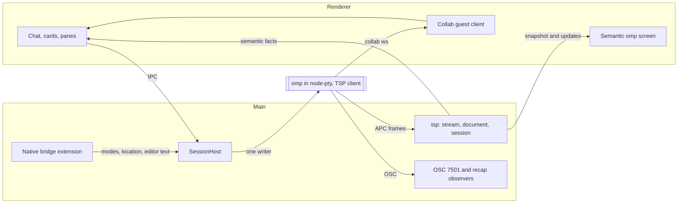

# visual-omp: moving app-hosted chats to TSP plus collab

Status: proposed migration. Written 2026-10-30 against visual-omp `main` at `da5e968` (0.7.2) and omp 18.14.0, then revised after astra's review. It describes intended changes; `docs/ARCHITECTURE.md` and `docs/SPEC.md` remain the description of current behavior until each phase ships.

## Sources and citations

- **omp** links point at tag `v18.14.0` (commit `31147f9d1a76608549821c3759f8487b4d66c72d`) of `can1357/oh-my-pi`, MIT licensed.
- **studio** links point at commit `4dbe037dc3bda4c37e831625450225cf102267d7` of `DawnJson/omp-studio`, MIT licensed. Its `docs/architecture/tsp-migration.md` records a desktop app that has completed a move to TSP. Its findings are labeled as studio observations, made against omp 18.12.3 to 18.14.0, and are evidence for this plan rather than guarantees about visual-omp.
- **visual-omp** paths in backticks are relative to the repository root.
- **The TSP study** is an investigation of omp 18.14.0 made on 2026-10-30. It is not committed; the findings this plan depends on are restated in the Background section, each with an upstream link or the probe that produced it.
- `[INFERENCE]` marks an engineering conclusion that no source or probe has confirmed.

## Objective

Every app-hosted chat moves from reading omp's painted classic TUI to reading omp's Tern Surface Protocol (TSP) documents, with collab kept as the transcript, sharing and question channel. The plan ends with TSP as the default presentation and the classic screen adapters A2-A17 deleted. File-based terminal-follow for sessions owned by another process stays as it is.

Removing the painted terminal for hosted chats is the proposed consequence of the owner's direction ("use TSP, if it means rebuilding how visual-omp works, then so be it"). It is conditional: every place that opens the omp terminal today must have a working semantic replacement before the default changes.

## Background: what the TSP study established

**Activation and handshake.** omp starts TSP when `TERM_PROGRAM=tern` and the path can carry APC; `PI_TUI_NATIVE=0` forces classic rows ([`packages/tui/src/terminal.ts:59-88`](https://github.com/can1357/oh-my-pi/blob/v18.14.0/packages/tui/src/terminal.ts#L59-L88), [`docs/environment-variables.md:650-652`](https://github.com/can1357/oh-my-pi/blob/v18.14.0/docs/environment-variables.md?plain=1#L650-L652)). omp sends `ESC _ tsp;q;{"q":"hello","v":[1],"app":"omp","features":["edit","undo","send"]} ESC \` followed by a DA1 sentinel, and expects the TSP reply before the DA1 answer ([`packages/tui/src/native/encode.ts:136-151`](https://github.com/can1357/oh-my-pi/blob/v18.14.0/packages/tui/src/native/encode.ts#L136-L151), [`packages/tui/src/terminal.ts:1991-2028`](https://github.com/can1357/oh-my-pi/blob/v18.14.0/packages/tui/src/terminal.ts#L1991-L2028)). The reply lists the kinds and terminal features the client supports, an APC size limit, credits, columns and appearance ([`packages/wire/src/tsp.ts:993-1016`](https://github.com/can1357/oh-my-pi/blob/v18.14.0/packages/wire/src/tsp.ts#L993-L1016)). The program's own `features` list in the query (`edit`, `undo`, `send`) says which events omp accepts; it is a separate list from the client's terminal features. An optimistic start that is not confirmed within 1 second falls back to classic rows ([`packages/tui/src/tui.ts:1106`](https://github.com/can1357/oh-my-pi/blob/v18.14.0/packages/tui/src/tui.ts#L1106), [`packages/tui/src/tui.ts:1679`](https://github.com/can1357/oh-my-pi/blob/v18.14.0/packages/tui/src/tui.ts#L1679)).

**Framing and flow control.** Messages are `ESC _ tsp;<verb>[;<key>=<value>]*;<body> ESC \` with JSON bodies; program verbs are `q`, `o`, `f`, `b`, `x` and client verbs are `r` and `e` ([`packages/wire/src/tsp.ts:1-31`](https://github.com/can1357/oh-my-pi/blob/v18.14.0/packages/wire/src/tsp.ts#L1-L31)). Large messages are chunked with `c=<id>` and `m=1`, and a PTY read can split any sequence or UTF-8 code point ([`packages/tui/src/native/encode.ts:57-128`](https://github.com/can1357/oh-my-pi/blob/v18.14.0/packages/tui/src/native/encode.ts#L57-L128)). Each surface allows two unacknowledged frames by default; once credits are exhausted omp stops sending frames, and after 5 seconds without an acknowledgment it logs a warning and resumes without credits ([`packages/wire/src/tsp.ts:25-28`](https://github.com/can1357/oh-my-pi/blob/v18.14.0/packages/wire/src/tsp.ts#L25-L28), [`packages/tui/src/native/backend.ts:557-571`](https://github.com/can1357/oh-my-pi/blob/v18.14.0/packages/tui/src/native/backend.ts#L557-L571)).

**Documents.** A node is `{id, k, p?, c?}`. A surface has regions `main`, `dock` and `layer`, and frames carry ordered operations (`add`, `set`, `text`, `splice`, `move`, `del`, `settle`, `focus`, `reveal`, `scroll`, `suspend`, `resume`) ([`packages/wire/src/tsp.ts:935-991`](https://github.com/can1357/oh-my-pi/blob/v18.14.0/packages/wire/src/tsp.ts#L935-L991)). omp ships a reference applier used by its tests and debug path ([`packages/tui/src/native/apply.ts:1-10`](https://github.com/can1357/oh-my-pi/blob/v18.14.0/packages/tui/src/native/apply.ts#L1-L10)). The 18.14 vocabulary has 44 kinds ([`packages/wire/src/tsp.ts:37-83`](https://github.com/can1357/oh-my-pi/blob/v18.14.0/packages/wire/src/tsp.ts#L37-L83)), including `editor` with exact text, cursor, ghost suffix and `sendable` ([`packages/wire/src/tsp.ts:393-417`](https://github.com/can1357/oh-my-pi/blob/v18.14.0/packages/wire/src/tsp.ts#L393-L417)), `overlay`, `toast` and the `rows` fallback of pre-rendered ANSI lines ([`packages/wire/src/tsp.ts:437-452`](https://github.com/can1357/oh-my-pi/blob/v18.14.0/packages/wire/src/tsp.ts#L437-L452)), and the data-first `picker` and `prefs` ([`packages/wire/src/tsp.ts:455-686`](https://github.com/can1357/oh-my-pi/blob/v18.14.0/packages/wire/src/tsp.ts#L455-L686)). Components without a semantic description become `rows` ([`packages/tui/src/native/reconcile.ts:937-949`](https://github.com/can1357/oh-my-pi/blob/v18.14.0/packages/tui/src/native/reconcile.ts#L937-L949)).

**Events.** The client sends `ack`, `resize`, `theme`, `motion`, `visible`, `toggle`, `select`, `activate`, `action`, `change`, `edit`, `undo`, `send`, `focus`, `error` and `gone` ([`packages/wire/src/tsp.ts:1019-1066`](https://github.com/can1357/oh-my-pi/blob/v18.14.0/packages/wire/src/tsp.ts#L1019-L1066)). `send` and `undo` may be sent only when the program advertised them ([`packages/wire/src/tsp.ts:1043-1058`](https://github.com/can1357/oh-my-pi/blob/v18.14.0/packages/wire/src/tsp.ts#L1043-L1058)). `send` goes through the composer's ordinary submission path, saves a displaced draft for recall and waits for in-flight paste work ([`packages/tui/src/prompt/custom-editor.ts:1416-1427`](https://github.com/can1357/oh-my-pi/blob/v18.14.0/packages/tui/src/prompt/custom-editor.ts#L1416-L1427)); omp drops a `send` for a stale surface or a target that is not the live editor ([`packages/tui/src/native/backend.ts:828-833`](https://github.com/can1357/oh-my-pi/blob/v18.14.0/packages/tui/src/native/backend.ts#L828-L833)). Ordinary PTY keys remain valid input.

**Readiness.** `sendable` follows the editor's submit gate ([`packages/tui/src/components/editor.ts:1896-1909`](https://github.com/can1357/oh-my-pi/blob/v18.14.0/packages/tui/src/components/editor.ts#L1896-L1909), [`packages/tui/src/prompt/custom-editor.ts:1063-1071`](https://github.com/can1357/oh-my-pi/blob/v18.14.0/packages/tui/src/prompt/custom-editor.ts#L1063-L1071)). omp clears that gate during interactive initialization ([`packages/coding-agent/src/modes/interactive-mode.ts:2912`](https://github.com/can1357/oh-my-pi/blob/v18.14.0/packages/coding-agent/src/modes/interactive-mode.ts#L2912)) and only later may ask the startup worktree question ([`packages/coding-agent/src/main.ts:766-767`](https://github.com/can1357/oh-my-pi/blob/v18.14.0/packages/coding-agent/src/main.ts#L766-L767), [`packages/coding-agent/src/modes/interactive-mode.ts:8884-8897`](https://github.com/can1357/oh-my-pi/blob/v18.14.0/packages/coding-agent/src/modes/interactive-mode.ts#L8884-L8897)). The first `sendable: true` therefore does not prove outer startup is complete, which is why the hosted `worktree.onStart: off` override stays.

**No second screen.** While TSP is active, omp's native branch returns before the row renderer ([`packages/tui/src/tui.ts:1749-1759`](https://github.com/can1357/oh-my-pi/blob/v18.14.0/packages/tui/src/tui.ts#L1749-L1759), [`packages/tui/src/tui.ts:3879-3885`](https://github.com/can1357/oh-my-pi/blob/v18.14.0/packages/tui/src/tui.ts#L3879-L3885)). The xterm mirror and every adapter that reads painted rows stop working for a TSP host. Ordinary OSC output, including OSC 7501, continues.

**Collab beside TSP.** Collab attaches to session events and its own WebSocket without checking the renderer ([`packages/coding-agent/src/collab/host.ts:473-543`](https://github.com/can1357/oh-my-pi/blob/v18.14.0/packages/coding-agent/src/collab/host.ts#L473-L543)). A scratch probe confirmed the omp collab host connected to a loopback relay while TSP frames flowed. The probe did not establish a guest join: `omp collab list --json` returned no hosts in the isolated environment, so no decrypted guest snapshot was obtained. Sharing parity is therefore unproven. Collab-aware hook dialogs race the local dialog against the guest response, and either answer cancels the other ([`packages/coding-agent/src/modes/controllers/extension-ui-controller.ts:964-981`](https://github.com/can1357/oh-my-pi/blob/v18.14.0/packages/coding-agent/src/modes/controllers/extension-ui-controller.ts#L964-L981)). Collab carries no BTW records or commands ([`packages/coding-agent/src/collab/host.ts:84-114`](https://github.com/can1357/oh-my-pi/blob/v18.14.0/packages/coding-agent/src/collab/host.ts#L84-L114), [`packages/wire/src/index.ts:328-384`](https://github.com/can1357/oh-my-pi/blob/v18.14.0/packages/wire/src/index.ts#L328-L384)).

**Live probe.** With the installed omp 18.14.0 under a scratch HOME and no model, the probe observed: the hello query above, surface `s:1` opened with role `omp.session`, `["set","g.line/input",{"sendable":true}]`, a `send` of `/btw` that opened `layer.ov-k` with role `omp.overlay.btwHistory`, Escape closing it, and `/exit` producing an `omp.toast.status` node "Closing session…" before `x` closed the surface with `keep: true`. The node ids in that run were specific to it and must be read from the document each time. The raw capture was 5,503 bytes containing nine TSP messages; Phase 1 commits an equivalent capture as a fixture (see Rule 5).

**Windows.** node-pty 1.1.0 offers `useConptyDll`, marked experimental, to use its shipped `conpty.dll` instead of the system ConPTY (`node_modules/node-pty/typings/node-pty.d.ts:88-104`); visual-omp sets neither ConPTY option (`src/main/omp/host.ts:167-173`). studio observed that the system ConPTY drops APC output and that the bundled DLL passes it ([`docs/architecture/tsp-migration.md:28`](https://github.com/DawnJson/omp-studio/blob/4dbe037dc3bda4c37e831625450225cf102267d7/docs/architecture/tsp-migration.md?plain=1#L28), [`src/main/tsp/tsp-session.ts:87-99`](https://github.com/DawnJson/omp-studio/blob/4dbe037dc3bda4c37e831625450225cf102267d7/src/main/tsp/tsp-session.ts#L87-L99)). omp accepts client messages as APC or as OSC 877 because a ConPTY input parser discards APC ([`packages/tui/src/terminal.ts:48-54`](https://github.com/can1357/oh-my-pi/blob/v18.14.0/packages/tui/src/terminal.ts#L48-L54), [`packages/tui/src/terminal.ts:1706-1709`](https://github.com/can1357/oh-my-pi/blob/v18.14.0/packages/tui/src/terminal.ts#L1706-L1709)). No Windows run happened in the study.

### Adapter inventory

These are the visual-omp mechanisms that read the painted screen or drive it with keys, with the ids the rest of this plan uses. Renderer paths omit `src/renderer/src/`.

| Id | Location | What it does today |
|---|---|---|
| A1 | `src/main/omp/host.ts` (headless xterm, serializer, `host:data`, `host:buffer`, `PI_TUI_NATIVE=0`) | Mirrors every PTY byte into a headless xterm; OSC 7501 decoding is separate and stays. |
| A2 | `src/main/omp/tui-debug.ts`, `src/main/handlers.ts` | Polls omp's debug channel for focus, overlays, painted text and component state; sends debug keys. |
| A3 | `features/session-tools/screen.ts`, `status.ts` | Reads the status line for model and thinking; diffs rows for command output. |
| A4 | `features/session-tools/drive.ts` | Treats a painted editor border with no overlay as ready; types slash commands and waits for painted change. |
| A5 | `state/session.ts`, `host.ts` `submit`/`paste`/`withEditorInput` | Sends prompts as bracketed paste plus Enter or Ctrl+Q; holds the input lock for editor transactions. |
| A6 | `state/session.ts`, `features/session-tools/typed.ts`, `results.ts` | Derives queue holds from overlays; watches slash output until it settles; opens the terminal for unclaimed screens. |
| A7 | `features/palette/OverlayWatcher.tsx`, `overlays.ts` | Detects overlays by debug focus kinds and regex titles; auto-opens the terminal unless a native card claims the screen. |
| A8 | `features/palette/TerminalSheet.tsx`, `TerminalMirror.tsx` | The interactive omp terminal sheet. |
| A9 | `features/session-tools/ompDialog.ts`, `ompDialogActions.ts`, `OmpDialogCard.tsx` | Parses hook select, confirm, input and editor dialogs; answers with keys; defers to collab questions. |
| A10 | `features/session-tools/screen.ts`, `PlanReviewCard.tsx`, `features/panes/PlanPane.tsx` | Parses plan review and drives it with keys. |
| A11 | `features/session-tools/model.ts`, `pickers.tsx` | Types `/switch` after screen readiness; cycles thinking with Shift+Tab and reads the border; collab confirms identity. |
| A12 | `features/session-tools/navigate.ts`, `tree.ts`, `TreeSheet.tsx` | Predicts `/tree` row order, navigates with keys, clears the restored draft with Ctrl+C. |
| A13 | `features/session-tools/advisorApply.ts` | Drives `/advisor configure` with keys and reads the saved message. |
| A14 | `features/session-tools/modes.tsx`, `drive.ts`, `chat/composer/tools.tsx` | Reads painted feedback for rename, handoff, guided goal, compact, cleanse and export. |
| A15 | `src/main/omp/host-observations.ts`, `host.ts` shutdown | Matches the startup and exit worktree confirms; types `/exit` and reads "Closing session…" rows. |
| A16 | `host.ts`, `host-observations.ts` | Reads startup diagnostics above the editor from the headless buffer. |
| A17 | `src/main/omp/prediction-transfer.ts` | Finds the painted next-message prediction; Tab transfer and recovery use the extension API. |
| A18 | `state/session.ts`, `collab/lib/client.ts`, `src/main/omp/follow.ts` | Collab `ui-response`, `abort` and subagent commands; read-only JSONL follow. These are not screen adapters and stay. |

## Assumptions

- Phase 1 is fixed by the shared contract and is being built in a separate worktree. Later phases build on its modules and IPC names; where this plan names an interface, Phase 1's final names govern.
- omp 18.14.0 is the protocol baseline, matching `MIN_OMP_VERSION` in `src/main/omp/locate.ts`.
- Collab stays authoritative for the transcript replica, sharing, guest permissions, subagents, main-turn abort and replicated asks and approvals.
- The app keeps its own composer, transcript, cards and panes, and uses omp's documents for state and for a semantic screen. studio chose a similar hybrid ([`docs/architecture/tsp-migration.md:139`](https://github.com/DawnJson/omp-studio/blob/4dbe037dc3bda4c37e831625450225cf102267d7/docs/architecture/tsp-migration.md?plain=1#L139)). Decision D1 asks the owner to confirm it.
- omp defines its role strings, such as `omp.overlay.hook-select`, outside the TSP v1 wire contract, so they can change between omp releases ([`packages/wire/src/tsp.ts:14-18`](https://github.com/can1357/oh-my-pi/blob/v18.14.0/packages/wire/src/tsp.ts#L14-L18) cites the normative protocol, which does not define them).
- Every Windows statement is source or studio evidence until Phase 6 produces visual-omp's own.

## End state

Authority after the migration:

| Fact or action | Authority | Notes |
|---|---|---|
| Transcript, streaming text, tools, subagents, model and thinking identity, context usage | collab | Unchanged. |
| Chat status | Existing derivation in `docs/SPEC.md` (Sessions) | In order: waiting for an answer, an error reported by omp, working (omp's own turn), helpers working, open, saved. Collab supplies questions, turns and helpers; OSC 7501 supplies waiting and error text when collab has no matching question. TSP adds no status input unless a later SPEC change approves one (see Phase 4a). |
| Main-turn Stop | collab `abort` | Unchanged; never replaced by Escape. |
| Ask and approval answers replicated over collab | collab `ui-response` by `reqId` | One answer path per question; matching rule in Rule 7. |
| Sharing, guest permissions, custom endpoint confirmation | collab and main | Unchanged; covered by Phase 2 acceptance. |
| Work modes, cwd, session file, exact editor read and clear | native bridge extension | Unchanged. |
| Editor text, cursor, ghost text, `sendable` | TSP `editor` node | Replaces A4, part of A5, A17 detection. |
| Local hook dialogs, plan review, pickers, prefs, overlays, toasts, TSP-only notices, shutdown notice | TSP document | Replaces A6-A16 screen reading. |
| `/btw` live answers | TSP `omp.overlay.btwHistory`, reconciled with `btw-history/` sidecar files | Phase 5. |
| Sessions owned by another process | JSONL follow | Unchanged and read-only. |
| Errors before omp opens a surface | bounded raw byte capture | A pre-TUI failure cannot arrive as a TSP frame. |

## Rules for every phase

1. **Launch-time choice.** A host is classic or TSP for its whole process life, because the study found no supported way to switch a running omp between renderers. `HostState` carries the presentation (`"classic" | "tsp"`), so the renderer never guesses it from screen content.
2. **Developer flag until the flip.** Phases 1-6 run only with `VOMP_TSP=1`, read in main at chat launch. Each phase can merge on its own, but the preview is a developer tool with known gaps until the Phase 2 usability gate passes, and it reaches parity only at the end of Phase 4. Classic chats keep their exact behavior in every phase; the existing Vitest suite and the classic fixtures guard that.
3. **One writer.** Every byte written to the PTY goes through one synchronous writer in `SessionHost`. Renderer-originated TSP events and keys enter the existing application-input chain (`#applicationInput` in `src/main/omp/host.ts`), with closing, generation and surface-id checks. Only protocol housekeeping (hello reply, DA1 answer, `ack`, `resize`, `theme`, `motion`) bypasses the transaction queue; it still uses the same writer and is never written in the middle of a multi-part write. `send` and `undo` are emitted only when omp's hello query advertised them.
4. **Role registry.** Every omp role string, action name and status word the app depends on is declared once in `src/shared/tsp/roles.ts`. Feature code imports names from there, so an omp rename fails one test file. studio follows the same rule ([`docs/architecture/tsp-btw.md:73-75`](https://github.com/DawnJson/omp-studio/blob/4dbe037dc3bda4c37e831625450225cf102267d7/docs/architecture/tsp-btw.md?plain=1#L73-L75)).
5. **Fixtures pinned to omp 18.14.0.** Each scenario is recorded twice: omp's own journal (`PI_TUI_TSP_RECORD`, [`packages/tui/src/native/backend.ts:94`](https://github.com/can1357/oh-my-pi/blob/v18.14.0/packages/tui/src/native/backend.ts#L94)) and the raw PTY bytes. Store fixtures in `src/main/omp/tsp/fixtures/18.14.0/<scenario>.jsonl` and `<scenario>.raw.bin`, with a `README.md` giving the omp version, commit, config and redactions. Recordings use a scratch HOME and config root and never the owner's profile.
6. **Scripted model turns.** Scenarios that need a model (plan review, asks, approvals, predictions, `/btw` answers, compaction) use a loopback OpenAI-compatible fake provider that returns scripted responses, so recordings cost nothing and repeat exactly. studio recorded its model-switch compaction fixtures this way ([`docs/architecture/tsp-migration.md:177`](https://github.com/DawnJson/omp-studio/blob/4dbe037dc3bda4c37e831625450225cf102267d7/docs/architecture/tsp-migration.md?plain=1#L177)). `[INFERENCE]` The omp config keys for a custom loopback provider must be confirmed while building the recorder.
7. **Claims decide suppression.** A semantic node is hidden from the generic omp screen only when a working TSP-backed consumer claims it. A consumer registers its claim in the role registry in the same change that implements it for TSP; classic cards never claim TSP nodes. Everything unclaimed stays visible in the omp screen. For hook dialogs that collab may also replicate, the collab card claims the node only under the arbitration rule below, which Phase 2 implements before generic TSP dialogs become interactive.
8. **One answer path for questions.** `[INFERENCE]` Content matching is a proposed arbitration heuristic because TSP hook nodes expose no collab `reqId`. Match only a unique pending request and unique live dialog within the same host, protocol epoch and collab generation, using their available title, field and option data. Ambiguous candidates disable local TSP answering while the collab question remains available. Implementation must define how main receives and invalidates the renderer-owned pending-request state before it can enforce the input-lock check. This heuristic cannot guarantee identity across delayed channel updates; replay and live ordering tests gate its use. While a matched collab request is pending, the collab card answers and the TSP node is claimed by it; an unmatched TSP node is answered through TSP, and inside the input lock, immediately before writing a TSP answer, main checks again for a matching collab request and refuses the write if one appeared. A matched answer waits for the request to settle and the corresponding node to leave. An unmatched local answer waits only for its node to leave.
9. **Lifecycle transitions are separate cases.** The app distinguishes four transitions and handles each explicitly:
   - **omp instance restart:** `/restart` can replace omp or start a child while retaining the existing PTY ([`packages/coding-agent/src/modes/interactive-mode.ts:7994-8031`](https://github.com/can1357/oh-my-pi/blob/v18.14.0/packages/coding-agent/src/modes/interactive-mode.ts#L7994-L8031): `execReplace` on POSIX, otherwise a child with inherited stdin, stdout and stderr). A newly negotiated hello starts a new protocol epoch even when SessionHost did not spawn another PTY. Reset live documents and reject events from the previous epoch. A new SessionHost spawn also starts a new epoch. Collab generation remains separate.
   - **Collab room rotation** (`/new`, `/resume`, branch, fork continuation, sibling-file continuation): `#resolveLink` increments `generation` when it finds the new room (`src/main/omp/host.ts`, around line 554). Generation does not prove a new process or a new hello, so TSP documents are not reset on a generation change alone.
   - **Session identity change** inside one process: the native bridge reports the new session id and file; the document stays and surfaces may change.
   - **Surface replacement**: omp closes a surface with `x` (`keep` true or false) and opens or adopts another. The applier retains a kept surface as read-only history and directs input only to the live surface.
10. **Unknown content stays readable.** An unknown kind, role or action renders through the fallback with a one-time log entry. An unknown interactive node may still prevent a workflow from finishing, so the app promises a readable view and a safe way out (Escape, closing the omp screen, collab abort, restart), and makes no promise that the workflow completes.
11. **Verification tiers.** Each acceptance criterion names its tier:
    - **Replay**: Vitest against recorded fixtures with a fake omp (`src/main/omp/tsp/testing/fake-tsp-omp.ts`) that writes recorded bytes and advances only after the exact expected event, as studio's tests do ([`docs/architecture/tsp-migration.md:123`](https://github.com/DawnJson/omp-studio/blob/4dbe037dc3bda4c37e831625450225cf102267d7/docs/architecture/tsp-migration.md?plain=1#L123)). Replay proves the app follows a recording. It does not prove the current omp still accepts that workflow.
    - **Live**: tests gated on `OMP_BIN` that run the installed omp with a scratch profile, following `src/main/omp/compat.live.test.ts`. A no-model live suite checks handshake, roles and actions; a scripted-provider live suite runs the model-dependent workflows. Both run in `.github/workflows/omp-watch.yml` for each new omp release.
    - **Packaged**: checks against the built app layout and the packaged native modules.
    - **Manual**: the owner or the main agent in an Electron development build or an installed build, on macOS or Windows. Subagents never start Electron; they use headless Chrome against a Vite server with its own `cacheDir` and a stub preload fed from fixtures, then stop it.
12. **Docs and review.** Each phase updates `docs/ARCHITECTURE.md`, `docs/SPEC.md`, `docs/DESIGN.md`, `docs/COMMANDS.md` and `CHANGELOG.md` when it changes behavior, follows `docs/VOICE.md`, and goes to astra before the main agent commits it. SPEC's painted-terminal statements change in the phase that changes that behavior for users, which is Phase 7.

## What a TSP chat can do after each phase

The table applies to chats started with `VOMP_TSP=1`. Classic chats are unchanged throughout. "Disabled" means the control is shown as unavailable with a one-sentence reason, so a preview user never sees a control that silently fails.

| After phase | Available in a TSP chat | Disabled, with the reason shown | Fallback |
|---|---|---|---|
| 1 | Transcript, tools, subagents and context over collab; Stop (collab abort); collab-replicated asks and approvals; read-only omp document inspector. Plain-text steer submission uses TSP `send` when the live editor is sendable and omp advertised `send`. Escape is available. Follow-up, attachment and other unsupported input paths return explicit errors; full composer parity remains Phase 3. | Every screen-driven control: omp dialog card, plan review actions, model and thinking changes, tree navigation, advisor apply, command result rows, prediction transfer, the interactive terminal sheet. | Restart the chat without the flag. |
| 2 | Phase 1 plus: the interactive semantic omp screen for every terminal entry point; send blocked while an overlay or `screen` surface is open, with the composer showing why; Escape and close handling for overlays; clean chat close and quit; TSP-only notices in the transcript | Plan review card, model and thinking controls, tree navigation, advisor apply, command result rows and prediction transfer still disabled; each offers "Open omp screen" where omp has its own menu | The semantic omp screen. |
| 3 | Phase 2 plus: steer and follow-up, shell and Python prefixes, pastes, images, queue holds, Escape queue restore, ghost text display | As phase 2 | The semantic omp screen. |
| 4 (each step) | The card or control that step converts, claiming its nodes | The controls of later steps | The semantic omp screen. |
| 5 | Native `/btw` pane | None beyond Phase 4 gaps | The omp screen shows the BTW overlay when the pane is closed. |
| 6 | TSP chats on Windows | None | Windows stays classic until this phase passes. |
| 7 | TSP is the default for hosted chats | None | Proposed one-release hidden `VOMP_TSP=0` (decision D3). |

## Phase overview

| Phase | Ships | Depends on | Planning estimate |
|---|---|---|---|
| 1 Transport | Developer-only TSP host, IPC, inspector | none | 3-5 days (in progress) |
| 2 Usable preview | Minimum readiness, send and close; semantic omp screen; notices; claims | 1 | 8-11 days |
| 3 Input | Full composer parity | 2 | 3-5 days |
| 4 Adapter cutover | A9, A15, A10, A11, A14, A12, A13, A17, A16, A6/A7 | 2, 3 | 7-11 days |
| 5 Native `/btw` | Side-question pane | 2 (claims), 3, 4e | 3-5 days |
| 6 Windows | Bundled ConPTY, packaging, CI and machine evidence | 1; runs beside 2-5 | 3-5 days plus machine time |
| 7 Default flip and removal | TSP default; classic adapters and hosted xterm path deleted | 2-6 passed | 3-5 days plus one release |

These figures are planning judgment for one engineer familiar with the repository. Together they come to 30-47 engineer-days, about 6-9 weeks, with Phase 6 able to overlap Phases 2-5. The study's earlier figure of 3-5 weeks after a proof of concept excluded fixture recording, the usable-preview work and the removal release, which this plan includes.

---

## Phase 1: developer-only transport preview (fixed contract)

**Goal.** Provide a developer-only transport preview. Classic remains unchanged; the TSP preview does not yet provide feature parity. A chat started with `VOMP_TSP=1` on macOS or Linux runs omp as a TSP client, keeps collab exactly as today, and shows a read-only outline of omp's documents in place of the xterm mirror.

**Files and modules (contract).** `src/main/omp/tsp/` (stream splitter, protocol and vendored applier, session), a small `src/main/omp/host.ts` integration, shared IPC contract types in `src/shared`, and a renderer inspector shown by `features/palette/TerminalSheet.tsx` for TSP hosts. The applier is vendored from [`packages/tui/src/native/apply.ts:1-277`](https://github.com/can1357/oh-my-pi/blob/v18.14.0/packages/tui/src/native/apply.ts#L1-L277) (the `TspDocument` class begins at [`packages/tui/src/native/apply.ts:39`](https://github.com/can1357/oh-my-pi/blob/v18.14.0/packages/tui/src/native/apply.ts#L39)) with MIT attribution beside it and in `NOTICE`.

**Recorded decisions (implementing agent and main, 2026-10-30).**

- The hello reply advertises all 44 upstream kinds as inspection-only data, because the inspector shows every node generically. Advertising every kind means omp sends no classic fallback for any of them, and advertising `json` makes tool views emit `json` nodes ([`packages/tui/src/chat/tool-execution.ts:1026-1027`](https://github.com/can1357/oh-my-pi/blob/v18.14.0/packages/tui/src/chat/tool-execution.ts#L1026-L1027)). Phase 2 must therefore render all 44 kinds or narrow the list in its hello reply.
- Terminal features are empty. omp 18.14 consults only `aside`, `blobs` and `scroll` ([`packages/tui/src/native/backend.ts:182`](https://github.com/can1357/oh-my-pi/blob/v18.14.0/packages/tui/src/native/backend.ts#L182), [`packages/tui/src/native/backend.ts:619`](https://github.com/can1357/oh-my-pi/blob/v18.14.0/packages/tui/src/native/backend.ts#L619), [`packages/tui/src/native/reconcile.ts:306`](https://github.com/can1357/oh-my-pi/blob/v18.14.0/packages/tui/src/native/reconcile.ts#L306)), so an empty list is safe. This list is separate from the program's advertised `edit`, `undo` and `send`, which govern which events the app may send.
- Input uses APC; credits are 2; acks are cumulative and sent right after synchronous application.
- Plain-text steer submission uses TSP `send` when the live editor is sendable and omp advertised `send`. Escape is available through the guarded key path. Follow-up, attachment and other unsupported input paths return explicit errors; full composer parity remains Phase 3.
- Renderer events use the application-input lock with generation and surface checks. Hello and ack bypass the transaction gates and share the single writer.
- On Windows, `VOMP_TSP` is ignored: the chat launches classic and main logs one line. The presence of `conpty.dll` and `OpenConsole.exe` in packaged Windows artifacts has not been verified, and node-pty's `binding.gyp` does not copy them (Phase 6).

**Acceptance criteria.**

1. Replay: flag off, the spawn environment still sets `PI_TUI_NATIVE=0` and deletes `TERM_PROGRAM`, no TSP module is constructed, and the full existing suite passes unchanged.
2. Replay: flag on (macOS and Linux), the spawn sets `TERM_PROGRAM=tern` and omits `PI_TUI_NATIVE=0`, and the collab overlay, extension, relay and room resolution arguments equal the classic launch. Flag on (Windows), the launch is classic byte for byte and one log line names the reason.
3. Replay: committed copies of the study's raw captures, fed in every two-way split and in one-byte pieces, produce the same decoded message list as a single feed. OSC 7501 and every non-TSP byte reach the existing path in order.
4. Replay: chunked messages (`c=<id>`, `m=1`) reassemble, including a split inside a multi-byte UTF-8 code point; an interrupted chunk sequence is dropped and reported.
5. Replay: the hello reply is written before the DA1 answer for each hello, its body is the recorded decision, and no `resize`, `theme` or `motion` APC is written before it. studio saw early APC torn apart at startup and carries those values in the reply instead ([`docs/architecture/tsp-migration.md:117`](https://github.com/DawnJson/omp-studio/blob/4dbe037dc3bda4c37e831625450225cf102267d7/docs/architecture/tsp-migration.md?plain=1#L117)).
6. Replay: frames apply through the vendored applier; per-surface documents equal the applier's snapshot after replaying the probe journal; rejected operations are counted and reported.
7. Replay: every applied frame produces one cumulative `ack` for its surface, and no ack waits on the renderer. Live (no-model, informational): with acks withheld, frames stop after two per surface; after 5 seconds omp logs a warning and resumes without credits ([`packages/tui/src/native/backend.ts:557-571`](https://github.com/can1357/oh-my-pi/blob/v18.14.0/packages/tui/src/native/backend.ts#L557-L571)). A replay cannot reproduce omp's timer, so this criterion only records omp's behavior.
8. Replay: `send` and `undo` are never written when the program's hello query did not list them.
9. Replay: the renderer fetches a snapshot per host and receives ordered updates with a sequence number; a sequence gap or a new protocol epoch (a newly negotiated hello, on the same PTY or a new spawn) forces a fresh snapshot. A collab generation change alone does not (Rule 9).
10. Replay: a renderer-originated event for a stale surface id, a previous protocol epoch or an old generation is refused; a valid one is written once, in order with other application input.
11. Replay: plain-text submission writes one `send` through the application-input lock to the current sendable editor. Missing capability, an unsendable editor and stale targets refuse submission. Escape uses the guarded key path. Unsupported input paths return explicit errors without falling back to painted-screen readiness.
12. Manual (macOS): with `VOMP_TSP=1 npm run dev`, a new chat starts, the transcript streams over collab, `/btw` shows the overlay node in the inspector, Escape closes it, and `/exit` shows the "Closing session…" toast node before the surface closes. Without the flag, the terminal sheet, dialogs and plan review behave as before.

**Risks and gate.** If the hello reply is late, omp falls back to classic rows after 1 second and the inspector stays empty; Phase 2 adds the explicit failure path. Gate to Phase 2: criteria 1-11 pass, criterion 12 is observed by the owner or main agent, and the Phase 1 report records the plain-text send and Escape results and lists unsupported input paths.

---

## Phase 2: usable preview and the semantic omp screen

**Goal.** Make a TSP chat usable for daily work behind the flag, with known gaps that are disabled and explained. This phase extends Phase 1's readiness and plain-text send with overlay and screen blocking and UI availability, brings the minimum close handling forward from Phase 4b, makes the Rule 8 question arbitration a prerequisite for interactive dialogs, adds a generic interactive renderer that replaces the terminal sheet for TSP chats, projects TSP-only notices into the transcript, and introduces claims (Rule 7). It removes the largest blocker the study found: the classic terminal sheet was the catch-all for menus the app has no card for, and a TSP host has no painted terminal.

### 2.0 Minimum readiness, input and close

- **Readiness.** Extends Phase 1: `composer(doc)` returns the live editor with `p.sendable === true`, and Phase 2 adds blocking while an overlay or `screen` surface is open. The composer's send control shows that availability and its reason.
- **Send.** Phase 1's plain-text `send` path is unchanged; Phase 2 adds the overlay and screen blocking above and the UI availability state. Follow-up, images and queue behavior stay disabled until Phase 3.
- **Escape and overlays.** Escape on the omp screen writes `\x1b`; overlays have no close action in the protocol ([`docs/architecture/tsp-migration.md:205-206`](https://github.com/DawnJson/omp-studio/blob/4dbe037dc3bda4c37e831625450225cf102267d7/docs/architecture/tsp-migration.md?plain=1#L205-L206)).
- **Stop.** Collab `abort`, unchanged.
- **Close and quit.** Closing a chat or quitting uses the existing shutdown stages. On a TSP host, `/exit` is sent with `send` once the editor is sendable (or after Escape closes an open overlay), and acknowledgment is the `omp.toast.status` "Closing session…" node, the surface closing, or process exit, whichever comes first, combined with the existing native shutdown stage and exit records. The exit worktree question appears in the omp screen until Phase 4b converts it to the native dialog. Quit while working keeps the confirmations in `docs/SPEC.md` (Lifecycle).
- **Handshake failure.** If no hello arrives within 10 seconds of spawn while output flows, or no surface opens within 5 seconds after the reply, main marks the host `tspFailed`, shows "omp did not start its semantic screen" with Restart, and logs the first bytes it saw. A blank inspector is never the resting state.

### 2.1 Semantic omp screen

**Scope.** The omp screen draws omp's `layer` region (overlays, pickers, prefs, toasts), any `screen`-mode surface, and `dock` nodes that no consumer claims. It does not draw omp's `main` transcript or the `omp.editor` composer card, which collab and the app's composer already present (decision D1). A section titled "Other omp output" lists unclaimed `main` nodes whose roles the registry does not mark as replicated by collab, so nothing omp shows is unreachable.

**Files and modules.**

- `src/shared/tsp/roles.ts`: role, action and status registry; claims (Rule 7); per-role interaction overrides.
- `src/shared/tsp/question-match.ts`: the Rule 8 arbitration, including how main receives and invalidates the renderer's pending collab requests. It ships in this phase, before generic TSP dialogs in the omp screen become interactive, so the omp screen never offers a second control for a question the collab card already shows. Phase 4a adds native cards on top of it.
- `src/shared/tsp/document.ts`: renderer copy of the applied document with node subscriptions by id and reuse of unchanged nodes on resync, as studio does ([`docs/architecture/tsp-migration.md:113-115`](https://github.com/DawnJson/omp-studio/blob/4dbe037dc3bda4c37e831625450225cf102267d7/docs/architecture/tsp-migration.md?plain=1#L113-L115)).
- `src/shared/tsp/view-state.ts`: pure derivations shared by main and renderer: `openOverlay`, `screenSurface`, `focusedNode`, `composer`, `unclaimed`.
- `src/renderer/src/features/tsp/`: `OmpScreenSheet.tsx`, `nodes/` (one component per kind group), `interactive/` (list, picker, prefs, input, editor, tabs), `ansi.ts` (SGR-only ANSI to spans), `keys.ts` (DOM key to xterm bytes for raw-key fallback), `labels.ts`.
- `src/renderer/src/features/palette/TerminalSheet.tsx`: `OmpScreenSheet` for TSP hosts, `TerminalMirror` for classic hosts.
- `src/renderer/src/features/palette/OverlayWatcher.tsx`: for TSP hosts, opens the sheet from `openOverlay` and `screenSurface` with no 300 ms wait.
- `src/renderer/src/registry/lazy.tsx`: a lazy chunk for `features/tsp`.

**Node coverage and fit with `docs/DESIGN.md`.**

| Group | Kinds | Rendering |
|---|---|---|
| Containers | `overlay`, `col`, `row`, `card`, `section`, `rule`, `spacer` | Overlay `head` becomes the sheet title ("omp screen: {head}"). Cards follow §5.10 without nesting a card inside the sheet card; `section` collapses with `toggle`. |
| Text | `text`, `md`, `code`, `diff`, `math`, `kbd`, `badge`, `icon`, `status`, `seg` | `md` uses the shared Markdown renderer; `code` and `diff` use the transcript highlighters; `kbd` uses the palette footer's mono style; icons map to Phosphor and Nerd Font private-use glyphs are dropped, as studio does ([`docs/architecture/tsp-migration.md:118`](https://github.com/DawnJson/omp-studio/blob/4dbe037dc3bda4c37e831625450225cf102267d7/docs/architecture/tsp-migration.md?plain=1#L118)). |
| Lists and choice | `list`, `item`, `picker`, `tabs`, `checklist`, `tree`, `table`, `kv` | Rows follow §5.9, picker queries the §5.11 search input, tabs §5.8. Interaction follows each node's declared `actions` when present. Without them, a click highlights locally and Enter or a double-click sends `activate`. Components that treat `select` as a commitment are marked in the registry: omp's tree selector navigates on either `select` or `activate` ([`packages/tui/src/overlays/tree-selector.ts:1693-1705`](https://github.com/can1357/oh-my-pi/blob/v18.14.0/packages/tui/src/overlays/tree-selector.ts#L1693-L1705)), so its rows send nothing until the user confirms. |
| Forms | `prefs`, `input`, `editor` inside overlays, `effort` | Switch, Select and Input rows from §5.11-5.12; `change` for typed values; `edit` with the observed `len`; `action submit` and `action cancel` for buttons. |
| Progress and live | `spinner`, `shimmer`, `elapsed`, `progress`, `meter`, `rate`, `chart` | §5.14-5.15 primitives through `ui/motion.tsx`, static under reduced motion; `chart` uses `ui/Chart.tsx`. |
| Work items | `tool`, `agent`, `json` | Compact read-only rows; `json` uses the existing lazy JSON field tree from the eval renderer. |
| Media | `image`, `media` | Alt-text placeholder while `blobs` is not advertised. Advertising `blobs` is a separate recorded decision with its own fetch IPC. |
| Notices | `toast` | Inside the sheet, an inline status line. Elsewhere, see 2.2. |
| Fallback | `rows`, `ansi`, unknown kinds | Mono block on `--bg-inset` using the omp terminal palette the extension already reads (DESIGN §4.11). A focused `rows` node forwards raw keys through `keys.ts`, since custom extension components may need them. |

**Interfaces.**

- Phase 1's snapshot and update channel, unchanged.
- `sendTspEvent(hostId, event)`: a typed subset of `TspEvent` ([`packages/wire/src/tsp.ts:1019-1066`](https://github.com/can1357/oh-my-pi/blob/v18.14.0/packages/wire/src/tsp.ts#L1019-L1066)) excluding `ack`, `resize`, `theme` and `motion`, which main owns.
- `host:keys` remains the raw-key route for `rows` and Escape.
- Main sends `theme` and `motion` on `nativeTheme` and reduced-motion changes, after the hello reply only; the sheet reports its width in mono columns and main sends `resize`.

### 2.2 TSP-only notices in the transcript

Some omp output exists only in TSP: `omp.toast.status` notices (reused node id, replaced text), `omp.notice.error` rows in `main` (studio, omp 18.14.0, [`docs/architecture/tsp-migration.md:177`](https://github.com/DawnJson/omp-studio/blob/4dbe037dc3bda4c37e831625450225cf102267d7/docs/architecture/tsp-migration.md?plain=1#L177)), and startup warnings such as the probe's no-default-model warning. The registry lists these roles. Main projects them into the existing notice rows (`chat/transcript/NoticeRow.tsx`), anchored after the latest collab entry at the time they appear. Deduplication: a projected notice is dropped when a collab `notice` event or `custom_message` entry with the same text arrives within the same turn. Roles that collab replicates (`omp.user`, `omp.assistant`, tool cards, subagents) are never projected.

### Tests

Record (Rule 5): `slash-overlays` (`/jobs`, `/usage`, `/session`, `/hotkeys`, `/changelog`, `/tools`), `model-picker`, `settings-screen` (a `screen` surface), `hook-select`, `hook-input`, `hook-editor` (a fixture extension calls the hook UI, so no model is needed), `hook-collab-aware` (collab events injected), `extension-rows` (a fixture component without a semantic description), `tree-open`, `notice-error`, `startup-no-model`, `exit`, `exit-with-overlay`, and the transition fixtures `restart` (`/restart` negotiates a second hello over the same transport and reuses surface ids), `new`, `resume`, `sibling-continuation`, `surface-close-keep`, `handshake-timeout` (the fake omp delays its expectation of a reply past 1 second and then emits classic rows).

### Acceptance criteria

1. Replay: every kind in `TSP_KINDS` has a renderer or the documented fallback; a test enumerates the list so a new kind fails it.
2. Replay with headless Chrome: each overlay fixture completes through the omp screen, and the events emitted equal the recording's next expected event. On `tree-open`, clicking a row emits nothing until confirmation.
3. Replay: claims. With no TSP consumer registered, a hook dialog node is shown in the omp screen even though a classic `OmpDialogCard` exists.
4. Replay: unknown kinds and roles render through the fallback and log once; unclaimed `main` content appears under "Other omp output".
5. Replay: `notice-error` and `startup-no-model` produce one notice row each, and a duplicate collab notice suppresses the projection.
6. Replay: transitions. `restart` starts a new protocol epoch on the same transport: live documents reset, the reused surface ids belong to the new epoch, and events addressed to the previous epoch are refused; `new`, `resume` and `sibling-continuation` keep the epoch's documents through the generation change; `surface-close-keep` keeps the old surface read-only and routes input to the new one; `handshake-timeout` ends in the `tspFailed` state with Restart. `hook-collab-aware`: with a unique match the generic omp screen offers no answer control and nothing is written to the PTY; with ambiguous candidates local answering is disabled and the collab question stays available.
7. Replay: `exit` and `exit-with-overlay` close cleanly through 2.0's sequence, and an application input after closing begins is rejected.
8. Headless Chrome, accessibility: lists expose `listbox` and `option` with selection; overlays are dialogs labeled by `head`; focus moves into the sheet on open and returns to the composer on close.
9. Headless Chrome, layout: at the 960×620 minimum window and at the 130% text-size setting, long picker labels wrap or truncate with a tooltip, action rows wrap, nested overlays scroll inside the sheet, and no action button is clipped or hidden.
10. Live (no-model): the overlay and hook fixtures re-record against the installed omp, and their roles and actions match the registry.
11. Manual (macOS): every terminal entry point opens the omp screen for TSP chats: `features/palette/commands.ts:97`, `shell/StatusBar.tsx:83`, `features/projects/ImportDialog.tsx:37`, `features/session-tools/OmpDialogCard.tsx:103`, `TreeSheet.tsx:170`. A menu without an app card (for example `/plugins`) opens automatically and can be completed with mouse and keyboard. Light and dark themes, reduced motion and text size render correctly.
12. Manual (macOS), collab and sharing in a TSP chat: Share creates a link; a guest in a browser joins and sees the live transcript; a guest without control cannot answer; a guest with control answers a replicated question, the app card closes and nothing is written to the PTY; a custom relay endpoint still shows the native endpoint confirmation before publishing. The study did not establish a decrypted guest join, so this criterion is the first evidence of sharing parity.
13. Manual (macOS): a chat whose session another terminal process owns still opens read-only through JSONL follow, and if ownership becomes unknown the chat stays read-only and starts no TSP host.

**Risks and gate.** The main risk is breadth: `packages/tui/src/overlays/` defines more than 30 `omp.overlay.*` roles. Usability gate (required before decision D7 can expose the preview beyond developers): criteria 1-13 pass, and the owner accepts the omp screen as the replacement for "Open omp terminal" (decision D2).

---

## Phase 3: input parity

**Goal.** Complete the composer for TSP chats: follow-up queueing, shell and Python modes, pastes, images, queue holds, Escape restore, approval interplay and ghost text, without reading painted rows.

**Files and modules.** `src/main/omp/tsp/composer.ts` (reads the `editor` node and composer facts), `src/main/omp/host.ts` (`submit`, `paste`, `withEditorInput` by presentation), `src/renderer/src/state/session.ts` (queue holds), `src/renderer/src/chat/composer/` (readiness and ghost text), `src/main/omp/prediction-transfer.ts` (offer detection only).

| Area | Classic today | TSP | Source |
|---|---|---|---|
| Outer startup | `worktree.onStart: off` override | Keep the override; `sendable` precedes the startup worktree question | Background, Readiness |
| Follow-up (Ctrl+Q) | Bracketed paste plus `\x11` | omp defines no follow-up event; its composer actions are `thinking.cycle`, `dictation.toggle`, `submit` and `interrupt` ([`packages/tui/src/prompt/custom-editor.ts:1434-1452`](https://github.com/can1357/oh-my-pi/blob/v18.14.0/packages/tui/src/prompt/custom-editor.ts#L1434-L1452)). Use `edit` to set the editor text with a `len` check, then the `\x11` key through the same writer | omp source |
| Shell and Python (`!`, `!!`, `$`) | Typed | `send` the text; studio observed omp running them as `omp.bash` and `omp.eval` | [`docs/architecture/tsp-real-omp-probes.md:22-30`](https://github.com/DawnJson/omp-studio/blob/4dbe037dc3bda4c37e831625450225cf102267d7/docs/architecture/tsp-real-omp-probes.md?plain=1#L22-L30) |
| Pastes | Bracketed paste | Unchanged key path; omp's paste handling is the same code | `host.ts` `paste` |
| Images | Path paste plus Enter | `edit` the text, bracketed-paste the image path, wait for omp's attachment, then `action submit`; studio found that `send` drops attached images | [`docs/architecture/tsp-migration.md:196`](https://github.com/DawnJson/omp-studio/blob/4dbe037dc3bda4c37e831625450225cf102267d7/docs/architecture/tsp-migration.md?plain=1#L196) |
| Queue holds | Debug overlays and painted editor (A6) | `omp.queue` items in `dock`, an open overlay or `screen` surface, or the editor replaced by an ask | [`docs/architecture/tsp-real-omp-probes.md:36-41`](https://github.com/DawnJson/omp-studio/blob/4dbe037dc3bda4c37e831625450225cf102267d7/docs/architecture/tsp-real-omp-probes.md?plain=1#L36-L41) |
| Escape with queued items | Painted editor return | On Escape omp appends queued text to its own editor; read it from the `text` append operation, return it to the app composer, then clear omp's editor with `edit` | [`docs/architecture/tsp-real-omp-probes.md:40-41`](https://github.com/DawnJson/omp-studio/blob/4dbe037dc3bda4c37e831625450225cf102267d7/docs/architecture/tsp-real-omp-probes.md?plain=1#L40-L41) |
| Approval pending | "Sending a message now denies this request" | Same rule: `send` while an approval waits denies and steers (studio confirmed on omp 18.12.5); model, thinking and slash actions are refused while an approval waits | [`docs/architecture/tsp-migration.md:220-224`](https://github.com/DawnJson/omp-studio/blob/4dbe037dc3bda4c37e831625450225cf102267d7/docs/architecture/tsp-migration.md?plain=1#L220-L224) |
| Panel open | Terminal sheet | Send refused with a message while a `screen` surface or the Agent Hub picker is open | [`docs/architecture/tsp-migration.md:226`](https://github.com/DawnJson/omp-studio/blob/4dbe037dc3bda4c37e831625450225cf102267d7/docs/architecture/tsp-migration.md?plain=1#L226) |
| Ghost text | Painted cursor text (A17) | Editor `ghost` property; Tab still accepts | Background, Documents |
| Undo | Ctrl+Z | `undo` event when advertised | [`packages/wire/src/tsp.ts:1043-1050`](https://github.com/can1357/oh-my-pi/blob/v18.14.0/packages/wire/src/tsp.ts#L1043-L1050) |

**Interfaces.** `SessionHost.submit(text, mode)` keeps its signature. `SessionHost.composerFacts(): { sendable, text, cursor, ghost, editorId, surfaceId, queued: string[], blockedBy: "ask" | "approval" | "panel" | null }` is published over the Phase 1 channel. `EditorInputTransaction` gains `edit(from, to, text, cursor)` for TSP hosts; `keys` stays for Tab.

**Tests.** Fixtures: `send-busy-steer`, `follow-up-queue`, `queue-escape-restore`, `shell-bang`, `python-dollar`, `paste-large`, `image-attach`, `approval-send-denies`, `ask-replaces-editor`, `prediction-ghost` (scripted provider). Ordering tests interleave an `ack` with a multi-part image submission.

**Acceptance criteria.**

1. Replay: each fixture completes using only the new input path, and the written bytes match the recording's events.
2. Replay: `send` is never written while `sendable` is false, while a `screen` surface is open, or with a stale surface id; each refusal returns a distinct message the composer shows.
3. Replay: follow-up appears in `omp.queue` and is delivered after the turn ends; Escape during a queued follow-up returns its text to the app composer and leaves omp's editor empty.
4. Replay: an image submission produces a user message with the image in the collab transcript of the fixture.
5. Replay: classic hosts write exactly the bytes they wrote before.
6. Live (scripted provider): `follow-up-queue`, `image-attach` and `approval-send-denies` complete against the installed omp.
7. Manual (macOS): steer, follow-up, `!ls`, `$ 1+1`, a long paste, an image and a prediction in a TSP chat; IME composition (Japanese or Chinese) submits the committed text once. `[INFERENCE]` The app composer is unchanged, so IME should behave as before; it must still be checked by hand.

**Risks and gate.** Follow-up depends on a key after an `edit`, so in-flight paste work affects ordering ([`packages/tui/src/prompt/custom-editor.ts:1619-1620`](https://github.com/can1357/oh-my-pi/blob/v18.14.0/packages/tui/src/prompt/custom-editor.ts#L1619-L1620)). Gate: criteria 1-7 pass and the owner confirms steer and follow-up behave as in classic chats.

---

## Phase 4: adapter cutover

**Goal.** Replace each screen adapter with document facts and TSP actions for TSP hosts. The classic path stays for classic hosts until Phase 7. Each step merges separately, and its consumer claims its nodes only in the change that makes it work (Rule 7).

| Step | Adapters | Why in this position |
|---|---|---|
| 4a | A9 hook dialogs | Builds the shared helpers later steps use: find a node by role, `activate` an item, `edit` a field, `action submit` or `cancel`, wait for the node to leave; and adds the native card on top of the Phase 2 arbitration (Rule 8). Most frequent card. |
| 4b | A15 worktree confirms and shutdown refinements | Reuses 4a; replaces main-process screen parsing in a lifecycle path. |
| 4c | A10 plan review | High value; explicit upstream roles and actions. |
| 4d | A11 model and thinking | Native picker and `thinking.cycle` actions; collab already confirms identity. |
| 4e | A14 command feedback | Needs a "new toast or notice after this command" helper, which 4a-4d exercise first. |
| 4f | A12 tree navigation | Depends on Phase 3 editor ownership; needs a recorded workflow. |
| 4g | A13 advisor apply | Rare; the file-preservation transaction stays. |
| 4h | A17 prediction offer | Small change on top of Phase 3 ghost text. |
| 4i | A16 startup diagnostics | Raw pre-TUI capture stays; only post-surface reading changes. |
| 4j | A6, A7 overlay watching, queue holds, slash watches | The catch-all, retired last once every specific card claims its nodes. |

**Collab authorities that stay.** Replicated asks and approvals are answered only through collab `ui-response` under Rule 8 (`state/session.ts`, `collab/lib/client.ts`). Stop stays collab `abort`. Subagent commands and model identity confirmation stay on collab. Work modes stay on the extension (`nativeModes.ts`, `plan.ts`).

### 4a. Hook dialogs (A9)

- **Today.** `ompDialog.ts` parses framed dialogs; `ompDialogActions.ts` drives arrows, deletion keys and Enter; `OmpDialogCard.tsx` defers to collab questions.
- **TSP.** `omp.overlay.hook-select`, `omp.overlay.hook-input`, `omp.overlay.hook-editor` with native events ([`packages/tui/src/overlays/hook-selector.ts:800-839`](https://github.com/can1357/oh-my-pi/blob/v18.14.0/packages/tui/src/overlays/hook-selector.ts#L800-L839), [`packages/tui/src/overlays/hook-input.ts:119-177`](https://github.com/can1357/oh-my-pi/blob/v18.14.0/packages/tui/src/overlays/hook-input.ts#L119-L177), [`packages/tui/src/overlays/hook-editor.ts:188-280`](https://github.com/can1357/oh-my-pi/blob/v18.14.0/packages/tui/src/overlays/hook-editor.ts#L188-L280)). studio observed these dialogs in the `dock` region ([`docs/architecture/tsp-migration.md:95`](https://github.com/DawnJson/omp-studio/blob/4dbe037dc3bda4c37e831625450225cf102267d7/docs/architecture/tsp-migration.md?plain=1#L95)).
- **Files.** `src/shared/tsp/dialogs.ts` (pure `hookDialog(doc)`), `OmpDialogCard.tsx` TSP source, `features/session-tools/ompDialogTsp.ts`. It reuses `src/shared/tsp/question-match.ts` from Phase 2.
- **Interfaces.** The card keeps its props; choose = `activate` on the list with the item id; text = `edit` over the full range with `len`, then `action submit`; cancel = `action cancel` or Escape.
- **Chat status.** A TSP hook dialog is local to omp and has no collab question. Today the classic card does not change chat status for local dialogs either, so this step keeps status unchanged. Showing "waiting for an answer" for local dialogs would be a SPEC change for the owner.
- **Acceptance.**
  1. Replay: each classic dialog fixture in `features/session-tools/fixtures/omp-dialogs/` has a TSP counterpart that renders the same card and completes; long option lists show every option, so the "options hidden" note and its Open terminal offer disappear for TSP chats.
  2. Replay, question ordering (`hook-collab-aware` with collab events injected): collab request before the node, node before the request, a reconnect while the dialog is open, and a guest answering remotely. In every case exactly one answer is written: through collab when matched, through TSP when unmatched, and nothing when a guest answered.
  3. Live (no-model): hook fixtures re-record with identical roles and actions.

### 4b. Worktree confirms and shutdown (A15)

- **TSP.** Startup and exit worktree questions are hook selectors with title, detail and options. Shutdown is already handled by 2.0.
- **Files.** `src/main/omp/tsp/worktree.ts` (main-side matcher), `host.ts`.
- **Acceptance.** Replay: `worktree-exit-ask` (scratch git repo, `worktree.onExit: ask`) shows the native dialog with omp's risk text verbatim and Keep as default, and both Keep and Remove complete with `activate`. `worktree-start-ask` is recorded for evidence while the hosted override stays. Manual: quit while working still follows SPEC Lifecycle.

### 4c. Plan review (A10)

- **TSP.** `omp.overlay.planReview` with `omp.plan.body`, `omp.plan.options`, `omp.plan.slider` and `omp.plan.tools` ([`packages/tui/src/overlays/plan-review-overlay.ts:1573-1618`](https://github.com/can1357/oh-my-pi/blob/v18.14.0/packages/tui/src/overlays/plan-review-overlay.ts#L1573-L1618), [`packages/tui/src/overlays/plan-review-overlay.ts:1654-1700`](https://github.com/can1357/oh-my-pi/blob/v18.14.0/packages/tui/src/overlays/plan-review-overlay.ts#L1654-L1700)).
- **Files.** `src/shared/tsp/plan-review.ts`, `PlanReviewCard.tsx` TSP source, `PlanPane.tsx` (direct Enter approval becomes `activate`).
- **Acceptance.** Replay: `plan-review` (scripted provider) drives Approve and run, Approve and compact first, Refine with a comment, Switch to Auto and run, Discard plan and Save and stop, each matching the recording. Live (scripted provider): the same fixture re-records. The pane's options action opens the omp screen. Permission-mode choices stay on the extension.

### 4d. Model and thinking (A11)

- **Today.** `model.ts` types `/switch <selector>` after screen readiness and cycles Shift+Tab while reading the status border.
- **TSP.** Recommended: `action status.model` on the composer's model node opens the session model picker; `activate` the `provider/model` item; success is the picker closing plus collab model identity. Thinking uses `action thinking.cycle` on the effort node until `p.level` matches, stopping after one full cycle for an unsupported level ([`packages/tui/src/prompt/custom-editor.ts:1435-1437`](https://github.com/can1357/oh-my-pi/blob/v18.14.0/packages/tui/src/prompt/custom-editor.ts#L1435-L1437); studio [`docs/architecture/tsp-migration.md:174-179`](https://github.com/DawnJson/omp-studio/blob/4dbe037dc3bda4c37e831625450225cf102267d7/docs/architecture/tsp-migration.md?plain=1#L174-L179)). A switch to a smaller context window compacts first and can take minutes, so the wait follows the compaction row (studio, omp 18.14.0, [`docs/architecture/tsp-migration.md:177`](https://github.com/DawnJson/omp-studio/blob/4dbe037dc3bda4c37e831625450225cf102267d7/docs/architecture/tsp-migration.md?plain=1#L177)).
- **Typed commands remain valid.** omp defines TUI handlers for `/model` and `/switch`; `/switch` explicitly accepts selector arguments ([`packages/coding-agent/src/slash-commands/builtin-modes.ts:413-490`](https://github.com/can1357/oh-my-pi/blob/v18.14.0/packages/coding-agent/src/slash-commands/builtin-modes.ts#L413-L490)), and `send` uses ordinary submission. studio's observation that `/model <id>` reached the model as a message does not establish a TSP rule. Sending `/switch <selector>` through `send` therefore stays an acceptable fallback; the picker route is preferred because it confirms the exact item.
- **Acceptance.** Replay: `model-switch`, `model-switch-compact`, `model-switch-compact-error`, `thinking-cycle`, and `switch-typed` complete through the composer controls; collab confirms identity. Live (scripted provider): `model-switch-compact` re-records.

### 4e. Command feedback (A14)

- **TSP.** `omp.toast.status`, `omp.notice.error` and `section` with role `omp.compaction` (studio [`docs/architecture/tsp-migration.md:149-152`](https://github.com/DawnJson/omp-studio/blob/4dbe037dc3bda4c37e831625450225cf102267d7/docs/architecture/tsp-migration.md?plain=1#L149-L152), [`docs/architecture/tsp-migration.md:212-213`](https://github.com/DawnJson/omp-studio/blob/4dbe037dc3bda4c37e831625450225cf102267d7/docs/architecture/tsp-migration.md?plain=1#L212-L213)). A local transaction records the document sequence before `send` and accepts only nodes added or changed after it.
- **Files.** `src/shared/tsp/command-result.ts` (pure `commandOutcome(before, after, spec)`), `typed.ts` TSP source, `results.ts`.
- **Interfaces.** A spec per command: success pattern, error patterns, or quiet success with a settle window (studio uses 1.5 seconds for `/jobs kill`).
- **Acceptance.** Replay: `rename`, `export` (the export path still comes from omp's message text), `compact-ok`, `compact-error`, `handoff`, `cleanse`, `jobs-kill`; each result row matches the classic text. These outcomes are not projected twice by 2.2.

### 4f. Session tree navigation (A12)

- **Today.** `navigate.ts` and `tree.ts` predict `/tree` row order and press keys; Ctrl+C clears the restored draft.
- **TSP.** The tree selector's rows use session entry ids as keys ([`packages/tui/src/overlays/tree-selector.ts:688-691`](https://github.com/can1357/oh-my-pi/blob/v18.14.0/packages/tui/src/overlays/tree-selector.ts#L688-L691), [`packages/tui/src/overlays/tree-selector.ts:751-752`](https://github.com/can1357/oh-my-pi/blob/v18.14.0/packages/tui/src/overlays/tree-selector.ts#L751-L752)), and both `select` and `activate` on the list navigate ([`packages/tui/src/overlays/tree-selector.ts:1693-1705`](https://github.com/can1357/oh-my-pi/blob/v18.14.0/packages/tui/src/overlays/tree-selector.ts#L1693-L1705)). Go here sends one `activate` with the entry id; the summary question is a hook selector (4a); the restored draft is visible in the editor node and cleared with `edit`.
- **Gate.** A recorded workflow must verify that selection and navigation behave as the source describes, including the summary question and the draft. Until it passes, Go here in a TSP chat is disabled with an explanation and offers the omp screen with `/tree` open.
- **Acceptance.** Replay: `tree-navigate` and `tree-navigate-summary` complete with no row-order prediction and no Ctrl+C. Live (scripted provider): both re-record.

### 4g. Advisor apply (A13)

- **TSP.** `omp.overlay.advisor` ([`packages/tui/src/overlays/advisor-config.ts:920`](https://github.com/can1357/oh-my-pi/blob/v18.14.0/packages/tui/src/overlays/advisor-config.ts#L920)) with list and prefs actions. The main-owned preservation transaction is unchanged.
- **Acceptance.** Replay: `advisor-apply` chooses scope and Save and apply by id; the transaction's existing tests pass. The study did not exercise this workflow, so this fixture is its first evidence.

### 4h. Prediction offer (A17)

- Detection uses `composerFacts().ghost`. Tab, exact capture, compare and clear through the extension stay.
- **Acceptance.** Replay: `prediction-ghost`; existing `prediction-transfer.test.ts` cases pass with a document source. Live (scripted provider): `prediction-ghost` re-records.

### 4i. Startup diagnostics (A16)

- After a surface opens, warnings arrive as nodes and 2.2 projects them. Before it opens, main keeps a bounded raw capture of non-TSP bytes with escape sequences removed, within the existing eight-line and 1,200-character limits.
- **Acceptance.** Replay: `startup-no-model`, and `startup-missing-resume` (a missing `--resume` file that fails before the TUI starts); both still offer their existing actions.

### 4j. Overlay watching, queue holds and slash watches (A6, A7)

- `OverlayWatcher.tsx` and `overlays.ts` use `openOverlay` and claims for TSP hosts; `typed.ts` screen watches use 4e outcomes; queue holds in `state/session.ts` use Phase 3 facts.
- **Acceptance.** Replay: no TSP code path calls `host:screen`, `host:buffer` or debug `tree`/`text` polling, and the TSP host never starts the 1-second or 450 ms poll.

**Phase 4 gate to Phase 7.** Every step's replay and live criteria pass, the owner signs off each converted card, and a scripted session shows zero screen reads for TSP chats.

---

## Phase 5: native `/btw` pane

**Goal.** A native side-question pane for TSP chats, fed live from omp's `omp.overlay.btwHistory` overlay and reconciled with omp's durable `btw-history` sidecar files, with no second agent and no writes to omp's files.

**Why this channel.** Collab carries no BTW records, deltas or commands, and omp persists a BTW record only at completion, cancellation or error, so disk polling cannot show a streaming answer ([`packages/coding-agent/src/modes/controllers/btw-controller.ts:623-680`](https://github.com/can1357/oh-my-pi/blob/v18.14.0/packages/coding-agent/src/modes/controllers/btw-controller.ts#L623-L680)). The TSP overlay carries the live answer as streaming Markdown and exposes close, stop, copy, follow-up, discard and send actions ([`packages/tui/src/overlays/btw-history-panel.ts:669-787`](https://github.com/can1357/oh-my-pi/blob/v18.14.0/packages/tui/src/overlays/btw-history-panel.ts#L669-L787)). The overlay is a UI document: a lone topic may omit its id, and its metadata is formatted for display, so durable identity and timestamps come from the sidecar files ([`packages/coding-agent/src/session/btw-history.ts:16-64`](https://github.com/can1357/oh-my-pi/blob/v18.14.0/packages/coding-agent/src/session/btw-history.ts#L16-L64), [`packages/coding-agent/src/session/btw-history.ts:132-159`](https://github.com/can1357/oh-my-pi/blob/v18.14.0/packages/coding-agent/src/session/btw-history.ts#L132-L159)).

**Depends on.** Phase 2 claims (the pane claims the overlay), Phase 3 (`send` and `edit`), and Phase 4e's outcome helper. Phase 4j is not required, because claims arrive in Phase 2.

**Files and modules.**

- `src/main/omp/btw-history.ts`: read-only reader for `<session artifacts>/btw-history/entry-<id>.json` and `.title`, and for focused subagent histories under `btw-history/sessions/<owning-session-id>/`. It watches the directory and skips unparseable files with a log entry.
- `src/shared/tsp/btw.ts`: pure projection of the overlay into topics, turns, streaming answer, status words and available actions.
- `src/main/omp/tsp/btw-driver.ts`: serialized interaction queue for ask, follow-up, stop and close.
- `src/renderer/src/features/btw/BtwPane.tsx`: a side panel pane (DESIGN §3.7); `routeSlash` (`session-tools/slash.ts`) routes the composer's `/btw` to it.

**Interfaces.**

- `btw:list(hostId)` returns merged topics `{ id, title, turns: [{ question, answer, status, createdAt }], live }`; `btw:changed` pushes updates.
- `btw:ask(hostId, question)`: `send "/btw <question>"` to the live composer (studio [`src/main/tasks/tsp-btw.ts:198-212`](https://github.com/DawnJson/omp-studio/blob/4dbe037dc3bda4c37e831625450225cf102267d7/src/main/tasks/tsp-btw.ts#L198-L212)).
- `btw:followUp(hostId, topicId, text)`: open `/btw`, `select` the topic, `action follow-up`, `edit` the field, `action send` (studio [`src/main/tasks/tsp-btw.ts:229-276`](https://github.com/DawnJson/omp-studio/blob/4dbe037dc3bda4c37e831625450225cf102267d7/src/main/tasks/tsp-btw.ts#L229-L276)).
- `btw:stop(hostId)`: `action stop` on the overlay. `btw:close(hostId)`: `action close`.
- Identity: a live topic without an id gets `live:N` until its sidecar file appears, then the file's id replaces it (studio [`src/main/tasks/tsp-btw.ts:104-125`](https://github.com/DawnJson/omp-studio/blob/4dbe037dc3bda4c37e831625450225cf102267d7/src/main/tasks/tsp-btw.ts#L104-L125)). Status comes from the document while live and from the file once persisted. The app never marks an answer complete because the stream went quiet.

**Rules.**

- While the pane presents the overlay, the pane claims it and the omp screen does not draw it.
- Main sends are refused while the follow-up composer owns the overlay; studio saw a main send swallowed otherwise ([`src/main/tasks/tsp-btw.ts:163-184`](https://github.com/DawnJson/omp-studio/blob/4dbe037dc3bda4c37e831625450225cf102267d7/src/main/tasks/tsp-btw.ts#L163-L184)).
- Stopping the main turn uses collab `abort`, as everywhere else. Stopping a side question is a separate pane action that sends `action stop` and then `action close`. When the user stops the main turn while a side answer streams, main sends the collab abort and does not send any side-question action. The effect of that abort on the side question is unconfirmed: `[INFERENCE]` collab abort acts on the session and may leave the side turn running, and the live `btw-open-main-abort` run must establish what happens before the pane describes it.
- omp has no topic delete; `discard` only drops an unsent follow-up draft (studio [`docs/architecture/tsp-btw.md:83`](https://github.com/DawnJson/omp-studio/blob/4dbe037dc3bda4c37e831625450225cf102267d7/docs/architecture/tsp-btw.md?plain=1#L83)). The pane offers no delete (decision D6).
- Classic chats keep today's behavior.

**Tests.** Fixtures with the scripted provider: `btw-empty`, `btw-ask`, `btw-ask-again`, `btw-follow-up`, `btw-cancel`, `btw-open-main-abort`, with sidecar files captured from the same runs.

**Acceptance criteria.**

1. Replay: each fixture replays through the driver; the merged topic list equals the sidecar files after the run, with matching ids, titles, statuses and timestamps.
2. Replay: a streaming answer updates the pane per frame, and the final text equals the persisted record.
3. Replay: after a process restart with `--resume`, previous topics come from disk, and records that were running show omp's interrupted status.
4. Replay: `btw-open-main-abort` shows the main turn aborted through collab and no side-question action written. The recording documents the side question's state in that run; it does not confirm current omp behavior.
5. Replay: the app writes nothing under `btw-history/`.
6. Live (scripted provider): `btw-ask`, `btw-follow-up` and `btw-open-main-abort` re-record against the installed omp. The `btw-open-main-abort` result decides how the pane describes a main-turn stop while a side answer streams.
7. Manual (macOS): ask, follow up, stop and reopen in a TSP chat with a configured provider. This run is billed, so the owner runs it.

**Risks and gate.** The pane depends on `omp.btw.*` roles and action names that omp can change. Gate: criteria 1-6 pass and the owner accepts the placement.

---

## Phase 6: Windows

**Goal.** Evidence that TSP works in a packaged Windows build in both directions, which is the condition for removing Phase 1's Windows exclusion.

**Facts.**

- node-pty loads `<directory of conpty.node>\conpty\conpty.dll` when `useConptyDll` is set (`node_modules/node-pty/src/win/conpty.cc:181-183`). Its post-install script copies `third_party/conpty/<version>/win10-<arch>/{conpty.dll,OpenConsole.exe}` into `build/Release/conpty` (`node_modules/node-pty/scripts/post-install.js`). The installed tree has version `1.23.251008001` for x64 and arm64, with identical copies under `prebuilds/win32-<arch>/conpty/`.
- `electron-builder.yml` admits `build/Release/conpty/` through its Release filter, excludes `prebuilds` and `third_party`, and unpacks node-pty from asar. node-pty's `binding.gyp` does not copy the DLL or `OpenConsole.exe`, and whether electron-builder's target rebuild leaves a post-install copy in place has not been verified. The presence of the two files in packaged Windows artifacts is therefore unverified.
- After-pack fuses keep Node mode on Windows because node-pty's console cleanup forks with `ELECTRON_RUN_AS_NODE` (`docs/ARCHITECTURE.md`, Renderer loading and packaging).

**Files and modules.**

- `src/main/omp/host.ts`: remove the Windows exclusion for TSP hosts and pass `useConptyDll: true` on Windows for TSP hosts only.
- `src/main/omp/tsp/encode.ts`: input framing (APC or OSC 877) chosen by one platform constant, set from the evidence below.
- `scripts/stage-conpty.mjs`: copies `third_party/conpty/<version>/win10-<arch>/{conpty.dll,OpenConsole.exe}` into `node_modules/node-pty/build/Release/conpty/` for the architecture being packaged, failing unless exactly one version folder exists. It must run after electron-builder's native rebuild for that architecture and before files are copied into the app, so it runs from the `beforePack` hook. `[INFERENCE]` electron-builder rebuilds native dependencies before calling `beforePack` for each architecture; the packaged-layout check below is what proves the order. An `afterPack` copy into the source `node_modules` would be too late.
- `scripts/after-pack.mjs`: asserts that both files exist in `resources/app.asar.unpacked/node_modules/node-pty/build/Release/conpty/` and match the architecture being packaged, and fails the build otherwise.
- `.github/workflows/ci.yml`: the Windows job installs omp, runs the live test with `OMP_BIN` set, packages, checks the layout and runs the packaged smoke test.

**Tests and evidence.**

- **Live, Node (Windows CI, x64):** `src/main/omp/tsp/tsp-windows.live.test.ts`, gated on `OMP_BIN`, which CI sets so the test never skips there. It spawns omp through node-pty with `useConptyDll: true`, completes the hello, receives frames, sends `send` and `edit` through APC and then through OSC 877, and records both directions, including non-ASCII text split across chunks. A second case with `useConptyDll: false` records the system ConPTY behavior. This test loads node-pty as built for Node; the packaged smoke run below covers the Electron rebuild.
- **Packaged (Windows CI):** the layout assertion for x64 and arm64, and a smoke run of the packaged x64 app with `ELECTRON_RUN_AS_NODE=1` executing a script that loads the packaged, Electron-rebuilt node-pty and repeats the hello and `send` exchange. arm64 is packaged and checked for layout only, unless an arm64 Windows runner is added.
- **Unit:** `stage-conpty.mjs` picks the right architecture and fails on zero or two versions.

**Acceptance criteria.**

1. Packaged: the CI artifact contains both files at the unpacked path for each architecture; disabling the staging step fails the build; the file listing is uploaded as evidence.
2. Live: the Windows test runs (not skipped), receives hello, frames and acks through bundled ConPTY, and the chosen framing delivers `send` and `edit` with non-ASCII text intact.
3. Live: the system ConPTY case is recorded; studio's observation predicts no APC frames, and the recorded result is kept either way.
4. Packaged: the x64 smoke run completes the exchange with the Electron-rebuilt node-pty.
5. Manual (Windows machine, installed build): a TSP chat starts, streams, opens and answers a hook dialog, opens `/btw` and exits cleanly; no `OpenConsole.exe` or `bun.exe` remains after closing the chat and after quitting.
6. Manual: Windows Defender and SmartScreen do not block the bundled `OpenConsole.exe`. `[INFERENCE]` It is signed by Microsoft, but this app has not tested it.

**Risks and gate.** `useConptyDll` is experimental in node-pty, a ConPTY update could drop APC again, and a node-pty upgrade can change the version folder, which the staging step detects. Windows chats stay classic until criteria 1-5 pass.

---

## Phase 7: default flip and removal

**Goal.** TSP becomes the presentation for every app-hosted chat, and the classic adapters A2-A17 and the hosted xterm path are deleted. File-based terminal-follow, the general Terminal pane and onboarding or login terminals stay.

**Sequence.**

1. **Flip release.** TSP is the default on each platform whose gates passed. The proposal in decision D3 keeps a hidden `VOMP_TSP=0` for this one release; it needs the owner's approval because it is an exception to clean removal.
2. **Removal release.** Classic code and the flag are deleted, but only when every supported platform runs TSP. If Windows is still classic, removal of the shared classic code waits for Phase 6.

| Area | Delete | Keep |
|---|---|---|
| A1 | Headless xterm and `SerializeAddon` for hosted chats; `host:data`, `host:buffer`, `host:screen` and `host:write` for hosted chats; `PI_TUI_NATIVE=0` and the `TERM_PROGRAM` deletion | OSC 7501 parser, raw pre-TUI capture |
| A2 | Debug `info`/`tree`/`text`/`values`/`keys` polling | `OMP_TUI_DEBUG` itself if restart still needs it; check before removing |
| A3-A4 | `screen.ts`, `status.ts` and `drive.ts` screen helpers; status-line pins in the config overlay | Collab model and thinking identity |
| A5 | Bracketed-paste prompt path | Paste and key paths Phase 3 uses |
| A6-A7 | `typed.ts` screen watches, `OverlayWatcher` regex titles, `overlays.ts` | Claims and the role-to-consumer map |
| A8 | `TerminalMirror.tsx` for hosted chats and the theme extraction only it uses | xterm for the Terminal pane and onboarding |
| A9 | `ompDialog.ts`, `ompDialogActions.ts`, `fixtures/omp-dialogs/` | `OmpDialogCard.tsx` with its TSP source |
| A10-A17 | Screen parsing in `screen.ts`, `model.ts`, `navigate.ts`, `tree.ts`, `advisorApply.ts`, `modes.tsx`, worktree matchers in `host-observations.ts`, painted shutdown and startup reading, painted ghost detection | Advisor preservation transaction, exact prediction transfer, native shutdown stage |
| Tests | Classic-only tests and fixtures | All TSP fixtures |

**Docs.** Rewrite the SPEC Engine statements about a hidden TUI and the terminal sheet, the ARCHITECTURE overview and SessionHost step 5, DESIGN §4.8 ("omp dialog") and §4.11, `docs/COMMANDS.md` handling notes and the Help text for the terminal sheet.

**Acceptance criteria.**

1. Replay: a test fails if any file under `src/` imports the deleted modules or names the deleted IPC channels.
2. Replay: typecheck and the full suite pass on macOS and Windows CI; every TSP fixture replays; JSONL follow tests pass unchanged.
3. Live: the no-model and scripted-provider suites pass against the current omp release.
4. Packaged, bundle: a build script reads the renderer build's chunk metadata and fails if the initial renderer entry chunk includes any module under `features/tsp/`, and it records the entry chunk's uncompressed size beside the size from the last classic release build. Growth above 20 KB fails the check unless the owner accepts it.
5. Manual (macOS and Windows release candidates, per the release rule in `AGENTS.md`): a checklist covering every former terminal entry point, every Phase 4 card, `/btw`, sharing with a guest, worktree exit, quit while working, crash restore with `--restore`, `/new`, `/resume`, fork and rewind.

**Gate.** Flip a platform only when: every terminal entry point has a semantic replacement, Phase 6 passed if the platform is Windows, Phase 4 shows zero screen reads in a scripted session, and the live suites pass for the current omp. Remove classic code only after one release with no TSP regression reported, or with the owner's explicit approval.

---

## Decisions for the owner

| Id | Decision | Options | Recommendation |
|---|---|---|---|
| D1 | How much of omp's document the app draws | (a) Overlays, screens, unclaimed dock nodes and TSP-only notices; the app keeps its transcript and composer. (b) omp's whole session document, as studio does for its process view. | Decided by the owner on 2026-10-30: (a). It keeps collab's transcript, sharing and the current design. The cost is two presentation sources, which needs the notice deduplication in 2.2 and the claims in Rule 7. |
| D2 | What replaces "Open omp terminal" for TSP chats | (a) The semantic omp screen, named "omp screen". (b) Hand the session to the system terminal. (c) Remove the entry points. | Decided by the owner on 2026-10-30: (a). (b) is safe only after a confirmed shutdown of the hosted process, which ends app hosting of that chat while the terminal runs it; it suits an explicit "Continue in Terminal" action more than a menu fallback. |
| D3 | Escape hatch after the flip | (a) Hidden `VOMP_TSP=0` for one release, then none. (b) A permanent per-chat classic option. (c) None. | Decided by the owner on 2026-10-30: (a), approved as an exception to the clean-removal rule for one release. (b) would keep A2-A17 indefinitely. |
| D4 | Minimum omp version | (a) Keep 18.14.0. (b) Raise it when needed. | (a). Role churn is detected by the live suites in `omp-watch.yml`; their results inform whether to support a release, and raising the minimum alone does not fix a renamed role. |
| D5 | Windows timing | (a) Flip both platforms together. (b) Flip macOS first and keep Windows classic until Phase 6 passes. | (b). Flip macOS once its gates pass and retain classic Windows until Phase 6 passes. Shared classic-code removal waits for Windows. |
| D6 | `/btw` placement and actions | (a) Side panel pane. (b) Right sheet. omp has no topic delete. | (a) with no delete. A "Hide topic" action would need app-owned state, since the app does not write omp's files. |
| D7 | Preview exposure | (a) Developer flag only. (b) A Settings toggle labeled as a preview. | (a) until the Phase 2 usability gate passes; (b) afterwards only if the owner wants outside testers and the Phase 3 gate has also passed. |
| D8 | Wording in the omp screen | omp's own text is shown as omp wrote it, which the VOICE exemption for attributed omp output already covers. App-owned headings, labels and controls follow VOICE. | Confirm only if the owner wants a different boundary. |
| D9 | Upstream requests | Ask omp for an outer input-readiness flag, documented role names for hook dialogs and plan review, a collab BTW channel, and a `reqId` on collab-aware hook nodes. | Ask; none of them blocks this plan. |

## Risks

- **Role churn.** omp defines its role strings outside the TSP v1 wire contract. Mitigation: the registry, pinned fixtures, and live suites in `omp-watch.yml`.
- **Loss of the painted terminal.** Proposed as a consequence of the owner's direction, conditional on the Phase 2 usability gate. A blank sheet at any entry point is a regression.
- **Two presentation sources.** Collab and TSP can both show the same question or notice. Mitigation: Rules 7 and 8 and the 2.2 deduplication, each with replay coverage.
- **Sharing parity unproven.** No guest join was established in the study. Mitigation: Phase 2 criterion 12 before any exposure beyond developers.
- **Startup readiness.** `sendable` precedes the startup worktree question. Mitigation: keep `worktree.onStart: off` until omp exposes outer readiness.
- **Custom extension UI.** `rows` nodes and PTY-mode editors need raw keys. Mitigation: the fallback forwards keys when such a node has focus.
- **Windows transport.** Bundled ConPTY is experimental in node-pty and its packaging is unverified. Mitigation: Windows stays classic until Phase 6 passes.
- **Lifecycle transitions.** omp instance restart (a new protocol epoch, possibly on the same PTY), room rotation, session identity change and surface replacement need different handling (Rule 9). Mitigation: the Phase 2 transition fixtures.
- **Pre-TUI failures.** Raw capture stays.

## Verification summary

| Tier | What it proves | Who runs it | Phases |
|---|---|---|---|
| Replay | The app follows a recorded omp 18.14.0 workflow and sends the exact events | Any agent, CI | All |
| Headless Chrome | Rendering, interaction, accessibility, narrow window and large text against fixture snapshots | Any agent | 2-5 |
| Live, no model | The installed omp still uses the registered roles and actions | CI (`omp-watch.yml`), main agent | 1 onward |
| Live, scripted provider | Model-dependent workflows still complete on the installed omp | CI (`omp-watch.yml`), main agent | 3-5, required before the flip |
| Packaged | Bundled ConPTY files and the Electron-rebuilt node-pty work in the built app; the bundle check | CI | 6, 7 |
| Manual | The full app on macOS and Windows, sharing with a guest, billed `/btw` | Owner or main agent | End of each phase, release candidates |

## Estimated complexity

The migration is large. Planning judgment puts it at 30-47 engineer-days, about 6-9 weeks for one engineer familiar with the repository, with Phase 6 able to overlap Phases 2-5. The main drivers are the breadth of omp's overlay vocabulary for the omp screen, the ten adapter steps of Phase 4, and the Windows transport and packaging work.
